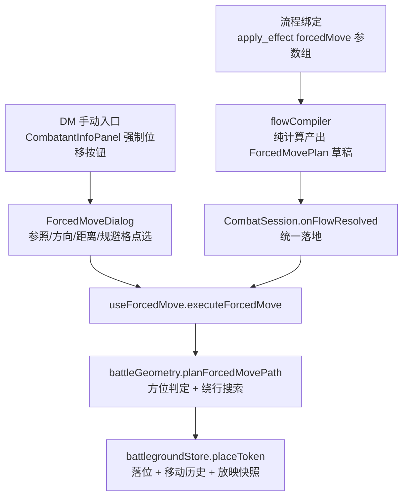

# 沙盘移动引擎（battleground-movement-engine）技术设计

Feature Name: battleground-movement-engine
Updated: 2026-11-03

## Description

为战斗沙盘新增网格几何引擎：8 方位判定纯函数模块、强制位移（推离）执行体（手动入口 + 流程绑定双入口共用）、带定向原则约束的绕行路径搜索。规避区域作为 forcedMove 操作自带属性（单次位移生效），与既有地形区域（zone）系统配合。

设计遵循项目既有三原则：

1. **编译器纯计算**：流程侧只产出待落地记录，`CombatSession.onFlowResolved` 统一落地（同 zone/status/check_modifier 模式）；
2. **apply_effect 扩参数**：新增机制通过节点 config 加参数实现，零新节点类型、零引擎结构改动；
3. **单一落位引擎**：手动入口与流程绑定共用 `planForcedMovePath`，零双轨。

## Architecture



- `battleGeometry.ts`：纯函数层，零 store 访问、零 React 依赖，可独立单测
- `useForcedMove`：React 接线层，读沙盘 + 写落位 + 移动历史
- `ForcedMoveDialog`：交互层，方位裁决结果可视化（如「目标位于你东北方，将向西南推离至多 3 格」）
- 流程链路：apply_effect config 新增 forcedMove 参数组 → 编译器产出待落地记录 → onFlowResolved 调 `executeForcedMove`

## Components and Interfaces

### 1. `src/data/battleGeometry.ts`（新建，纯函数模块）

```ts
export type Bearing = 'N' | 'NE' | 'E' | 'SE' | 'S' | 'SW' | 'W' | 'NW' | 'same';

// 目标相对参照的 8 方位分类；(0,0) → 'same'
export function bearing8(from: { col: number; row: number }, to: { col: number; row: number }): Bearing;

// 取反扇区（远离侧裁决）；'same' → 'same'
export function oppositeBearing(b: Bearing): Bearing;

// 主方向扇区：主方向及其两个相邻 45° 方向（E → [NE, E, SE]）；定向原则的约束集
export function bearingSector(b: Bearing): Bearing[];

// 方位 → 单位步向量（'same' → {dc:0, dr:0}）
export function bearingDelta(b: Bearing): { dc: number; dr: number };

interface ForcedMoveInput {
  start: { col: number; row: number };
  bearing: Bearing;                       // 位移主方向（已裁决远离/朝向后）
  maxCells: number;                       // 总格数上限（含绕行步）
  bounds: { cols: number; rows: number };
  isBlocked: (col: number, row: number) => boolean; // 禁行判定闭包（边界墙 ∪ 规避区 ∪ 占用）
}

interface ForcedMovePath {
  path: { col: number; row: number }[];   // 逐格路径（不含起点，含终点）
  truncated: boolean;                     // true = 途中被截断（无路可推/越界/步数耗尽）
}

// 落位引擎：限深搜索，每步候选 ∈ bearingSector(bearing)，代价 1，
// 偏差角最小优先、剩余直线进度最大次之；无可行步 → 停在当前格并置 truncated
export function planForcedMovePath(input: ForcedMoveInput): ForcedMovePath;
```

绕行搜索算法：限深 Dijkstra（深度 ≤ maxCells），状态 = (col, row, stepsUsed)；转移边 = sector 内三方向的合法格；优先队列按 (与主方向偏差, stepsUsed, 负的剩余直线进度) 排序；命中「已走步数 + 直线剩余 ≤ maxCells 且直线沿途全通」的贪心快路则提前收敛。网格上限 36×54，深度通常 ≤ 6，全图状态空间小，无需 A* 剪枝优化。

### 2. `src/hooks/combat/useForcedMove.ts`（新建）

```ts
export function useForcedMove(recordId: string | null) {
  // 组装 isBlocked 闭包（isCellBlocked ∪ 规避格 ∪ cellToken 占用）→ 调 planForcedMovePath
  // → battlegroundStore.placeToken(终点)
  // → 返回 { plan, truncated }；消耗目标移动力恒为 0（不调 onConsumeMovement）
  return { executeForcedMove };
}
```

放映模式兼容：落位走 `battlegroundStore.placeToken`，位置变化天然进入现有沙盘移动历史（`moveHistory`）与 `rollbackSnapshot` 快照机制，零额外快照代码。

### 3. `src/components/ForcedMoveDialog.tsx`（新建弹窗）

Props：`target`（被位移棋子）、`candidates`（可选参照棋子列表）、`combatantPositions`、`defaultOriginId`（攻击/来源棋子，可空）、`gridSize`、`onConfirm(plan)`、`onClose`。

- 参照棋子下拉（默认来源棋子）；方向裁决单选（远离/朝向）；距离输入（格数，复用 `useNumberInput`）
- 规避格点选：弹窗内嵌 mini 网格，点击切换加入/移出本次规避集合
- 方位裁决结果实时展示：`bearing8(originPos, targetPos)` → 文案「目标位于参照东北方，将向西南方向推离」；同格时阻断确认并提示
- 手动优劣势弹窗同款定位：纯展示 + 参数收集，落位逻辑全在 hook

### 4. 接线点（既有文件小改）

| 文件 | 改动 |
|------|------|
| `src/components/CombatantInfoPanel.tsx` | 操作区加「强制位移」按钮（props 回调 `onRequestForcedMove(combatantId)`） |
| `src/pages/CombatSession.tsx` | state `forcedMoveModal` + 渲染 `ForcedMoveDialog`；`onFlowResolved` 增加 `effectType === 'forced_move'` 分支调 `executeForcedMove` |
| `src/lib/flowCompiler.ts` | apply_effect 的 `effectType === 'forced_move'` 分支：解析 config 参数组（下表），产出待落地记录（同 zone 的「编译器不落库」模式） |
| apply_effect 参数 schema（FlowEditor 侧注册处） | 新增 4 个 config 字段（见 Data Models 键名表） |

## Data Models

### forcedMove 参数组（apply_effect config 键名，沿用 `zone*` 前缀惯例）

| config 键 | 类型 | 语义 |
|-----------|------|------|
| `forcedMoveEnabled` | boolean | 启用本节点的强制位移效果 |
| `fmDirectionMode` | `'away' \| 'toward'` | 远离/朝向参照（来源 = 施法者，同 zone 以 `context` 为准） |
| `fmDistanceCells` | number | 位移格数上限（含绕行步） |
| `fmAvoidRadius` | number | 以目标当前位置为圆心的规避半径（切比雪夫），运行时展开格子并入禁行集 |

### 运行时计划对象（编译器产出 → onFlowResolved 消费）

```ts
interface ForcedMovePlanDraft {
  targetId: string;
  originId: string | null;          // 编译器侧即施法者 id
  bearing: Bearing;                 // 按 fmDirectionMode 裁决后的主方向
  distanceCells: number;
  avoidCells: string[];             // fmAvoidRadius 展开的格子集（以目标当前位置为中心）
}
```

手动入口由 Dialog 产出同构对象（`avoidCells` 来自点选）后进入 `executeForcedMove`——两个入口的数据契约完全一致。

### 禁行集组装（executeForcedMove 内）

```
isBlocked(col, row) =
  isCellBlocked(col, row)            // 边界墙 paintedCells（Battleground.tsx:243 同逻辑）
  || avoidCells.has(`${col},${row}`) // 规避区
  || cellToken.has(`${col},${row}`)  // 其他棋子占用
```

规避集合的生命周期 = 单次 `executeForcedMove` 调用栈内：闭包参数传入，执行完毕即释放，沙盘持久数据零残留（R5.4）。

## Correctness Properties

- **P1 方位完备性**：任意 `(Δcol, Δrow) ≠ (0,0)` 恰好落入一个扇区；`(0,0)` → `'same'`
- **P2 取反对合**：`oppositeBearing(oppositeBearing(b)) === b`
- **P3 扇区凸性**：`bearingSector(b)` 恒含 `b` 与其两个相邻 45° 方向，恒不含 `oppositeBearing(b)`
- **P4 步数上限**：`path.length ≤ maxCells`
- **P5 定向不变性**：`path` 中每步的步向量经 `bearing8` 分类后 ∈ `bearingSector(bearing)`——净位移恒在主方向 45° 扇区内，绕行保证定向原则不变
- **P6 落点合法性**：`path` 上每个格均满足 `!isBlocked` 且在 bounds 内；`truncated === true` 时终点为最后合法格
- **P7 移动力零消耗**：`executeForcedMove` 调用前后目标 `remainingMovementMap` 不变
- **P8 纯函数无副作用**：`battleGeometry.ts` 零 store import、零 DOM/React 依赖

## Error Handling

| 场景 | 处置 |
|------|------|
| 参照与目标同格（`bearing === 'same'`） | Dialog 阻断确认按钮，提示「参照与目标同格，方向无定义」 |
| `distanceCells ≤ 0` | no-op：返回空 path，`truncated === false` |
| 目标未放置在沙盘 | 阻断并提示（同 zone 的 pos 缺失处理，flowCompiler.ts:1230 模式） |
| 沙盘记录缺失（`bg === null`） | `executeForcedMove` 返回 null（useThrownDrop.ts:93 同款检查） |
| 三面围死无可行步 | `path` 为空、`truncated === true`，弹窗/日志提示「无路可推，棋子原地」 |
| 昏迷/死亡/失能目标 | Dialog 阻断确认（R2.5） |

## Test Strategy

1. **battleGeometry 单测**（P1–P8 性质 + 场景）：
   - 轴向/对角线分类边界（如 `(1,0)`→E、`(1,1)`→SE、`(2,1)`→E 切比雪夫主轴归属）
   - 直线通畅 3 格全走；第 2 格堵死 → 绕相邻扇区一格续走且方向不变；三面围死截断
   - 绕行步计入上限（maxCells=3、堵 1 格 → 总前进 2 格 + 1 绕行 = 截断于 3 步）
2. **构建验证**：`npx tsc --noEmit` + `npm run build`
3. **人工走查**：
   - 手动推离 E2E：参战者面板 → 弹窗裁决 → 落位 → 剩余移动力不变（P7）→ 撤回栈可回退
   - 流程推离 E2E：apply_effect 配 forcedMove → 流程施放 → onFlowResolved 落地 → 战斗日志可查
   - 放映模式：推离后回滚，位置还原至快照
   - 普通移动回归：落点式移动直线计费行为与本改动前一致（范围外承诺）

## References

[^1]: (Filename) - `src/data/battlegroundStore.ts` — 沙盘数据与 placeToken/addZone 落位接口
[^2]: (Filename#L736) - `src/components/Battleground.tsx` — attemptMove 直线计费现状（本设计不改动）
[^3]: (Filename#L1192) - `src/lib/flowCompiler.ts` — effectType='zone' 编译器纯计算模式（forcedMove 照此接入）
[^4]: (Filename#L1539) - `src/pages/CombatSession.tsx` — onFlowResolved 统一落地链路
[^5]: (Filename) - `src/hooks/combat/useThrownDrop.ts` — chebyDist 与 bg null 检查先例
