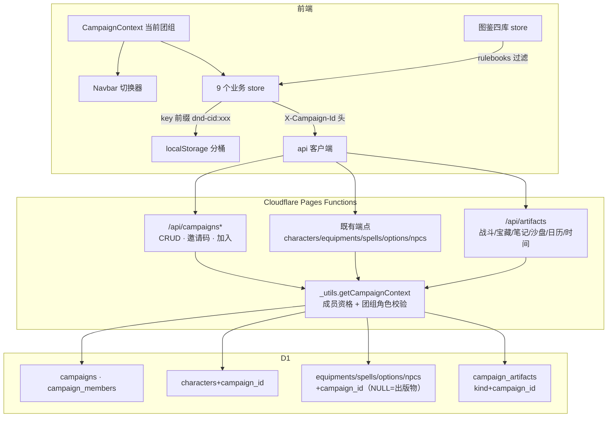

# 团组（Campaign）技术设计

Feature Name: campaign-group
Updated: 2026-11-01
关联需求: requirements.md（R1~R9，决策三项已确认）

## Description

引入「团组」作为顶层组织单元：一场跑团战役的数据容器。改造分四层——D1 数据模型（团组/成员/制品表 + 既有表加归属列）、Functions API（团组 CRUD/邀请码/加入 + 既有端点团组上下文校验 + 六类纯本地数据上云）、前端状态（CampaignContext + store 按团组分桶）、UI（切换器/管理页/引导页）。流程库（flows/bindings）与账号体系保持团组无关。

## Architecture



## Components and Interfaces

### 1. 数据模型（D1 迁移 0011 / 0012）

**新表**：

```sql
-- 0011_campaigns.sql
CREATE TABLE campaigns (
  id TEXT PRIMARY KEY,
  name TEXT NOT NULL,
  description TEXT DEFAULT '',
  invite_code TEXT UNIQUE NOT NULL,        -- 8 位随机码，DM 可重置
  rulebooks TEXT NOT NULL DEFAULT '[]',    -- JSON 数组：["玩家手册 2014", ...]
  created_by TEXT NOT NULL,
  created_at INTEGER NOT NULL
);
CREATE TABLE campaign_members (
  campaign_id TEXT NOT NULL,
  user_id TEXT NOT NULL,
  role TEXT NOT NULL DEFAULT 'player',     -- 'dm' | 'player'
  joined_at INTEGER NOT NULL,
  PRIMARY KEY (campaign_id, user_id)
);
-- 六类纯本地数据统一上云：kind ∈ combat|treasure|note|battleground|calendar|gametime
CREATE TABLE campaign_artifacts (
  id TEXT NOT NULL,
  campaign_id TEXT NOT NULL,
  kind TEXT NOT NULL,
  user_id TEXT,                            -- 创建者
  data TEXT NOT NULL,                      -- 整包 JSON（与现有 store 条目同构）
  updated_at INTEGER NOT NULL,
  PRIMARY KEY (campaign_id, kind, id)
);
CREATE INDEX idx_artifacts_lookup ON campaign_artifacts(campaign_id, kind);

-- 既有表加归属列（JSON blob 表同加独立列便于 WHERE 过滤）
ALTER TABLE characters ADD COLUMN campaign_id TEXT;
ALTER TABLE equipments ADD COLUMN campaign_id TEXT;   -- NULL=出版物条目
ALTER TABLE spells ADD COLUMN campaign_id TEXT;
ALTER TABLE character_options ADD COLUMN campaign_id TEXT;
ALTER TABLE npc_templates ADD COLUMN campaign_id TEXT;
```

**0012_backfill_campaign.sql（幂等回填）**：建「默认团组」（固定 id `campaign-default`，rulebooks=`["玩家手册 2014"]`）；全部站点管理员 INSERT OR IGNORE 为 DM、其余账号为 player；characters 等表 `WHERE campaign_id IS NULL` 回填默认团组 id。图鉴表 campaign_id 保持 NULL（出版物条目，查询时按规则书集过滤）。

### 2. 服务层（functions/）

**新增**：

| 端点 | 方法 | 权限 | 说明 |
|------|------|------|------|
| /api/campaigns | GET | 登录 | 我加入的团组列表 |
| /api/campaigns | POST | 登录 | 创建团组（创建者=DM；站点管理员可为他人建） |
| /api/campaigns/[id] | GET/PATCH | 成员/DM | 详情（成员可见）/改名、描述、规则书集（DM） |
| /api/campaigns/[id]/members | GET | 成员 | 成员列表（含账号名、团组角色） |
| /api/campaigns/[id]/members/[userId] | PATCH/DELETE | DM | 改团组角色 / 移出成员 |
| /api/campaigns/[id]/invite | POST | DM | 重置邀请码 |
| /api/campaigns/join | POST | 登录 | body {code} → 凭码加入（角色 player） |
| /api/artifacts/[kind] | GET | 成员 | 该团组某 kind 全量列表 |
| /api/artifacts/[kind]/[artId] | PUT/DELETE | DM 写、成员读 | 制品 UPSERT / 删除 |

**`functions/_utils.ts` 新增**：

```ts
// 解析 X-Campaign-Id 头 → 校验成员资格 → 返回 { campaignId, role }；无头/非成员抛 401/403
async function getCampaignContext(request, env, auth): Promise<CampaignContext>
// 团组作用域写操作校验：role==='dm' 或 auth.isAdmin
function assertCampaignWrite(ctx, auth): void
```

**既有端点改造**：
- characters/equipments/spells/options/npcs 全部端点：解析 campaign 上下文；读端点对团组作用域数据校验成员资格；写端点 `assertCampaignWrite`
- 图鉴读端点查询语义：`WHERE campaign_id = ? OR (campaign_id IS NULL AND source IN (SELECT value FROM json_each(?rulebooks)))`——参数为团组 id + 团组 rulebooks JSON（DM/成员均可读，rulebooks 由团组详情带给前端？为避免每次查询多一跳，服务端在 getCampaignContext 内一并读出 rulebooks）
- 图鉴写端点（自建条目）：强制写入 `campaign_id = ctx.campaignId`（团组私有）
- characters 写端点：PUT 支持 `campaign_id` 字段变更（移入/移出团组）

### 3. 前端状态（src/）

**新增 `contexts/CampaignContext.tsx`**：

```ts
interface CampaignState {
  campaigns: Campaign[];          // 我加入的团组
  current: Campaign | null;       // 当前团组（localStorage 'dnd-current-campaign'）
  campaignRole: 'dm' | 'player' | null;
  switchCampaign(id): void;       // 切换 + location.reload()（强一致，store 全量重读）
  refresh(): Promise<void>;
}
```

切换后整页 reload 的决策理由：9 个 store + 图鉴四库均为模块级单例，逐 store 热刷新侵入面远大于收益；reload 保证零残留。切换入口集中在 Navbar。

**store 分桶改造（`src/data/campaignScope.ts` 新增）**：

```ts
// 统一读 CampaignContext 写入的模块级当前团组 id（context 挂载时同步给本模块）
export function getCampaignId(): string;          // 无团组时返回 'default'
export function scopedKey(base: string): string;  // `dnd-${cid}:${base}`
```

9 个 store 的 `STORAGE_KEY` 常量改为 `scopedKey('...')` 调用（load/save 内取值）。流程库 flowStore/bindingStore/选项库外的一致性：flowStore/bindingStore 键保持无前缀（流程库团组无关）。

**图鉴四库过滤（equipmentStore/spellStore/optionStore/npcTemplateStore）**：
- 新增 `setRulebookScope(rulebooks: string[], campaignId: string)`：CampaignContext 挂载时注入
- `getAll()` 返回过滤结果：`条目.campaignId === 当前团组 || (无归属 && rulebooks.includes(条目.source))`
- 管理页（DM 维护用）走 `getAllRaw()` 全量视角
- 条目类型加 `campaignId?: string` 字段（四类 types 同步）

**云同步改造（六类 store）**：沿 spellStore 托底链模式——`fetchAll` 先云端 `GET /api/artifacts/[kind]`，失败回退本地 localStorage；`create/update/delete` 写本地后异步 PUT 云端（fire-and-forget + 失败静默，与 equipmentStore 同步模式一致）。日历/游戏时间为团组单例制品（id 固定 `singleton`）。

**api 客户端（`src/lib/api.ts`）**：`authHeaders()` 注入 `X-Campaign-Id`（读 campaignScope 模块当前值）；新增 campaigns/artifacts 函数族（泛型 `T = any` 风格沿用）。

### 4. UI（src/pages + components）

| 位置 | 内容 |
|------|------|
| Navbar | 团组切换器下拉：团组列表（当前高亮）+「创建团组」「凭邀请码加入」入口；未加入任何团组时显示引导入口 |
| /campaigns | 团组管理页：信息编辑（DM）、规则书集多选（出版物列表 = 四库 source 去重枚举 + 手输新增）、成员列表（角色切换/移出）、邀请码展示与重置 |
| 角色列表页 | 卡片操作加「移入/移出团组」（DM） |
| 首次进入 | 无团组成员关系时引导页（创建 / 输邀请码） |

路由与守卫：/campaigns 挂 ProtectedRoute；页面内部按 campaignRole 显隐 DM 操作（沿 AuthContext.isAdmin 的派生风格，CampaignContext 提供 campaignRole）。

## Correctness Properties

1. **跨团组不可见**：任何团组作用域端点在 `X-Campaign-Id` 缺失、非成员、或制品/角色/条目归属他团时返回 403/404；A 团组成员无法通过枚举 id 读取 B 团组数据
2. **身份权威源**：团组内玩家/DM 判定一律读 campaign_members；users.role 全局字段停止读取（保留列兼容旧代码路径，不删）
3. **图鉴并集语义**：团组内查询结果 = rulebooks 集内出版物条目 ∪ 本团组 campaign_id 条目；两集合无交集（出版物条目 campaign_id 恒 NULL），无重复
4. **附属数据跟随**：角色卡 data 为整包 JSON（背包/手持/穿戴内嵌），campaign_id 列变更即整体迁移，无部分迁移可能
5. **迁移幂等**：默认团组固定 id + INSERT OR IGNORE + `WHERE campaign_id IS NULL` 守卫，重复执行零副作用
6. **localStorage 分桶完整**：所有团组作用域 store 读写经过 scopedKey；流程库/绑定/编辑草稿/editorState 保持全局键

## Error Handling

| 场景 | 处理 |
|------|------|
| 邀请码无效/过期 | join 端点 404，前端提示「邀请码无效」 |
| 请求缺团组上下文（旧客户端） | 服务端回退默认团组 id（存量兼容），并按默认团组成员资格校验 |
| 云同步失败 | 制品 store 保持本地写入成功，静默记 console；下次 fetchAll 以云端为准覆盖前提示 |
| 团组无 DM | 管理页对站点管理员显示「补派 DM」操作；成员端只读提示 |
| 切换团组后旧数据残留 | reload 策略保证；开发期用 tsc + 手动切换验收 |

## Test Strategy

1. `npx tsc -b` + `npm run build`（背景终端执行）每阶段必过
2. functions/ 语法验证：`npx esbuild <file> --loader:.ts=ts --outfile=/dev/null`
3. 迁移 SQL：D1 Console 手动执行清单（0011 → 0012 顺序敏感），幂等性通过二次执行验证
4. 手动验收清单：
   - 创建团组 → 切换 → 角色列表/战斗/宝藏/笔记/日历互串检查
   - 生成邀请码 → 另一账号凭码加入 → 玩家端只读边界
   - 团组 A 自建装备 → 团组 B 不可见；规则书集去掉「玩家手册 2014」→ 团组内装备库仅剩自定义
   - 战斗记录断网写 → 恢复后云端可见
   - 存量账号登录 → 默认团组数据完整

## References

[^1]: functions/_utils.ts — authenticateRequest 双轨认证，getCampaignContext 沿此风格
[^2]: src/data/spellStore.ts — 云端优先/本地兜底托底链，六类 store 同步沿用
[^3]: migrations/0009_site_admin.sql — 追加式迁移先例
[^4]: src/contexts/AuthContext.tsx — 派生状态模式，CampaignContext 沿用

## 分阶段实施

| 阶段 | 内容 | 验证 |
|------|------|------|
| A 骨架 | 0011/0012 迁移 + campaigns API + CampaignContext + Navbar 切换器 + store 分桶（纯本地隔离） | 切团组数据互串检查 |
| B 图鉴隔离 | 四库 campaignId 字段 + rulebooks 过滤 + 自建条目归属 + /campaigns 管理页 + 角色移团组 | 并集语义验收 |
| C 上云 | artifacts API + 六类 store 云同步 | 断网/恢复验收 |
| D 收尾 | 存量回填验证 + 玩家端适配 + users.role 读取路径下线 | 全量手动清单 |
