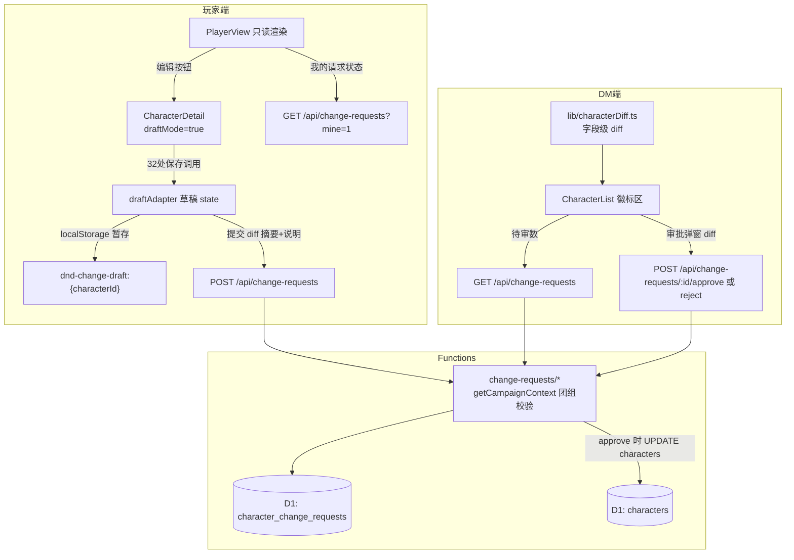

# 角色卡玩家变更回路 技术设计

Feature Name: character-change-review
Updated: 2026-11-11
关联需求: requirements.md（R1~R4；三项决策已确认：复用完整编辑器 / CharacterList 徽标区审批 / 一卡一 pending）

## Description

在玩家端开放「编辑自己绑定的角色卡 → 提交变更请求」能力，DM 在 CharacterList 徽标区集中审批（字段级 diff 比对 + 批准入库 / 驳回附理由）。变更请求存云端 D1 新表，按团组隔离；同一张卡同时至多一条待审请求（DB 部分唯一索引兜底）。

## Architecture



## Components and Interfaces

### 前端

| 组件/模块 | 职责 |
|---|---|
| `CharacterDetail`（改） | 新增 `draftMode?: boolean` prop：`readOnly=false + draftMode=true` 时编辑入口全开（复用既有 `!readOnly` 门控），32 处 `characterStore.update` 机械替换为组件内 `saveCharacter(id, patch)`——draftMode 下写草稿 state（浅合并 + setCharacter 即时回显），否则走原 characterStore.update |
| `draftAdapter`（CharacterDetail 内部） | 草稿读写：localStorage `dnd-change-draft:{characterId}` 暂存整卡快照（刷新恢复，复用 editorState 思想）；`resetDraft()` 放弃草稿；顶部显示「草稿未提交」横幅 + 「提交变更」按钮（弹确认框：diff 摘要 + 说明输入） |
| `src/lib/characterDiff.ts`（新建） | `diffCharacter(base, draft): CharacterDiffRow[]`——顶层标量逐字段比对；abilities 按六维展平；equipment 按 childId 对齐（增/删/改数量或字段）；spells 槽位比对；features 按 name 对齐（增删 + role 变化）；产出 `{ path, before, after, kind }[]` 人类可读行。玩家提交摘要与 DM 审批弹窗共用 |
| `CharacterList`（改） | 顶部徽标区：待审请求数徽标（拉取 pending 列表计数，按角色卡分组）；点击展开审批面板——每条请求显示玩家说明/提交时间/diff 行数，进入 diff 明细弹窗（复用 characterDiff），操作：批准 / 驳回（理由必填）/ 版本漂移提示（`baseUpdatedAt !== 正式卡.updatedAt` 时黄条警告，DM 可选择仍批准） |
| `PlayerView`（改） | ①顶部「编辑角色卡」按钮 → 以 `draftMode` 重新挂载 CharacterDetail；②「我的变更请求」区块：当前卡的 pending 状态（可撤回）/ 最近已决（驳回理由回显）；页面加载与手动刷新时同步拉取 |

### 后端（functions/api/change-requests/）

| 端点 | 方法 | 权限 | 行为 |
|---|---|---|---|
| `index.ts` | GET | 登录 | DM（getCampaignContext 角色 dm 或 isAdmin）→ 本团组全部请求；玩家 → 仅自己发起的。均按 created_at 倒序，附角色卡名 |
| `index.ts` | POST | 登录玩家 | 校验：`user_characters` 存在 (requester_id, character_id) 绑定；角色卡属当前团组；该卡无 pending（DB 部分唯一索引兜底）；插入 payload/base_updated_at/note/status='pending' |
| `[id]/withdraw.ts` | POST | 请求者本人 | 仅 pending 可撤回 → status='withdrawn' |
| `[id]/approve.ts` | POST | 团组 DM | 仅 pending 可批：`UPDATE characters SET data=?, updated_at=? WHERE id=?`（以请求快照为准）→ status='approved'，记 reviewer_id/reviewed_at；返回最新正式卡供前端本地桶同步 |
| `[id]/reject.ts` | POST | 团组 DM | 仅 pending 可驳：review_note 必填 → status='rejected' |

前端 `src/lib/api.ts` 新增五个对应函数（authHeaders + X-Campaign-Id 头，与既有 apiFetch 一致）。

## Data Models

### D1 迁移 0014_character_change_requests.sql

```sql
CREATE TABLE IF NOT EXISTS character_change_requests (
  id TEXT PRIMARY KEY,
  campaign_id TEXT NOT NULL,
  character_id TEXT NOT NULL,
  requester_id TEXT NOT NULL,
  payload TEXT NOT NULL,
  base_updated_at INTEGER NOT NULL,
  note TEXT,
  status TEXT NOT NULL DEFAULT 'pending',
  review_note TEXT,
  reviewer_id TEXT,
  created_at INTEGER NOT NULL,
  reviewed_at INTEGER
);
CREATE INDEX IF NOT EXISTS idx_ccr_campaign ON character_change_requests(campaign_id, status);
CREATE INDEX IF NOT EXISTS idx_ccr_requester ON character_change_requests(requester_id);
-- 一卡一 pending：数据库级兜底（应用层提交前同样校验并返回友好错误）
CREATE UNIQUE INDEX IF NOT EXISTS idx_ccr_one_pending
  ON character_change_requests(character_id) WHERE status = 'pending';
```

### TS 类型（src/types/character.ts 或新文件 src/types/changeRequest.ts）

```ts
export interface ChangeRequest {
  id: string;
  campaignId: string;
  characterId: string;
  characterName?: string;
  requesterId: string;
  requesterName?: string;
  payload: Character;
  baseUpdatedAt: number;
  note?: string;
  status: 'pending' | 'approved' | 'rejected' | 'withdrawn';
  reviewNote?: string;
  reviewerId?: string;
  createdAt: number;
  reviewedAt?: number;
}
export interface CharacterDiffRow { path: string; before: string; after: string; kind: 'add' | 'remove' | 'change'; }
```

## Correctness Properties

1. **绑定不变量**：变更请求的 requester_id 与 character_id 必须存在于 user_characters；审批后正式卡数据与已批准请求的 payload 逐字节一致。
2. **单 pending 不变量**：任一 character_id 在任意时刻至多一条 status='pending' 请求（部分唯一索引强制）。
3. **状态机**：pending → approved / rejected / withdrawn（单向）；终态请求不可再变更。
4. **团组隔离**：请求的 campaign_id 与角色卡、审批者所在团组一致；跨团组读写一律 403/404。
5. **版本提示**：approve 端点在执行 UPDATE 前比对正式卡 updated_at 与 base_updated_at，不一致时仍在响应中带 `versionDrift: true`（不阻断，决策权在 DM，前端已提前提示）。

## Error Handling

| 场景 | 处理 |
|---|---|
| 未绑定角色提交 | 403「未绑定该角色卡」 |
| 已有 pending 时提交 | 409「该角色卡已有待审请求」（捕获唯一索引冲突同样返回） |
| 审批时请求已非 pending | 409「请求已被处理」 |
| 驳回无理由 | 400「驳回理由必填」 |
| 草稿与正式卡无差异提交 | 前端拦截「没有检测到变更」 |
| 云端不可用 | 草稿仅存本地不丢失；列表/徽标显示离线状态（沿用 CampaignContext 离线模式） |

## Test Strategy

- `npx tsc --noEmit` + `npm run build` 全量类型与构建验证。
- characterDiff 纯函数手测：构造 base/draft 样例（属性改动、装备增删改数量、features 新增、spells 槽位变化）断言行输出。
- API 逻辑走查（D1 不可本地起服务，人工核对 SQL 与 _utils 既有模式一致性；迁移语句与 0011 同风格）。
- 手动验收路径：玩家 A 提交变更 → DM 徽标看到 → diff 查看 → 驳回（理由回显玩家端）→ 玩家改后重提 → DM 批准 → 双端数据一致。

## References

[^1]: src/pages/CharacterDetail.tsx（readOnly 门控 L1634-3590；Dialog 受控组件 AbilityBreakdownDialog L170 / ProficienciesDialog L352）
[^2]: src/pages/PlayerView.tsx L98（CharacterDetail 复用点）
[^3]: migrations/0011_campaigns.sql（建表与索引风格参照）
[^4]: functions/_utils.ts getCampaignContext（团组成员/角色校验复用）
