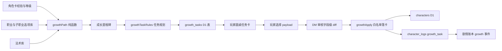
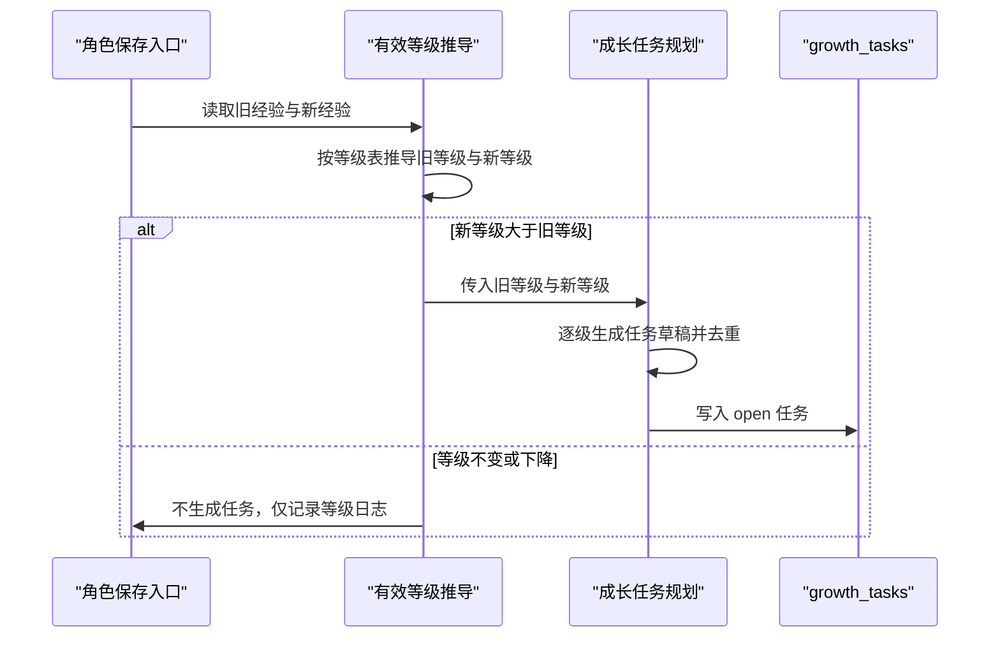
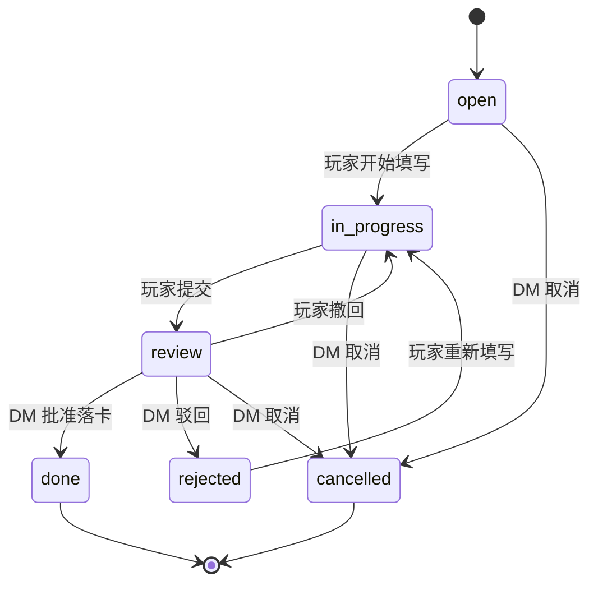

# 角色成长任务自动化（character-growth-tasks）

Feature Name: character-growth-tasks
Updated: 2026-11-28
状态: 技术设计初稿，触发方式与等级口径已确认

## Description

本设计把角色职业成长路径转换为可执行的成长任务。有效等级由经验值推导，角色卡 `level` 字段作为派生缓存同步；有效等级提升时自动生成任务，DM 保留取消与手工调整入口。核心原则是三层分离：

1. **派生层**：从职业表、职业特性、子职业特性、法术进度与生命骰派生 1-20 级成长里程碑，纯函数、无 IO。
2. **任务层**：升级事件触发任务生成，任务持久化路径快照与玩家选择，状态机管理待办、提交、审核、完成。
3. **落卡层**：DM 审核后只写白名单字段到正式角色卡，并写角色日志与剧情账本可挂载的 growth 事件。

玩家提交的是升级选择，落卡动作保持在 DM 权限下。成长任务不复用通用变更请求的整卡快照存储，避免玩家构造任意字段；通用变更请求继续服务非结构化手工修改。

## Architecture



### 自动生成触发



触发点统一为「角色保存成功且有效等级提升」：

1. `characterStore.update` 在本地保存后比较旧有效等级与新有效等级，调用 `growthTaskStore.ensureForLevelChange`。
2. 服务端 `PUT /api/characters/[id]` 在同一请求中比较数据库旧数据与新数据的有效等级，补齐任务，覆盖云端直改。
3. 服务端 `POST /api/change-requests/[id]/approve` 在批准落卡后比较有效等级，补齐任务，覆盖玩家变更请求升级。
4. 三条路径共用唯一键与幂等生成函数，重复触发直接复用已有任务。

### 分层职责

| 层 | 模块 | 职责 | 禁止事项 |
|----|------|------|----------|
| 派生层 | `src/lib/growthPath.ts` | 读取职业表与特性，输出里程碑 | 读写 localStorage、调用 API |
| 规划层 | `src/lib/growthTaskRules.ts` | 检测等级差、生成任务子项、去重键 | 直接修改角色卡 |
| 预演层 | `src/lib/growthApply.ts` | 根据选择生成预览角色卡与 diff | 写正式卡 |
| 状态层 | `src/data/growthTaskStore.ts` | 本地缓存、订阅、API 同步 | 决定权限 |
| 服务层 | `functions/api/growth-tasks/**` | 权限、持久化、版本校验、落卡 | 信任玩家整卡快照 |
| 展示层 | `src/components/growth/**` | 路径时间线、任务卡、审核弹窗 | 直接写角色卡 |

## Components and Interfaces

### 1. GrowthPathBuilder

文件：`src/lib/growthPath.ts`

```ts
export interface GrowthFeatureRef {
  name: string;
  nameEn?: string;
  description: string;
  level: number;
  source: 'class' | 'subclass';
  category: '职业特性';
  role?: FeatureRole;
  system?: string;
  systemKind?: 'container' | 'member';
  options?: GrowthFeatureRef[];
}

export interface GrowthMilestone {
  level: number;
  proficiencyBonus: number;
  classFeatures: GrowthFeatureRef[];
  subclassFeatures: GrowthFeatureRef[];
  subclassChoice?: {
    required: boolean;
    candidates: { id: string; name: string }[];
  };
  abilityScoreImprovement?: {
    points: number;
    modes: Array<'+2' | '+1/+1'>;
  };
  spellSlots?: Record<number, number>;
  cantripsKnown?: number;
  spellsKnown?: number;
  hitDie?: number;
  hpGain?: {
    fixed: number;
    conMod: number;
    formula: string;
  };
  gaps: GrowthDataGap[];
}

export interface GrowthPath {
  characterId: string;
  classKey: string;
  subclassKey?: string;
  effectiveLevel: number;
  pathVersion: string;
  milestones: GrowthMilestone[];
}
```

派生规则：

0. 有效等级使用 `getLevelFromExp(character.experience)` 推导；`character.level` 只作为展示缓存，派生、触发与校验都不读取该缓存。
1. 职业选项按 `profession.class` 查找，子职业按 `profession.subclass` 查找。
2. 职业表行作为等级、熟练加值、职业特性名与法术位的主数据。
3. 职业特性描述从职业 `traits` 补齐，子职业特性从子职业 `traits` 补齐。
4. 属性值提升从职业表行的 `属性值提升` 条目识别。
5. 子职业门槛从职业表行的选择类特性识别，候选来自职业 `subclasses`。
6. 法术位从 `slots` 的 `N环` 键解析，`－` 视为 0；`已知戏法` 解析为戏法数量。
7. 生命值增量由职业 `mechanics.hitDie` 与角色体质调整值计算固定值。
8. 路径版本号使用 `classKey + subclassKey + level + ruleVersion + 关键数据哈希`。

### 等级派生改造

新增统一入口 `getEffectiveLevel(character)`，内部调用 `getLevelFromExp(character.experience)`。以下规则在 P1 一并落地：

1. 所有业务读取使用 `getEffectiveLevel`，包括特性解锁、职业资源池、被动战斗规则、额外攻击、反应规则、子职业门槛、角色选择器与角色列表等级展示。
2. `character.level` 在保存时同步为 `getEffectiveLevel`，作为旧数据与外部展示的兼容缓存。
3. `proficiencyBonus` 在保存时同步为 `Math.ceil(level / 4) + 1`。
4. 经验值为 0 时有效等级为 1，旧数据中的 `level = 0` 在迁移时归一为 1。
5. `CharacterDetail` 的经验输入只写 `experience`，等级与熟练加值由保存流程派生。
6. `CharacterDetail` 中奥法骑士法术位预览改用有效等级，删除对 `character.level` 的直接判断。
7. `CharacterPicker`、`CharacterList`、`TreasureDistribute`、`TradePage`、`PlayerStory` 的等级展示统一使用有效等级。

### 2. GrowthTaskPlanner

文件：`src/lib/growthTaskRules.ts`

```ts
export type GrowthTaskStatus =
  | 'open'
  | 'in_progress'
  | 'review'
  | 'done'
  | 'rejected'
  | 'cancelled';

export type GrowthTaskItemKind =
  | 'subclass'
  | 'asi'
  | 'feature'
  | 'feature-choice'
  | 'spell-cantrip'
  | 'spell-known'
  | 'hp'
  | 'proficiency'
  | 'manual';

export interface GrowthTaskItem {
  id: string;
  kind: GrowthTaskItemKind;
  label: string;
  required: boolean;
  source: 'class-table' | 'class-trait' | 'subclass-trait' | 'spell' | 'manual';
  options?: Array<{ id: string; label: string; description?: string }>;
  selectCount?: number;
  choice?: unknown;
  gap?: string;
}

export function planGrowthTasks(input: {
  path: GrowthPath;
  fromLevel: number;
  toLevel: number;
  existing: Array<{ targetLevel: number; pathVersion: string; status: GrowthTaskStatus }>;
}): GrowthTaskDraft[];
```

规划规则：

1. `fromLevel` 与 `toLevel` 都来自经验推导的有效等级，角色卡 `level` 缓存不参与比较。
2. 对 `fromLevel + 1` 到 `toLevel` 的每个等级生成一个草稿，自动写入 `open` 状态。
3. 已存在同路径版本且状态为 `open` / `in_progress` / `review` 的任务时复用，不新建。
4. 已存在但路径版本不同时标记 `stale`，由 DM 选择重新生成。
5. 已存在 `done` 任务时不重新生成；等级回退保留任务。
6. 未绑定玩家时 `assignedUserId = null`，任务只在 DM 端展示。
7. 经验值跨越多级时按目标等级升序生成任务，后一级任务在前一级落卡后继续处理。

### 3. GrowthApply

文件：`src/lib/growthApply.ts`

```ts
export interface GrowthApplyInput {
  character: Character;
  task: GrowthTask;
  choices: GrowthChoices;
}

export interface GrowthApplyResult {
  character: Character;
  diff: CharacterDiffRow[];
  logs: GrowthLogDraft[];
  errors: string[];
}
```

白名单字段：

| 字段 | 写入规则 |
|------|----------|
| `level` | 设置为目标等级 |
| `proficiencyBonus` | 使用里程碑熟练加值 |
| `maxHp` / `currentHp` | 增加生命值增量，当前生命值同步增加 |
| `abilities.*.score` | 按属性值提升分配增加，单项上限 20 |
| `features` | 追加任务中缺少的职业/子职业特性，已有同名条目保留 |
| `profession.subclass` | 写入玩家选择的子职业 id |
| `spells.cantrips` | 追加戏法，数量不超过里程碑数量 |
| `spells.custom` | 追加法术，数量不超过里程碑数量 |
| `spells.spellSlots` | 设置 `max` 为里程碑值，`used` 保留并裁剪到新上限 |
| `hitDice` | 按职业生命骰同步类型 |

`apply` 不写装备、钱币、外观、背景、阵营与自定义文本字段。

### 4. 前端状态与展示

新增文件：

- `src/types/growthTask.ts`：任务、子项、选择、状态、触发来源类型。
- `src/data/growthTaskStore.ts`：本地缓存 + 订阅 + API 同步，模式与既有 store 一致。
- `src/components/growth/GrowthPathTimeline.tsx`：角色详情页 1-20 级路径时间线。
- `src/components/growth/GrowthTaskCard.tsx`：圆桌任务卡，展示状态、目标等级与待办数。
- `src/components/growth/GrowthTaskWizard.tsx`：玩家填写向导。
- `src/components/growth/GrowthTaskReview.tsx`：DM 审核弹窗，复用 `diffCharacter` 展示差异。
- `src/pages/GrowthTasks.tsx`：DM 成长任务列表与待审核入口。

入口：

- `CharacterDetail`：新增「成长路径」页签，显示路径时间线、待处理任务数与手动生成按钮。
- `RoundTable`：任务区显示成长任务卡，DM 可进入审核。
- `PlayerRoundTable`：显示绑定角色的待填写成长任务。
- `CharacterLogPanel`：显示 `growth_task` 日志。

### 5. 服务端接口

目录：`functions/api/growth-tasks/`

| 方法 | 路径 | 权限 | 用途 |
|------|------|------|------|
| GET | `/api/growth-tasks` | 团组成员 | DM 取全团，玩家取绑定角色 |
| POST | `/api/growth-tasks/generate` | DM | 为角色生成指定等级任务 |
| GET | `/api/growth-tasks/[id]` | 团组成员 | 任务详情与路径快照 |
| PATCH | `/api/growth-tasks/[id]` | 玩家本人 / DM | 保存选择草稿 |
| POST | `/api/growth-tasks/[id]/submit` | 玩家本人 | 提交审核 |
| POST | `/api/growth-tasks/[id]/withdraw` | 玩家本人 | 撤回提交 |
| POST | `/api/growth-tasks/[id]/approve` | DM | 审核落卡 |
| POST | `/api/growth-tasks/[id]/reject` | DM | 驳回并回传理由 |
| POST | `/api/growth-tasks/[id]/cancel` | DM | 取消任务 |
| POST | `/api/growth-tasks/manual` | DM | 创建手工任务 |

服务端共享纯函数放在 `functions/api/growth-tasks/_shared.ts`，负责：

- 任务行投影。
- 权限与团组校验。
- 路径版本校验。
- 落卡白名单校验。
- 角色日志写入载荷生成。

## Data Models

### 迁移 0019_growth_tasks.sql

```sql
CREATE TABLE IF NOT EXISTS growth_tasks (
  id TEXT PRIMARY KEY,
  campaign_id TEXT NOT NULL,
  character_id TEXT NOT NULL,
  assigned_user_id TEXT,
  scene_id TEXT,
  from_level INTEGER NOT NULL,
  target_level INTEGER NOT NULL,
  status TEXT NOT NULL,
  trigger_source TEXT NOT NULL,
  path_version TEXT NOT NULL,
  path_snapshot TEXT NOT NULL,
  items TEXT NOT NULL,
  choices TEXT NOT NULL,
  base_updated_at INTEGER NOT NULL,
  submitted_at INTEGER,
  reviewer_id TEXT,
  reviewed_at INTEGER,
  review_note TEXT,
  created_by TEXT NOT NULL,
  created_at INTEGER NOT NULL,
  updated_at INTEGER NOT NULL,
  UNIQUE (campaign_id, character_id, target_level, path_version)
);

CREATE INDEX IF NOT EXISTS idx_growth_tasks_campaign_status
  ON growth_tasks (campaign_id, status, updated_at);
CREATE INDEX IF NOT EXISTS idx_growth_tasks_character
  ON growth_tasks (character_id, target_level);
```

字段说明：

- `path_snapshot`：生成时的 `GrowthMilestone` JSON，保证审核与追溯使用同一份路径。
- `items`：任务子项清单 JSON，包含必填、候选与数据缺失标记。
- `choices`：玩家选择 JSON，只存结构化选择。
- `base_updated_at`：任务生成或玩家提交时角色卡的 `updatedAt`，用于漂移检测。
- `scene_id`：可选剧情场景绑定，落卡后账本可按场景挂载 growth 事件。

### 状态机



## Correctness Properties

1. **等级派生**：有效等级始终由 `experience` 推导，角色卡 `level` 缓存不参与路径、触发与审核判断。
2. **路径确定性**：相同角色、相同选项库版本、相同规则版本产生完全相同的 `GrowthPath`。
3. **自动生成幂等**：有效等级提升后自动生成缺失任务，重复保存或重复请求不产生重复任务。
4. **任务唯一性**：同一团组、角色、目标等级、路径版本最多存在一条成长任务。
5. **玩家只写选择**：玩家提交请求只更新 `choices` 与任务状态，正式角色卡在批准前保持不变。
6. **落卡白名单**：批准接口只应用白名单字段，其他字段保持正式卡当前值。
7. **版本漂移阻断**：正式卡 `updatedAt` 与任务 `base_updated_at` 不一致时，批准接口返回 409。
8. **幂等落卡**：同一任务重复批准只生效一次，日志只写一次。
9. **权限隔离**：玩家只能访问绑定角色任务；非 DM 不能批准、驳回或取消。
10. **多级顺序**：多级连升生成的任务按目标等级升序处理，后一级任务基于前一级落卡结果。
11. **数据缺失可继续**：缺少特性或法术候选时任务仍可生成，缺失项进入 DM 手工补充流程。
12. **历史保留**：等级下降或路径版本变化不删除既有任务，只标记状态或路径变更。
13. **日志一致**：落卡成功后 `level_up` 与 `growth_task` 日志在同一批次写入，失败时整体回滚。

## Error Handling

| 场景 | HTTP | 行为 |
|------|------|------|
| 未登录 | 401 | 返回统一未认证错误 |
| 非团组成员 | 403 | 拒绝访问 |
| 玩家访问未绑定角色 | 403 | 拒绝并记录审计 |
| 任务不存在或跨团组 | 404 | 拒绝访问 |
| 任务状态不允许当前操作 | 409 | 返回当前状态与允许动作 |
| 角色版本漂移 | 409 | 要求 DM 重新派生或手工合并 |
| 经验值与等级缓存不一致 | 200 | 以有效等级为准，保存时同步缓存 |
| 必填子项缺失 | 422 | 返回缺失子项列表 |
| 属性值超过 20 | 422 | 返回具体属性与上限 |
| 法术不在职业列表 | 422 | 返回非法法术名 |
| 选项库数据缺失 | 200 | 任务正常返回，附 `gaps` |
| 数据库异常 | 500 | 返回通用失败信息，不暴露 SQL |

## Test Strategy

### 纯函数探针

新增 `scripts/probes/probe-growth-path.cjs`：

1. 战士 1-5 级路径：熟练加值、属性值提升、额外攻击。
2. 法师 1-5 级路径：法术位、戏法数量、子职业门槛。
3. 子职业特性合并：战士 3 级选择勇士后出现 3/7/10/15/18 级特性。
4. 数据缺失：删除目标等级特性后出现 `gaps` 且任务仍生成。
5. 确定性：同一输入两次派生结果一致，路径版本一致。
6. 等级派生：经验值 6500 推导 5 级，角色卡 `level` 缓存写成 3 时路径仍按 5 级派生。
7. 多级连升：3 到 5 级生成两个任务草稿，目标等级升序。
8. 自动生成：保存经验值后无需额外调用即出现目标等级任务。
9. 任务去重：已有同路径任务时不重复生成。
10. 落卡预演：属性提升、生命值、法术位、特性与法术写入正确。
11. 白名单：预演不修改装备、钱币、外观字段。
12. 版本漂移：`base_updated_at` 不一致时预演返回冲突。

### API 权限探针

新增 `scripts/probes/probe-growth-tasks-api.cjs`：

1. 玩家只能读取绑定角色任务。
2. 玩家不能批准、驳回、取消任务。
3. DM 可以读取全团任务并批准。
4. 跨团组任务返回 404。
5. 重复批准返回幂等结果且日志只有一条。

### UI 冒烟

新增 `scripts/probes/probe-growth-tasks-ui.cjs`：

1. 角色详情显示成长路径时间线。
2. 玩家圆桌显示成长任务卡。
3. DM 审核弹窗显示 diff。
4. 批准后角色卡等级、属性、法术位更新。

### 人工验收

1. DM 把角色从 3 级升到 4 级，玩家收到属性值提升任务。
2. 玩家分配 `+2` 并提交，DM 审核通过后属性与日志正确。
3. 玩家选择非法属性分配时提交被阻止。
4. 3 级战士升级时任务要求选择子职业，未选择时无法提交。
5. 多级连升按顺序生成任务，逐级落卡。
6. 路径数据缺失时 DM 可手工补充并完成落卡。

## Implementation Phases

| 阶段 | 内容 | 交付物 |
|------|------|--------|
| P0 | 需求与设计确认 | 本文件 + requirements.md |
| P1 | 等级派生改造 + 纯函数成长路径 + 角色详情路径预览 | `getEffectiveLevel`、`growthPath.ts`、`GrowthPathTimeline`、路径探针 |
| P2 | 任务类型、迁移、自动生成、玩家填写与提交 | `growthTask.ts`、`growthTaskStore`、等级保存触发、任务 API、玩家任务卡 |
| P3 | DM 审核、落卡、日志与剧情账本联动 | 审核弹窗、批准/驳回 API、`growth_task` 日志 |
| P4 | 手工任务、别名归一化、数据缺失、权限与验收 | 手工任务入口、API 权限探针、人工验收 |

## Risks and Mitigations

| 风险 | 影响 | 缓解 |
|------|------|------|
| 职业表与特性数据不一致 | 路径缺项或重复 | 以职业表为主、特性库补齐；差异写 `gaps` 并在探针中断言 |
| 职业名称别名（邪术师/魔契师） | 子职业候选为空 | 建别名表，派生层统一归一化并显示来源 |
| 角色卡 `level` 与经验推导等级不一致 | 触发错误等级 | 以有效等级为准；保存时同步 `level` 缓存，派生层不读取缓存 |
| 自动生成覆盖 DM 已取消的任务 | 任务反复出现 | 取消记录保留，唯一键命中已取消任务时不重新生成，DM 可手工新建 |
| 角色 `features` 已包含未来特性 | 重复追加特性 | 按 category + name 去重，任务只追加缺失条目 |
| 法术库职业列表缺失 | 无法给出候选 | 标记数据缺失，允许 DM 手工填写 |
| 与通用变更请求并发 | 角色版本漂移 | 落卡前校验 `updatedAt`，冲突返回 409 |
| 多级连升任务顺序错误 | 属性与法术位叠加错误 | 逐级任务按目标等级升序，后一级基于前一级结果 |
| 玩家伪造选择 | 非法属性或法术 | 服务端白名单校验，非法值返回 422 |

## References

- `src/types/character.ts`：角色卡字段与职业/子职业字段。
- `src/types/characterOption.ts`：职业表与特性选项结构。
- `src/types/characterLog.ts`：`growth_task` 日志契约与 `GrowthTaskDetail`。
- `src/lib/characterDiff.ts`：DM 审核字段级 diff。
- `src/data/characterStore.ts`：等级推导、特性同步、日志写入。
- `functions/api/change-requests/[id]/approve.ts`：既有 DM 落卡权限与版本漂移处理。
- `docs/roadmap/round-table-hub.md`：M-R5 成长任务规划。
- `.monkeycode/specs/character-change-review/requirements.md`：通用变更请求回路。
