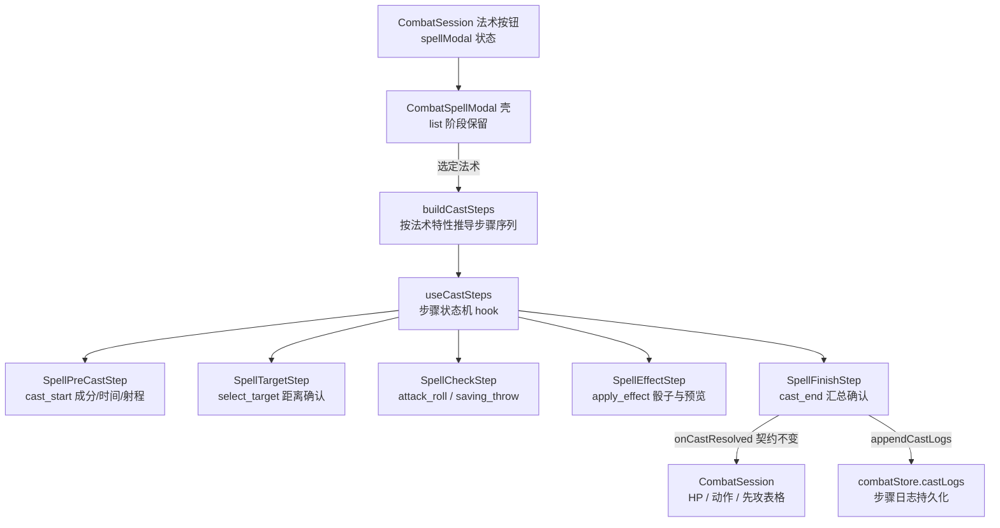

# 战斗施法步骤原子化（combat-cast-steps）技术设计

Feature Name: combat-cast-steps
Updated: 2026-10-19

## Description

将 `CombatSpellModal`（1069 行）的「单弹窗两阶段（list→cast）一次性施法」重构为**原子步骤状态机**：单弹窗 + 顶部步骤进度条，一次聚焦一步。步骤类型与 `FlowNodeType` 子集同名同三态，为 Phase 3 流程引擎接管预埋契约。前置检查（成分/施法时间/射程）为硬门禁 + DM 强制施放；所有副作用（HP/动作/先攻表格/步骤日志）延迟到收尾步骤一次性应用。已裁决：法术位扣减暂缓。

## Architecture



职责分层：

| 层 | 文件 | 职责 |
|----|------|------|
| 契约层 | `src/types/castStep.ts`（新建） | 步骤类型/三态/日志结构，对齐 `types/flow.ts` |
| 状态机层 | `src/hooks/combat/useCastSteps.ts`（新建） | 步骤序列推导 + 推进/强制/中止，纯 React 状态 |
| 视图层 | `src/components/combat/Spell*Step.tsx`（新建 5+1 个） | 每步骤一组件，只接收 props，无路由无 store CRUD |
| 宿主层 | `src/components/CombatSpellModal.tsx`（重构） | 弹窗壳 + list 阶段 + 步骤装配 + 现有检定/骰子逻辑下沉到对应步骤 |
| 持久层 | `src/types/combat.ts` + `src/data/combatStore.ts`（扩展） | `CombatRecord.castLogs` + `appendCastLogs` |

## Components and Interfaces

### 1. `src/types/castStep.ts`（新建，领域类型独立成文件）

```ts
/** 战斗侧施法步骤类型——FlowNodeType 子集的战斗镜像（types/flow.ts L11-20） */
export type CastStepType =
  | 'cast_start' | 'select_target' | 'attack_roll'
  | 'saving_throw' | 'apply_effect' | 'cast_end';

/** 三态语义与 NodeExecutionResult.status 一致（types/flow.ts L691） */
export type CastStepStatus = 'success' | 'failure' | 'partial';

/** 单步骤日志——字段形状对齐 FlowLogEntry（types/flow.ts L680-687） */
export interface CastStepLog {
  id: string;                       // crypto.randomUUID()
  castId: string;                   // 同一次施法的所有步骤共享
  stepType: CastStepType;           // 对齐 FlowLogEntry.nodeType
  status: CastStepStatus;
  message: string;
  data?: Record<string, unknown>;   // 强制施放时含 forced: true
  timestamp: number;
}
```

### 2. `src/hooks/combat/useCastSteps.ts`（新建，战斗 hook 域已有 9 个先例）

```ts
interface CastStepState {
  type: CastStepType;
  status: 'pending' | 'active' | CastStepStatus;
  forced?: boolean;                       // DM 强制施放
  result?: { status: CastStepStatus; message: string; data?: Record<string, unknown> };
}

interface UseCastStepsReturn {
  steps: CastStepState[];
  currentIndex: number;
  castId: string;
  completeCurrent(status: CastStepStatus, message: string, data?): void; // 完成并前进
  forceCurrent(message: string, data?): void;   // 强制施放：标记 partial + forced 前进
  abort(): void;                                // 无痕中止（关闭弹窗复用）
  collectLogs(): CastStepLog[];                 // 收尾步骤一次性取全量日志
}
```

**步骤序列推导**（`buildCastSteps(spell, checkType)` 纯函数，同文件内）：

| 条件 | 步骤 | 说明 |
|------|------|------|
| 恒有 | `cast_start` | 成分/施法时间/射程明细 |
| 恒有 | `select_target` | 目标由沙盘预填，可更换 |
| checkType === 'ac' | `attack_roll` | 法术攻击检定 |
| checkType === 'save' | `saving_throw` | 豁免检定 |
| 法术含伤害骰或治疗 | `apply_effect` | 恒保留（见实施偏差 #1），纯 buff 走「跳过效果(0)」出口 |
| 恒有 | `cast_end` | 汇总 + 确认 |

检定类型切换（现有 `handleCheckTypeChange`）保留在 `SpellCheckStep` 内部——切换只改变该步骤内部行为与日志 `stepType`，重建序列（避免序列抖动）。

### 3. 视图组件（`src/components/combat/`，扁平命名与既有 8 个战斗子组件一致）

| 组件 | props 要点 | 复用的既有逻辑（从 CombatSpellModal 下沉） |
|------|-----------|------------------------------------------|
| `SpellStepBar.tsx` | steps, currentIndex | 纯展示进度条 |
| `SpellPreCastStep.tsx` | caster, casterCharacter?, spell, canUseBonusAction, onConfirm/onForce | `deriveCanGesticulate`（somaticCheck.ts）；射程解析复用 `parseInt(range.replace(/\D/g,''),10)` 模式（flowCompiler.ts:302 同款） |
| `SpellTargetStep.tsx` | caster, target, combatants, combatantPositions, spell, onSelectTarget/onConfirm | 切比雪夫距离 × 5 尺（AGENTS.md 距离约定） |
| `SpellCheckStep.tsx` | caster, target, spell, recordId, currentRound, onConfirm | 现有 d20 手填/掷骰、AdvDisadvToggle、pending 消费、`SAVE_ATTR_MAP` 整体搬迁 |
| `SpellEffectStep.tsx` | spell, target, effectType 状态提升, onConfirm | `parseDice`/手动骰/预览（当前 HP → 预计 HP）整体搬迁 |
| `SpellFinishStep.tsx` | steps 全量摘要, onConfirmCast | 收尾确认清单（HP 变化/动作消耗/将写入的记录文本预览） |

组件约束：无路由、不直连 store CRUD（AGENTS.md 组件规范）；数据与回调全部 props 传入。

### 4. `CombatSpellModal.tsx` 重构

- `list` 阶段与法术选择逻辑保留
- `cast` 阶段 JSX 替换为 `SpellStepBar` + 当前步骤组件 switch
- 检定/效果相关 state 与 handler 迁入对应步骤组件（弹窗壳只留跨步骤共享态：selectedSpell、target、effectType）
- 删除死 import：`flowCompiler`（L16）
- `onCastResolved` 契约字段**逐字保留**（CombatSession.tsx L1174-1196 零改动）

### 5. 持久层扩展

`types/combat.ts`：`CombatRecord` 增加 `castLogs?: CastStepLog[]`。
`combatStore.ts`：

```ts
appendCastLogs(recordId: string, logs: CastStepLog[]): void
// load() 兜底：castLogs: r.castLogs ?? []
// 实现走既有 update() → save() → notify()
```

写入时机：仅 `cast_end` 确认时批量写入一次（副作用延迟原则）。

## Data Models

**CombatRecord.castLogs**：`CastStepLog[]`，按 castId 分组的扁平数组（追加式，不嵌套），示例：

```json
[
  { "id": "...", "castId": "cast-1729...", "stepType": "cast_start", "status": "success", "message": "成分齐全，动作可用", "timestamp": 1760000000000 },
  { "id": "...", "castId": "cast-1729...", "stepType": "cast_start", "status": "partial", "message": "强制施放：姿势被阻断（束缚）", "data": { "forced": true, "missing": ["S"] }, "timestamp": 1760000001000 },
  { "id": "...", "castId": "cast-1729...", "stepType": "saving_throw", "status": "failure", "message": "敏捷豁免 8+2=10 < DC 15", "data": { "d20": 8, "bonus": 2, "dc": 15 }, "timestamp": 1760000002000 },
  { "id": "...", "castId": "cast-1729...", "stepType": "cast_end", "status": "success", "message": "火球术：对哥布林造成 18 点伤害", "timestamp": 1760000003000 }
]
```

同一 castId 的 `cast_start` 可能出现两条（失败明细 + 强制 partial），按时间序保留全轨迹。

## Correctness Properties

1. **副作用原子性**：`cast_end` 确认前，HP、动作/附赠动作、先攻表格、`castLogs` 全部保持不变；关闭弹窗等价无痕中止。
2. **契约稳定**：`onCastResolved` 参数字段与重构前逐字一致（types 见 CombatSpellModal.tsx L43-57）。
3. **类型对齐**：`CastStepType` 与 `FlowNodeType` 子集一一对应；`CastStepStatus` 语义与 `NodeExecutionResult.status` 一致；`CastStepLog` 字段形状与 `FlowLogEntry` 兼容（stepType↔nodeType）。
4. **旧数据兼容**：无 `castLogs` 字段的既有 CombatRecord 打开、施法、保存均正常（load 兜底空数组）。
5. **序列完备**：任意法术推导的步骤序列以 `cast_start` 开头、`cast_end` 结尾，中间步骤按条件裁剪且相对有序。
6. **强制留痕**：被强制的步骤 status 恒为 `partial` 且 `data.forced === true`。

## Error Handling

| 异常 | 检测位置 | 处置 |
|------|---------|------|
| 施法者角色卡缺失（NPC 无 characterId） | cast_start | 成分检查直接读 Combatant 字段（`canSpeak`/`canGesticulate` undefined 视为可用，types/combat.ts L75/L80 为可选字段） |
| `spell.range` 无法解析（「触及/自身/无限/任意」） | cast_start / select_target | 射程检查视为通过，`data.rangeRaw` 记录原文 |
| 参战者无沙盘位置（token 未放置） | select_target | 距离检查标记 skipped（不计 failure），`data` 注明「未放置，距离未知」 |
| 更换目标后射程变化 | select_target | 步骤内实时重算，沿用同一门禁交互 |
| 弹窗打开期间战斗记录被删除 | cast_end | `appendCastLogs` 内部 get 为空时静默跳过日志，`onCastResolved` 照常回调（兜底不阻塞结算） |
| 法术无检定且无效果（纯 buff） | buildCastSteps | 检定裁剪、效果步骤保留（走跳过效果出口），`onCastResolved` 沿用现状字段（amount 0、success true） |

## Test Strategy

类型与构建：`./node_modules/.bin/tsc --noEmit` + `npm run build`（后台终端）。

手动走查清单（部署后）：

1. **火球术**（save+伤害）：5 步全走；人为制造成分失败 → 硬门禁阻断 → 强制施放 → 日志含 partial+forced。
2. **魔法飞弹**（none+伤害）：检定步骤自动裁剪，4 步。
3. **治疗真言**（none+治疗，触及）：射程按沙盘距离判定；超上限治疗截断留痕。
4. **纯 buff 法术**（无检定无效果）：3 步渲染（cast_start/select_target/cast_end，apply_effect 以「跳过效果(0)」即时通过）。
5. **中止路径**：效果确认前关闭弹窗 → HP/动作/先攻表格/castLogs 零变化。
6. **旧数据回归**：打开既有战斗记录不报错；施法后新日志正常追加。
7. **NPC 施法**：无角色卡参战者成分检查不崩溃。
8. **攻击弹窗回归**：CombatAttackModal 全流程不受影响（R8.3）。

## References

[^1]: (Filename#L11-L20) - `src/types/flow.ts` — FlowNodeType 步骤对齐源
[^2]: (Filename#L680-L703) - `src/types/flow.ts` — FlowLogEntry / NodeExecutionResult / StateMutation 契约源
[^3]: (Filename#L43-L57) - `src/components/CombatSpellModal.tsx` — onCastResolved 契约（逐字保留）
[^4]: (Filename#L16) - `src/components/CombatSpellModal.tsx` — 待删除的死 import flowCompiler
[^5]: (Filename#L1174-L1196) - `src/pages/CombatSession.tsx` — onCastResolved 消费方（零改动目标）
[^6]: (Filename) - `src/data/somaticCheck.ts` — 姿势成分阻断判定复用
[^7]: (Filename#L302-L304) - `src/lib/flowCompiler.ts` — 射程字符串解析参照实现
[^8]: (Filename#L75-L80) - `src/types/combat.ts` — Combatant.canSpeak / canGesticulate 可选字段

## Implementation Deviations（实施期偏差记录）

1. **apply_effect 恒保留**（原设计：纯 buff 法术裁剪效果步骤）。实施时发现 flat 数值法术（如描述为「造成 30 点伤害」、无骰子表达式的法术）会与纯 buff 混淆——若按「无法术骰」裁剪效果步骤，这类法术的伤害出口会被一并裁掉。改为：apply_effect 步骤恒在序列中，纯 buff 由 DM 在该步骤点「跳过效果(0)」显式出口（日志记 success + skipped: true，amount 0）。
2. **目标更换同步宿主**（新增 prop `onTargetChange`）。原设计假设目标固定；实施时确认 `onCastResolved` 的 HP 应用与先攻表格均读 `spellModal.target`，步骤内更换目标必须同步回宿主状态，否则结算落点错误。CombatSession 仅增此一处 prop 接线。
3. **动作门禁 prop**（新增 prop `canUseAction`）。前置检查步骤的「1 动作」门禁需要施法者剩余动作数，由 CombatSession 传入既有 `canUseAction(caster.id)`。
4. **检定步骤 ac↔save 互切**走 `hook.rebuild`：序列重建保留 cast_start/select_target 已完成前缀，检定步骤以新类型重挂载（骰值重置），与原设计一致。
