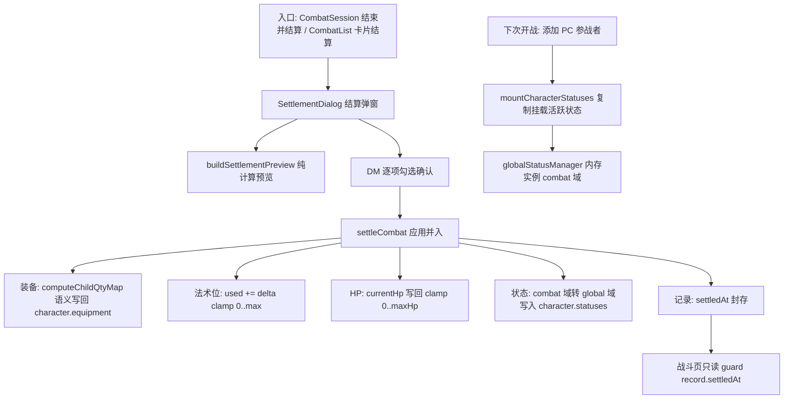

# 战斗结算（Combat Settlement）— 技术设计

Feature Name: combat-settlement
Updated: 2026-11-05

## Description

战斗结束时把 CombatRecord 上累积的战斗临时变更（装备漏斗、法术位漏斗、HP、持续状态）统一并入角色卡，记录封存（settledAt）后战斗页只读。角色卡新增状态持久挂载点，状态在「角色卡（global 域）↔ 参战者（combat 域）」之间随战斗生命周期流转，实现跨战斗持续效果闭环。

## Architecture



数据流核心原则：**角色卡 statuses 是状态的唯一持久源，globalStatusManager（内存）是运行时**。挂载 = 从角色卡复制进内存（保留 instanceId，targetId 改 combatantId）；结算 = 内存实例写回角色卡（活跃→更新/追加，已结束→移除）。

## Components and Interfaces

### 新增组件

**`components/combat/SettlementDialog.tsx`**
- Props: `record: CombatRecord; onClose: () => void; onSettled?: () => void`
- 内部调 `combatStore.buildSettlementPreview(record.id)` 取预览数据；按参战者分组渲染装备/法术位/HP/状态四区；每项 checkbox 默认勾选；确认时把勾选结果传 `combatStore.settleCombat(recordId, selections)`；成功后提示并 `onSettled`（CombatSession 跳列表 / CombatList 刷新）。

### combatStore 新增 API

```ts
// 结算预览（纯计算，无副作用）
buildSettlementPreview(recordId: string): SettlementPreview | null

// 应用结算（唯一写入口）
settleCombat(recordId: string, selections: SettlementSelections): boolean

// 下次开战挂载：把角色卡活跃状态复制进内存 combat 域
mountCharacterStatuses(recordId: string, combatantId: string): void
```

**SettlementPreview 数据结构**（types/combat.ts）：

```ts
interface SettlementEntry {
  combatantId: string;
  characterId: string;
  characterName: string;
  equipment: SettlementEquipLine[];   // { childId, name, srcQty, resultQty, removed, added }
  spellSlots: SettlementSlotLine[];   // { levelKey, label, delta, used, max }
  hp: { from: number; to: number } | null;
  statuses: SettlementStatusLine[];   // { instance, inheritable, excludeReason? }
}
interface SettlementPreview {
  recordId: string;
  entries: SettlementEntry[];         // 仅 PC 且有角色卡
}
interface SettlementSelections {
  equipmentChildIds: Record<string, string[]>;  // combatantId → 勾选的 childId
  spellSlotCombatantIds: string[];              // 勾选法术位并入的参战者（整体）
  hpCombatantIds: string[];
  statusInstanceIds: Record<string, string[]>;  // combatantId → 勾选继承的实例
}
```

### 状态域流转（statusManager 协作）

- **挂载**（`mountCharacterStatuses`，在 CombatSession 确认添加 PC 时调用）：
  1. 读 `character.statuses` 中 `isActive` 且（无 expiresAt 或 expiresAt > now）的实例
  2. 复制进内存：`{ ...inst, targetId: combatantId, scope: 'combat', combatId: recordId }`（instanceId 保留原值）
  3. 角色卡侧条目保留原样（作为持久源）
- **结算写回**（`settleCombat` 内部）：
  1. 对每个 PC 参战者，取内存中 targetId=combatantId 且 isActive 的实例
  2. 排除规则（R6.2/R6.6）：targetId 参战者 isDead → 排除；实例 instanceId 出现在某参战者 `concentration.statusIds` 且该参战者 isDead/isIncapacitated/concentration 缺失 → 排除；durationType='concentration' 且不在任何存活者专注列表 → 排除
  3. 勾选中的活跃实例 → 转域写回角色卡：`{ scope:'global', targetId: characterId, combatId: undefined, expiresAt 保留, durationRounds/startRound/expiresAtRound/anchorCombatantId/turnCount 清除, expirePolicy: rounds|combatantTurn → 'manual'（metadata.remainRounds 提示保留） }`
  4. 内存中已结束（isActive=false）且角色卡存在同 instanceId 条目 → 从角色卡移除
  5. 角色卡不存在同 instanceId 的战斗新实例 → 转域追加
  6. 昏迷补全：combatant.isUnconscious 且角色卡无 active unconscious 实例 → 生成 `definitionId:'unconscious'`、expirePolicy:'manual' 实例追加

### 角色卡状态展示与手动取消

**`pages/CharacterDetail.tsx` 新增「持续状态」区**（属性区下方）：
- 读 `character.statuses` 过滤 isActive 且未过期；显示名称（statusLibrary.get(definitionId).name）+ 持续信息（expiresAt 剩余时间 /「手动维持」+ metadata.remainRounds 提示）
- 每条带「取消」按钮：`combatStore` 不参与——直接 `characterStore.updateCharacterStatus(character.id, instanceId, 'end')`（标记 isActive=false 并从列表移除）+ 内存中同 instanceId 实例 `declareEnd`

### 只读封存 guard（CombatSession）

`const isSealed = !!record.settledAt`。禁用清单（按钮 disabled + 顶部只读横幅）：
- 攻击 / 施法 / 疾走 / 协助 / 激励 / 强制位移动作按钮
- HP 编辑、先攻编辑、回合回溯、放映模式切换
- 参战者添加 / 批量删除 / NpcCreator
- 状态附加面板（StatusAttachPanel）、回合待办增删
- 保留：查看弹窗、战斗日志、导出

### 入口

- **CombatSession**：页头操作区加「结束并结算」按钮（`isSealed || isProvingGround` 时隐藏）；结算成功后 `navigate('/combat')`
- **CombatList**：卡片操作区加「结算」按钮（已封存显示「已结算」徽记 + settledAt 时间；试验场卡片隐藏）；弹窗复用 SettlementDialog，成功后本地刷新

## Data Models

### types/combat.ts

```ts
interface CombatRecord {
  // ...existing
  /** 结算封存时间戳（存在 = 已结算只读） */
  settledAt?: number;
  // ...SettlementPreview/SettlementSelections 类型（见上）
}
```

### types/character.ts

```ts
interface Character {
  // ...existing
  /** 持久状态源：结算继承的状态实例（global 域），下次开战挂载到参战者 */
  statuses?: StatusInstance[];
}
```

characterStore `load()` 补兜底：`statuses: Array.isArray(c.statuses) ? c.statuses : undefined`。
characterStore 新增 `updateCharacterStatus(charId, instanceId, action: 'end' | 'remove')`。

### load 兜底（combatStore）

`settledAt: typeof r.settledAt === 'number' ? r.settledAt : undefined`。

## Correctness Properties

1. **幂等封存**：settledAt 存在的记录重复调用 settleCombat 返回 false，角色卡零写入。
2. **装备抵消语义**：结算写回与 `computeChildQtyMap` 计算的 combatQty 一致（removedChildIds 优先级最高；added 与 removed 同 childId 时净效果为零）。
3. **数值 clamp**：法术位 used ∈ [0, max]；HP ∈ [0, character.maxHp]。
4. **状态单例流转**：同一 instanceId 在「角色卡持久源」与「内存运行时」间移动，战斗内 declareEnd 的实例不残留于角色卡。
5. **试验场隔离**：isProvingGround 记录永不结算（入口隐藏 + settleCombat guard）。
6. **预览与落地一致**：settleCombat 仅应用 selections 勾选项，未勾选项角色卡零变化。

## Error Handling

| 场景 | 处理 |
|------|------|
| characterId 反查角色卡失败 | 该参战者条目标记「角色卡缺失」，跳过并入，弹窗内提示 |
| 状态定义丢失（definitionId 查不到） | 该实例排除继承，弹窗标注 |
| 已封存记录再次结算 | settleCombat 直接返回 false |
| 结算过程中 localStorage 写入失败 | save 抛错上抛，弹窗 alert 提示，settledAt 与变更同批写入保证原子性 |

## Test Strategy

项目无自动化测试框架（vitest 已裁决跳过）。验证路径：
1. `npm run build` 类型与打包通过
2. 无头沙盘 E2E（既有 playwright 流程）：创建战斗 → 消耗弹药/法术位/HP → 结算弹窗核对预览 → 勾选确认 → 角色卡逐项核对 → 列表徽记 → 重新进入只读
3. 状态闭环 E2E：战斗中附加中毒（rounds 型）+ 昏迷 → 结算继承 → CharacterDetail 可见 → 新战斗挂载 → 效果生效

## References

[^1]: `src/data/combatStore.ts` — equipmentChanges 漏斗与 computeChildQtyMap 语义
[^2]: `src/types/status.ts#L150` — StatusInstance 结构
[^3]: `src/data/statusManager.ts` — 内存状态管理器（applyEffect/declareEnd/getActiveStatuses）
[^4]: `src/data/statusLibrary.ts` — 14 个内置状态定义（含 unconscious）
[^5]: `src/pages/CombatList.tsx#L80` — 现有删除即丢弃语义（被结算取代的部分场景）
