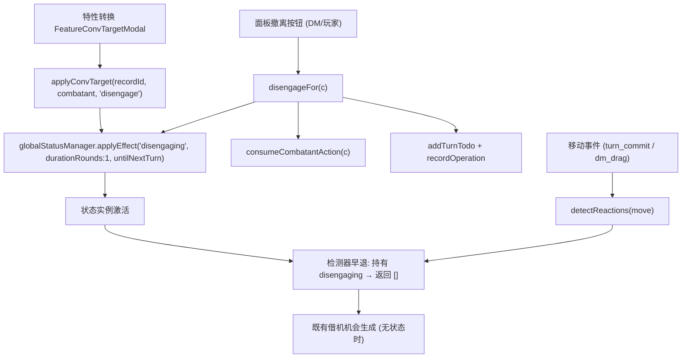

# 撤离（Disengage）基础动作 —— 技术设计

Feature Name: disengage-action
Updated: 2026-11-24

## 描述

把 `disengage` 从类型枚举占位升级为真机制：声明后为参战者挂载「撤离」状态实例，借机攻击检测器读取到该状态时抑制其移动触发的机会。实现完全复用「回避（dodge）」范式：状态库定义 + `globalStatusManager.applyEffect` + 回合驱动解除 + 双端面板入口 + 回合待办。

现状事实（决定性依据）：

- 借机攻击引擎完整：`detectReactions(record, { kind:'move', moverId, from, to, source })` 由注册式检测器产出机会（`src/data/reactionRules.ts:125-166`），调用点两处：回合包提交 `src/lib/turnCommitApply.ts:163`、DM 直操 `src/pages/CombatSession.tsx:2099`。
- 检测器文件已导入 `globalStatusManager`（`src/data/reactionRules.ts:8`），无需新增依赖。
- `getCombatRoundCtx(recordId)` 提供状态回合判定上下文（`src/data/combatAffinities.ts:64`）。
- 回避模板：`dodgeFor(c)`（`src/pages/CombatSession.tsx:1567`）——消耗动作、挂 `dodging` 状态、写待办、记录日志；状态定义见 `src/data/statusLibrary.ts:602`。
- 面板按钮门控：`CombatantInfoPanel` 仅对 help/attack/cast/dash/dodge 开槽（`src/components/CombatantInfoPanel.tsx:1388-1401`），撤离需新增 prop 与槽位。
- 特性转换：`applyConvTarget` 的 disengage 分支当前仅返回文案（`src/data/engines/resourceConvEngine.ts:49`）。

## 架构



抑制点在检测器入口（而非各调用点）：`detectReactions` 是唯一机会产出口，双来源天然覆盖。

## 组件与接口

### 1. 状态库标记状态（`src/data/statusLibrary.ts`）

新增 `disengaging` 定义，follow `dodging` 的结构：

- `id: 'disengaging'`，`name: '撤离'`
- `effects: []`（纯标记状态：无优劣势引擎效果，语义由检测器读取）
- `duration: { type: 'permanent' }` + `endTrigger: manual`（描述「你的下一回合开始解除」；实际过期由 `durationRounds` + `untilNextTurn` 锚定，与 dodging 同款）
- `ui: { badgeColor: 'emerald', icon: 'footprints' }`

不复用 `dodging`：两者语义与读取方不同；合并会造成「声明撤离也获得攻击劣势」的错误耦合。

### 2. 检测器抑制（`src/data/reactionRules.ts` 借机检测器内）

在 `if (!mover || mover.isDead || mover.isUnconscious) return []` 之后追加：

```
const ctx = getCombatRoundCtx(record.id);
const active = globalStatusManager.getActiveStatuses(moverId, 'combat', ctx);
if (active.some(s => s.definitionId === 'disengaging')) return [];
```

- 放在 owner 循环之前（早退，O(1) 过滤）
- 无需读侧失效判定：撤离作用于「移动」本身，速度归零者无法移动，无额外失效条件
- `getCombatRoundCtx` 返回可选字段，放映模式下 `untilNextTurn` 过期由状态管理器按上下文判定

### 3. 动作执行器（`src/pages/CombatSession.tsx`）

新增 `disengageFor(c: Combatant)`，镜像 `dodgeFor`：

1. `ensureCanAct(c, canUseAction(c.id))` 守卫（复用动作经济校验）
2. `globalStatusManager.applyEffect(c.id, 'disengaging', 'combat', record.id, { durationRounds: 1, ...(playback ? { combatMode:'playback', startRound, untilNextTurn:true, anchorCombatantId:c.id, turnCount:1 } : { combatMode:'simulation' }) })`
3. `combatStore.addTurnTodo(...)`：名称「撤离持续中（下回合开始解除）」，`startRound = currentRound`，`endRound = currentRound + 1`
4. `consumeCombatantAction(c.id)`
5. `recordOperation(c.id, '撤离：本回合移动不引发借机攻击', 'move')`
6. `alert(...)` 即时提示

### 4. 面板按钮（`src/components/CombatantInfoPanel.tsx`）

- `Props` 新增 `onDisengageClick?: () => void`（与 `onDodgeClick` 并列，`src/components/CombatantInfoPanel.tsx:48`）
- `clickable` 门控链追加 `(type === 'disengage' && !!onDisengageClick)`（:1388）
- `implemented` 判定追加 `type === 'disengage'`（:1389）
- `onClick` 分支追加 `else if (type === 'disengage') onDisengageClick?.();`（:1400）

### 5. 双端接线（`src/pages/CombatSession.tsx` 与 `src/components/Battleground.tsx`）

- `Battleground`：新增 `onPanelDisengageClick` prop，透传至 `CombatantInfoPanel.onDisengageClick`（对齐 `onPanelDashClick`/`onPanelDodgeClick`，`src/components/Battleground.tsx:1741-1742`）
- `CombatSession` DM 端：`onPanelDisengageClick={disengageFor}`（对齐 `onPanelDodgeClick={dodgeFor}`，:2045）
- `CombatSession` 玩家端：面板回调新增 `onDisengageClick={() => { disengageFor(liveCombatant); setInfoPanelCombatant(null); }}`（对齐 `onDodgeClick`，:3412）

### 6. 特性转换（`src/data/engines/resourceConvEngine.ts`）

`applyConvTarget` 的 disengage 分支替换占位文案为：

1. 构造 `getCombatRoundCtx(recordId)` 上下文
2. `globalStatusManager.applyEffect(combatant.id, 'disengaging', 'combat', recordId, { durationRounds: 1, ... })`（放映信息取 `latest` 记录的当前回合）
3. 返回 `{ note: '本回合移动不引发借机攻击' }`
4. 不调用 `consumeCombatantAction`（转换路径的动作/附赠动作消耗由上游既有流程处理）

## 数据模型

无新增持久化字段、无数据库迁移。

- 状态实例沿用 `StatusInstance`（`src/types/status.ts:150`），`definitionId='disengaging'`
- 回合判定沿用 `StatusRoundCtx`（`src/types/status.ts:141`）
- 回合待办沿用 `CombatRecord` 内嵌 `turnTodos`（与 `equipmentChanges` 同层）

## 正确性属性

1. **标记纯洁性**：`disengaging` 的 `effects` 恒为空数组，不参与优劣势/伤害/动作引擎计算。
2. **抑制完备性**：任何 `source` 的 `move` 事件检测都受撤离状态抑制（抑制点唯一）。
3. **无状态零回归**：未持有撤离状态时，`detectReactions` 输出与改动前逐项一致（含「离开触及」几何、阵营过滤、反应已用仍生成机会的既有语义）。
4. **豁免单向性**：撤离状态只抑制持有者作为 `moverId` 的机会生成，不抑制持有者作为借机攻击发起方的能力。
5. **动作经济不变**：撤离只消耗 1 主动作；拒绝路径（动作不足/失能）不产生任何状态与待办副作用。
6. **过期一致性**：放映模式下同一参战者新增回合开始时状态失效；模拟模式保留至手动解除（与 dodging 同款行为）。

## 错误处理

| 场景 | 处理 |
|------|------|
| 主动作不足 | `ensureCanAct` 拒绝，alert 提示，无状态副作用（复用既有动作经济守卫） |
| 参战者死亡/昏迷/失能 | 面板按钮不可点击（既有 `statusBlocked` 门控） |
| `record` 缺失（模拟游离态） | `getCombatRoundCtx` 返回空上下文，状态保留为激活即为期望行为 |
| 状态库定义缺失（老数据/热更新） | `getActiveStatuses` 按 `definitionId` 字符串匹配，不依赖定义存在；定义缺失时无徽标但抑制仍生效 |
| 回合包提交中移动被拒（移动力不足） | 既有 `return { ok:false }` 早退，检测不发生，无需新处理 |

## 测试策略

分层遵循 AGENTS.md §8.2（数据级断言 + UI 链人工验收）：

**数据级探针**（扩展 `scripts/probes/probe-reaction.cjs`，复用其 `evaluate` 内 `import('/src/data/reactionRules.ts')` 模式）：

1. 基线：无状态时 `detectReactions(move)` 产出机会（沿用既有断言，防回归）
2. 挂载 `disengaging` 状态后同参数检测 → `[]`
3. 状态归属校验：A 持有撤离，B 移动离开 A 触及 → 仍生成机会（只豁免持有者自身移动）
4. `applyConvTarget(recordId, c, 'disengage')` → 状态实例存在且 note 含「借机攻击」
5. 动作消耗：直接调 `combatStore` 侧 `consumeCombatantAction` 前后对比；`disengageFor` 属页面闭包，改由 UI 人工验收
6. 过期：构造放映上下文推进回合 → `getActiveStatuses(moverId,'combat',newCtx)` 不再含 disengaging（可复用 dodging 的过期断言写法）

**人工验收**（dev server + 沙盘）：

- DM 端：撤离 → 移动离开敌方触及 → 无借机弹窗；未撤离对照 → 有弹窗
- 玩家端：按钮存在且效果一致
- 面板徽标与回合待办出现，推进回合后消失
- 灵巧动作（盗贼类特性）转换撤离 → 附赠动作消耗 + 状态挂载

**构建门禁**：`npx tsc -p tsconfig.app.json --noEmit && npm run build`；全量基线 `sh scripts/probes/run.sh`。

## 设计决策与备选

| 决策 | 理由 | 备选与否决理由 |
|------|------|---------------|
| 状态实例而非 combatant 布尔字段 | 复用回合驱动过期、徽标展示、待办联动；与 dodging 同构 | 布尔字段：需手写清理钩子与 UI 徽标，生命周期分散 |
| 抑制点在检测器入口 | 双调用点天然覆盖，避免两处漂移 | 各调用点前置判断：重复逻辑易漏 |
| `untilNextTurn` 锚定（至下回合开始） | 与 dodging 完全一致，覆盖他人回合内的反应移动 | 严格「本回合结束」：需新增回合号相等判定，且与回避不一致 |
| 纯标记状态（effects 为空） | 撤离语义只在检测器读取，无引擎效果 | 复用 dodging：会错误附带回避增益 |
| 转换路径不扣主动作 | 灵巧动作的资源消耗在转换上游 | 重复扣减会破坏动作经济 |

## 实施顺序

1. `statusLibrary` 新增 `disengaging` 定义
2. `reactionRules` 检测器早退抑制
3. `resourceConvEngine` disengage 分支落地
4. `CombatSession.disengageFor` + 双端接线 + `CombatantInfoPanel`/`Battleground` prop
5. `probe-reaction.cjs` 扩展断言 → 全量基线
6. 人工验收脚本清单执行

## 参考资料

[^1]: 需求文档 - [requirements.md](./requirements.md)
[^2]: `src/data/reactionRules.ts#L125` - 借机攻击检测器
[^3]: `src/lib/turnCommitApply.ts#L163` - 回合包提交借机检测
[^4]: `src/pages/CombatSession.tsx#L2099` - DM 直操借机检测
[^5]: `src/pages/CombatSession.tsx#L1567` - dodgeFor 回避模板
[^6]: `src/data/statusLibrary.ts#L602` - dodging 状态定义
[^7]: `src/components/CombatantInfoPanel.tsx#L1388` - 动作按钮门控
[^8]: `src/data/engines/resourceConvEngine.ts#L49` - disengage 占位分支
[^9]: `src/data/combatAffinities.ts#L64` - getCombatRoundCtx
[^10]: `scripts/probes/probe-reaction.cjs` - 借机探针（684 行）
