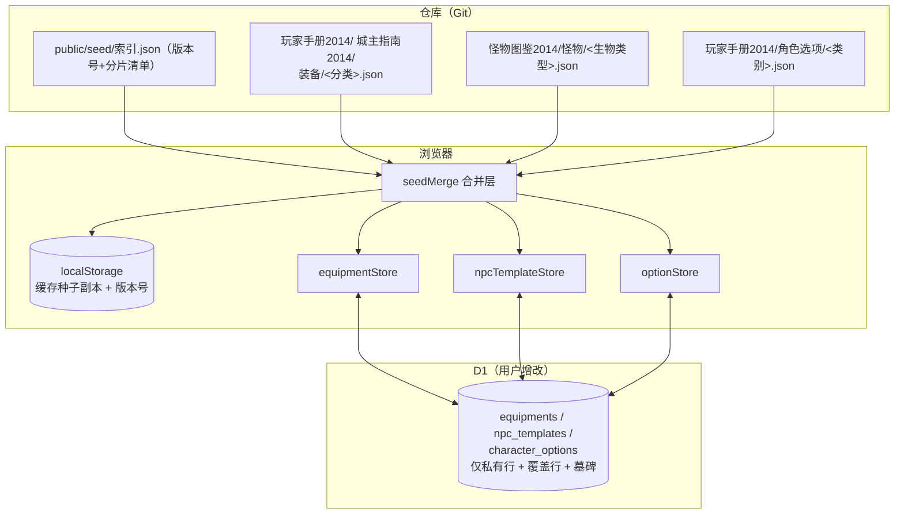

# 三宝书图鉴种子硬编码进仓库 — 技术设计

Feature Name: github-seed-library
Updated: 2026-11-09

## Description

把三宝书图鉴（装备、怪物、角色选项）从「D1 全量真源 + 手动导入」改为「仓库种子为基线 + 云端仅存增改」。种子文件放 `public/seed/` 作为运行时可 fetch 的静态资产，客户端按「种子 ∪ 云端覆盖 − 墓碑」合并出最终视图，种子条目在 UI 上只读。法术库保持不变。

关键权衡：种子全部迁出主 bundle（were 560KB raw / 148KB gzip）后首屏只保留代码；代价是图鉴页首次打开多一次同源 fetch（CDN 缓存友好，gzip 后三库合计约 220KB，且只有真正进入图鉴/选择器时才拉）。

## Architecture



数据流：

1. 应用启动或图鉴页打开 → `seedLoader` 读 `索引.json`，比对本地缓存版本号
2. 版本不一致或本地无缓存 → fetch 对应种子文件，写入 localStorage 并记录版本号
3. 各 store 的 `getAll()` = `mergeSeedWithCloud(seed, cloudOverlay, tombstones)`
4. 云端拉取只取用户私有行与覆盖行（不再包含出版物全量）

## Components and Interfaces

### 1. `public/seed/` 结构化中文目录（新增静态资产）

目录按「书 → 库 → 分类」三级组织，文件名全中文，便于手动增删改与审阅：

```
public/seed/
├── 索引.json                          # 版本号 + 分区清单（路径/条目数/字节），代码唯一入口
├── 玩家手册2014/
│   ├── 装备/
│   │   ├── 武器.json      4 条
│   │   ├── 护甲.json      4 条
│   │   ├── 法器.json      4 条
│   │   ├── 药水.json      1 条
│   │   ├── 工具.json      1 条
│   │   └── 杂物.json      4 条
│   └── 角色选项/
│       ├── 种族.json      9 条（内含亚种嵌套）
│       ├── 职业.json      12 条（内含子职业嵌套）
│       └── 背景.json      13 条
├── 城主指南2014/
│   └── 装备/
│       ├── 魔法武器.json  32 条
│       ├── 魔法护甲.json  20 条
│       ├── 魔法法器.json  30 条
│       ├── 魔法药水.json  24 条
│       ├── 魔法卷轴.json   2 条
│       ├── 奇物.json     118 条
│       └── 戒指.json      26 条
└── 怪物图鉴2014/
    └── 怪物/
        ├── 类人.json      70 条
        ├── 野兽.json      95 条
        ├── 怪兽.json      53 条
        ├── 龙类.json      44 条
        ├── 邪魔.json      34 条
        ├── 亡灵.json      24 条
        ├── 元素生物.json  23 条
        ├── 异怪.json      18 条
        ├── 构装.json      14 条
        ├── 植物.json      14 条
        ├── 巨人.json      13 条
        ├── 妖精.json       8 条
        ├── 天族.json       7 条
        └── 泥怪.json       4 条
```

- 共 30 个数据分片 + 1 个索引，单文件最大 43.6KB gzip（奇物），无超大雪崩文件
- 每份分片为纯数组，条目字段保持现有类型不变；角色选项分片保留嵌套父子结构（种族含亚种、职业含子职业）
- 种子条目内 `campaignId` 必须为 `null`
- 文件用 2 空格缩进美化格式（gzip 后与压缩格式仅差 0.7KB），便于人工 diff 与审阅
- 中文路径浏览器侧用 `encodeURIComponent` 逐段编码；Cloudflare Pages 与 Vite `public/` 均原样服务静态文件，`_redirects` 的 SPA 兜底只作用于无实体文件路径

```jsonc
// public/seed/索引.json
{
  "version": "2026-11-09.1",     // 任一分片变更即整体递增
  "generatedAt": "2026-11-09T...",
  "versionNote": "2026-11-09",
  "kinds": {
    "equipments": {
      "label": "装备库",
      "count": 270,
      "shards": [
        { "book": "玩家手册 2014", "group": "武器", "path": "玩家手册2014/装备/武器.json", "count": 4 },
        { "book": "城主指南 2014", "group": "奇物", "path": "城主指南2014/装备/奇物.json", "count": 118 }
      ]
    },
    "monsters": { "label": "怪物图鉴", "count": 421, "shards": [
      { "book": "怪物图鉴 2014", "group": "野兽", "path": "怪物图鉴2014/怪物/野兽.json", "count": 95 }
    ]},
    "options": { "label": "角色选项", "count": 84, "shards": [
      { "book": "玩家手册 2014", "group": "种族", "path": "玩家手册2014/角色选项/种族.json", "count": 9 }
    ]}
  },
  "sources": ["玩家手册 2014", "城主指南 2014", "怪物图鉴 2014"]
}
```

- 版本号格式 `YYYY-MM-DD.N`，同日多次变更递增 N
- 索引里 `shards` 是唯一事实源：新增书/分类只需加文件 + 注册 shard，加载器无需改代码

### 2. `scripts/build-seed.mjs`（新增离线转换脚本）

输入：数据管理页导出的单文件 `dnd-seed-export.json`（形如 `{ equipments, monsters, options, exportedAt }`）
输出：`public/seed/` 结构化中文目录 + `索引.json`

```
node scripts/build-seed.mjs <export.json> [--out public/seed] [--date 2026-11-09]
```

- 零 npm 依赖（Node 内置 fs / path / zlib）
- **分片规则**（写死在脚本的映射表，与索引 `shards` 一一对应）：
  - 装备：`source` → 书目录；`category` → 分片名。城主指南杂物再按 `subtype` 拆「奇物 / 戒指」，玩家手册按 `category` 拆 6 类；魔法物品文件名加「魔法」前缀避免与基础装备混名（武器 → 魔法武器，护甲 → 魔法护甲……；奇物/戒指本身已是魔法语义不加前缀）
  - 怪物：`creatureType` 枚举 → 中文类型名（`beast` → 野兽 等 14 类），未知落「未分类」
  - 选项：种族/职业/背景三分片，亚种子职业保持嵌套在父条目内
- 目录/文件命名：书名去空格（`玩家手册 2014` → `玩家手册2014`）；文件名 = 分类名 + `.json`
- 校验：装备必填 `id/name/category`；怪物必填 `id/templateId/name`；选项必填 `id/name/category`
- 规范化：`campaignId` 强制 `null`；`source` 走与 `normalizeSource` 相同归并（缺省补 `玩家手册 2014`）
- 去重：装备按 `id`，怪物按 `templateId`（保留后者）
- 格式化：`JSON.stringify(entries, null, 2)` 美化输出，便于人工审阅与 diff
- 索引生成：统计每分片条目数、字节数，写入 `索引.json`，`version` 用 `--date`（缺省当天）+ 当日递增序号
- 输出统计与告警清单（缺字段、重复 id、未映射分类、异常体积）
- **幂等**：同一输入重复运行产出字节一致（分片内按 `id`/`templateId` 排序，索引 `shards` 按 书名→分类 固定序）
- **人工可改**：脚本产出的分片允许手动调整后直接提交；重新运行会覆盖同名分片，需在提交前保留手动改动（脚本支持 `--dry-run` 只报差异不写盘）

### 3. `src/data/seedLoader.ts`（新增）

```ts
export interface SeedShard { book: string; group: string; path: string; count: number; }
export interface SeedKindMeta { label: string; count: number; shards: SeedShard[]; }
export interface SeedIndex { version: string; generatedAt: string; kinds: Record<SeedKind, SeedKindMeta>; sources: string[]; }
export type SeedKind = 'equipments' | 'monsters' | 'options';

// 读索引（会话级缓存），按需并发拉取单库全部分片并拼接；版本变化时覆盖 localStorage 副本
export async function loadSeed<T>(kind: SeedKind): Promise<T[]>;

// 同步读取已缓存副本（未加载完成返回 null，供 store 首帧渲染判断）
export function getCachedSeed<T>(kind: SeedKind): T[] | null;

// 订阅种子就绪（store 用它触发 notify）
export function subscribeSeed(fn: () => void): () => void;
```

实现要点：

- 索引路径固定 `SEED_INDEX_PATH = '/seed/索引.json'`，用 `encodeURIComponent` 逐段编码，例如 `encodeURI('/seed/') + encodeURIComponent('索引.json')`
- localStorage 键：`seed:<kind>:version` 与 `seed:<kind>:data`（**不挂团组分桶**：种子与团组合无关，全局一份）
- 首次请求已缓存且版本一致 → 直接返回，不发网络请求
- 版本不一致 → 按索引 `shards` **并发** `Promise.all` fetch 全部分片，`flat()` 拼接后写缓存并替换版本号，然后 notify
- 单片 fetch 失败 → 该分片降级为空数组并 `console.warn`（其余分片正常加载，界面部分可用）；整体索引失败才走旧缓存兜底
- fetch 失败且无旧缓存 → 返回空数组并 warn（不抛错，避免阻塞 UI）
- 与现有 `spellStore.loadFallback` 的会话级 flag 思路一致，但这里以版本号为幂等键

### 4. 三库 store 改造

统一模式（每库）：

```ts
// getAll() = filterByCampaignScope(mergeSeedWithCloud())
function merged(): T[] {
  const seeds = getCachedSeed<T>('equipments') ?? [];
  const cloud = loadCloudCache();            // localStorage 中的云端私有/覆盖行
  return mergeBaseline(seeds, cloud);        // 覆盖 + 墓碑
}
```

- **种子只读**的判断：`item.id` 在种子集合内 且 无同 id 覆盖行 → `isSeed: true`
  - UI 层（EquipmentList / MonsterList / OptionsPage）据此隐藏编辑删除入口
  - 有覆盖行时视为用户管理过的条目，恢复可编辑（覆盖行本身可编辑）
- **覆盖行用独立 id + `seedId` 关联（关键约束）**：四库 `id` 是全局主键、`npc_templates.template_id` 是全局唯一索引。若覆盖行复用种子 id，两个团组编辑同一条种子会在云端互相覆盖；若覆盖行复用种子 templateId，唯一索引会直接冲突。因此覆盖行与墓碑行使用**独立 id**，用 `seedId` 字段指回种子：
  - 覆盖行：`id = 'ovl-' + campaignId + '-' + seedId`，`seedId = <种子 id>`，`campaignId = 当前团组`
  - 怪物覆盖行：`id/templateId` 均用上述 overlay id（`templateId = id`），绕开 `template_id UNIQUE` 冲突
  - 墓碑行：`id = 'del-' + campaignId + '-' + seedId`，`seedId`、`deleted: true`、`gameKind: 'equipment' | 'monster' | 'option'`（便于跨库清理与调试）
  - 收益：**零表结构变更、零迁移**；多团组覆盖天然隔离（overlay 行是私有条目，服务端现有 `campaign_id` 过滤已生效）
- **合并匹配键**：`mergeBaseline` 对种子按 `id` 建索引，对 cloud 行按 `seedId ?? id` 匹配；自建条目 `seedId` 为空，按 `id` 处理
- **写路径**：
  - `saveItem(item)` 遇种子 id → 派生覆盖行（overlay id + seedId）走现有 `saveItem` 私有条目通道
  - `deleteItem(id)` 遇种子 id → 写墓碑行（`data.deleted = true`），界面立即过滤
  - 自建条目保持原有语义不变
- **怪物自动上云移除**：`npcTemplateStore.fetchAll` 现有「云端为空则把 421 条种子推上云」逻辑必须删除——种子驻留仓库，云端只存覆盖行；保留会造成整份副本回流
- **version 过期清理**：种子版本变化时，云端覆盖行无需动（`seedId` 仍对应）；仅替换本地种子副本

### 5. `src/data/libraryMerge.ts`（新增，纯函数）

```ts
export function mergeBaseline<T extends { id: string; seedId?: string | null; deleted?: boolean }>(
  seeds: T[],
  cloud: T[]
): { items: T[]; seedIdSet: Set<string> };

export function isSeedEditable(id: string, seedIdSet: Set<string>, cloudSeedIds: Set<string>): boolean;
```

- 以种子为底（索引键 `id`），cloud 按 `seedId ?? id` 覆盖同名种子；`deleted === true` 的条目剔除
- 自建条目（`seedId` 空且 id 不在种子集）直接并入结果
- `seedIdSet` 供 UI 判只读；`cloudSeedIds`（云端有覆盖行的种子 id 集合）用于区分「纯种子」与「已被覆盖」——纯种子隐藏编辑删除，已覆盖条目允许继续编辑（实际编辑的是覆盖行）

### 6. 云端读取收窄

覆盖行与墓碑行都是 `campaign_id = 当前团组` 的私有条目，现有四库 GET 的团组过滤已只返回「本团组私有 ∪ 规则书集内出版物」。清理出版物后，D1 只剩私有行，GET 自然只返回覆盖/墓碑/自建条目，**无需新增 `overlay=1` 参数**，只需：

- 客户端 `fetchAll` 保持现状，拿到的是覆盖/墓碑/自建行
- 客户端不再把出版物候选写回本地缓存（清理后云端本就没有出版物行，天然满足）
- 保留对旧数据的兼容：若某次 fetch 仍返回出版物行（清理未执行），合并时按 `id` 落入 cloud 层；`mergeBaseline` 会因无 `seedId` 且 id 命中种子而覆盖种子，语义安全

### 7. 一次性清理与导出

- 数据管理页新增两块：
  1. **导出三宝书种库快照**：`GET ?scope=all` 拉装备/怪物/选项（法术按现状不动），组装 `{ equipments, monsters, options, exportedAt }` 并下载。产物即 `build-seed.mjs` 的输入
  2. **清理云端出版物行**（站点管理员）：先 `GET` 计数预览，确认后调后端批量删除 `campaign_id IS NULL` 行（新增 `functions/api/admin/purge-publications.ts`，按库接收参数，逐表 `DELETE WHERE campaign_id IS NULL`）
- 清理幂等：重复执行删除 0 行
- **清理顺序约束**：必须先完成「导出快照 → 生成种子 → 发布」，再执行清理；否则云端删了、仓库还没有，期间图鉴会空。清理按钮旁固定展示该顺序提示
- **旧覆盖行兼容**：清理前若已有用户编辑过出版物条目（现存实现会把改动写回同 id 出版物行），清理会连带删除这些编辑。导出前应把这类行与纯种子区分：`updatedAt` 晚于种子生成时间或字段与种子不一致的行提示为「疑似用户编辑」，供人工确认（本期简化为导出全量、清理后差异由种子版本对照发现）

## Data Models

种子条目与现有类型完全一致，额外约定：

| 字段 | 约定 |
|------|------|
| `campaignId` | 种子恒 `null`；覆盖/墓碑行为当前团组 id |
| `source` | 归一化书名（`玩家手册 2014` 等） |
| `seedId` | 覆盖/墓碑行指回种子的 id；种子与自建条目无此字段 |
| `deleted` | 仅墓碑行含 `deleted: true` |
| `templateId` | 怪物稳定身份；覆盖行 `templateId = id`（overlay id），避免种子 templateId 撞唯一索引 |

2014 城主指南护甲系稀有度比武器高一档（+1 珍稀 / +2 极珍稀 / +3 传说），种子保留解析产物原样。

## Correctness Properties

1. **基线确定性**：相同 `(seeds, cloud)` 输入恒产出相同 `merged` 输出（纯函数，无 I/O）
2. **覆盖优先**：对任意 `seedId`，若 cloud 存在同名覆盖行且非墓碑，则 merged 中该种子条目字段来自覆盖行
3. **墓碑彻底性**：`deleted: true` 的条目对应的种子不出现在 merged，且不影响其它条目
4. **只读单向性**：种子 id 无覆盖行时，UI 无可达的编辑删除路径
5. **团组隔离**：团组 A 的覆盖/墓碑行 id 含 campaignId，不会影响团组 B 的同名种子
6. **离线可用**：无网络且 localStorage 无种子副本时，`loadSeed` 失败降级为空数组，界面显示空态而非崩溃
7. **规则书集等价**：种子经 `filterByCampaignScope` 与云端原条目的过滤结果一致（同 `source` 同 `campaignId`）
8. **版本幂等**：索引版本未变化时 `loadSeed` 不发网络请求
9. **无回流**：任何路径都不再把整份种子批量写入 D1

## Error Handling

| 场景 | 处理 |
|------|------|
| 索引拉取失败 | 回退本地缓存版本号；无缓存则空态 + 提示「图鉴数据加载失败，请检查网络」 |
| 单个种子文件 404/损坏 | 该库降级为空数组 + 提示；不影响其它库 |
| 种子条目缺必填字段 | `build-seed.mjs` 告警并跳过该条，不阻塞整体产出 |
| 云端写入失败（普通成员改种子） | 种子只读已从 UI 阻断；若仍触发，覆盖行写当前团组私有条目，DM/管理员可写，普通成员 403 → toast「当前团组 DM 才能修改图鉴」 |
| 清理误操作 | 清理交叉校验受影响行数必须先预览；提供导出快照作为回滚依据 |
| localStorage 配额溢出 | 种子写缓存失败时降级为内存缓存，仅本会话可用 |

## Test Strategy

- **单元**：`mergeBaseline` 覆盖 / 墓碑 / 合并顺序 / 空输入；`build-seed.mjs` 校验分支（缺字段、重复 id、source 归一）
- **类型**：`npx tsc -b --force`（注意 `tsc --noEmit` 在本仓库是 solution-style 假通过）
- **集成**：本地 `wrangler pages dev dist` 后验证 —— 清空 localStorage 首访三库均可见；改种子文件版本号后热刷新可见新数据；种子条目无编辑按钮；自建条目可编辑；删除种子条目后刷新不复现
- **回归**：规则书集切换后可见性符合预期；法术库流程不受影响；物资库卷轴虚拟条目仍与装备合并展示

## 实施阶段（建议顺序）

1. **P1 导出与种子生成**：数据管理页导出按钮 + `build-seed.mjs` + 生成 `public/seed/` 中文分片目录与 `索引.json`（本条先落地，用户即可把云端完整数据带进仓库）
2. **P2 加载与合并层**：`seedLoader` + `libraryMerge` + 三库 store 改造（懒加载+基线合并）
3. **P3 只读与墓碑**：UI 只读判据 + 删除写墓碑 + 覆盖行写路径
4. **P4 云端收窄与清理**：`overlay=1` 收窄 + `purge-publications` 端点 + 数据管理页清理块
5. **P5 校验收尾**：全量回归 + 体积对比（首屏 gzip 减 148KB）

## References

[^1]: (docs/generated/src/data/equipmentStore.md) - 装备 store 现状
[^2]: (docs/generated/src/data/npcTemplateStore.md) - 怪物图鉴 store 现状
[^3]: (src/data/spellStore.ts#L45) - 法术托底加载模式（复用思路）
[^4]: (src/data/libraryScope.ts#L55) - 团组与规则书集过滤
[^5]: (functions/_utils.ts#L299) - 图鉴库 SQL 过滤子句
[^6]: (.monkeycode/specs/npc-template-foundation/design.md) - 怪物解析器前例
