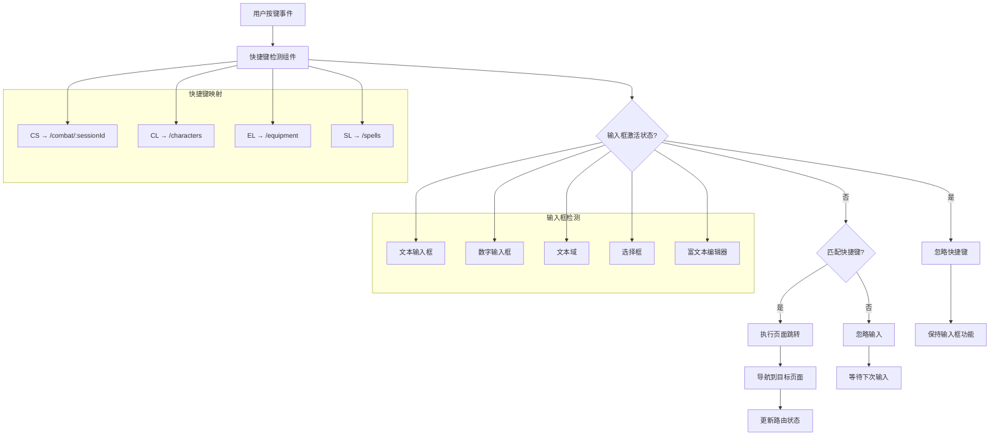

# Keyboard Shortcut Navigation

Feature Name: keyboard-shortcut-navigation
Updated: 2025-10-16

## Description

为 DND 5e DM Toolkit 添加全局键盘快捷键导航系统，支持通过 CS、CL、EL、SL 快捷键快速跳转到战斗场景、角色列表、装备库和法术库页面。系统会自动检测输入框激活状态并在输入时禁用快捷键，确保用户输入体验不受干扰。

## Architecture



## Components and Interfaces

### 1. KeyboardShortcutDetector 组件

**职责**: 全局键盘事件监听和快捷键检测

```typescript
interface KeyboardShortcutDetectorProps {
  children: React.ReactNode;
  onShortcutTrigger: (shortcut: string) => void;
  disabled?: boolean;
}

interface KeyboardShortcutDetector {
  // 主要方法
  useEffect: () => void;
  cleanup: () => void;
  
  // 事件处理
  handleKeyDown: (event: KeyboardEvent) => void;
  
  // 状态管理
  setInputActive: (isActive: boolean) => void;
  getShortcutSequence: () => string;
}
```

**功能特性**:
- 监听全局键盘事件
- 检测连续按键组合
- 支持输入框状态检测
- 防止浏览器默认快捷键冲突

### 2. InputFocusTracker 组件

**职责**: 跟踪输入框焦点状态

```typescript
interface InputFocusTrackerProps {
  children: React.ReactNode;
  onInputFocusChange: (isFocused: boolean) => void;
}

interface InputFocusTracker {
  // 事件监听
  useEffect: () => void;
  
  // 焦点检测
  handleFocus: (event: FocusEvent) => void;
  handleBlur: (event: FocusEvent) => void;
  
  // 状态管理
  isAnyInputFocused: () => boolean;
  getActiveElements: () => Element[];
}
```

**功能特性**:
- 自动检测所有输入框类型
- 支持动态添加的输入框
- 提供全局焦点状态
- 支持嵌套组件中的输入框

### 3. NavigationService 服务

**职责**: 处理页面导航逻辑

```typescript
interface NavigationService {
  // 导航方法
  navigateToCombat: (sessionId?: string) => void;
  navigateToCharacters: () => void;
  navigateToEquipment: () => void;
  navigateToSpells: () => void;
  
  // 状态检查
  getCurrentCombatSession: () => string | null;
  isCurrentPage: (path: string) => boolean;
  
  // 导航验证
  canNavigate: (path: string) => boolean;
}
```

**功能特性**:
- 复用现有路由系统
- 支持相对路径和绝对路径导航
- 提供导航前状态检查
- 集成权限验证

## Data Models

### 1. 快捷键配置模型

```typescript
interface ShortcutConfig {
  key: string;
  description: string;
  targetPath: string;
  requiredPermission?: string;
  enabled: boolean;
}

interface ShortcutSequence {
  keys: string[];
  timestamp: number;
  timeout: number;
}
```

### 2. 输入框状态模型

```typescript
interface InputFocusState {
  isFocused: boolean;
  activeElements: Element[];
  lastFocusedElement: Element | null;
  focusHistory: Element[];
}
```

### 3. 导航历史模型

```typescript
interface NavigationHistory {
  currentPath: string;
  previousPaths: string[];
  shortcutNavigations: {
    from: string;
    to: string;
    timestamp: number;
    shortcut: string;
  }[];
}
```

## Correctness Properties

### 1. 快捷键检测正确性
- **唯一性**: 每个快捷键组合对应唯一的导航目标
- **时效性**: 快捷键序列必须在指定时间窗口内完成（1秒）
- **优先级**: 输入框状态优先级高于快捷键检测
- **幂等性**: 相同快捷键重复触发不会产生副作用

### 2. 输入框检测正确性
- **全面性**: 检测所有类型的输入元素（input, textarea, select, contenteditable）
- **实时性**: 焦点状态变化立即反映到快捷键检测逻辑
- **准确性**: 正确识别嵌套组件中的输入框
- **一致性**: 所有页面的输入框行为保持一致

### 3. 导航逻辑正确性
- **有效性**: 导航目标路径必须存在且可访问
- **权限性**: 导航必须符合用户权限要求
- **状态一致性**: 导航后应用状态正确更新
- **错误处理**: 无效导航路径提供适当反馈

## Error Handling

### 1. 快捷键错误处理
- **无效快捷键**: 忽略无效的按键组合，不执行任何操作
- **超时处理**: 超过时间窗口的按键序列自动重置
- **冲突处理**: 与浏览器快捷键冲突时优先应用逻辑
- **状态错误**: 快捷键状态异常时自动重置

### 2. 输入框检测错误处理
- **动态元素**: 支持动态添加和移除的输入框
- **嵌套场景**: 正确处理模态框和嵌套组件中的输入框
- **焦点丢失**: 处理页面切换时的焦点状态丢失
- **异常事件**: 处理异常的 focus/blur 事件

### 3. 导航错误处理
- **无效路径**: 目标路径不存在时显示错误提示
- **权限不足**: 无权限访问时显示权限错误
- **网络错误**: 导航失败时提供重试选项
- **状态冲突**: 处理导航时的状态冲突

## Test Strategy

### 1. 单元测试
- **快捷键检测逻辑**: 测试各种按键组合的检测准确性
- **输入框状态跟踪**: 测试不同类型输入框的焦点检测
- **导航服务**: 测试导航路径的有效性和权限验证

### 2. 集成测试
- **端到端导航**: 测试从快捷键触发到页面加载的完整流程
- **输入框交互**: 测试输入框激活时快捷键的禁用效果
- **跨页面导航**: 测试在不同页面间的快捷键切换

### 3. 用户场景测试
- **DM 工作流**: 模拟 DM 在游戏过程中的快捷键使用场景
- **移动端兼容**: 测试在移动设备上的快捷键体验
- **键盘快捷键**: 测试各种键盘布局和快捷键组合

### 4. 性能测试
- **内存使用**: 监控快捷键组件的内存占用
- **响应时间**: 测试快捷键触发的响应延迟
- **事件处理**: 测试高频按键事件的处理性能

## References

[^1]: (src/components/TripleTapGesture.tsx) - 现有三击手势实现参考
[^2]: (src/App.tsx) - 路由配置和导航逻辑参考
[^3]: (src/hooks/useInput.ts) - 输入框处理逻辑参考
[^4]: (src/contexts/AuthContext.tsx) - 用户权限和认证逻辑参考