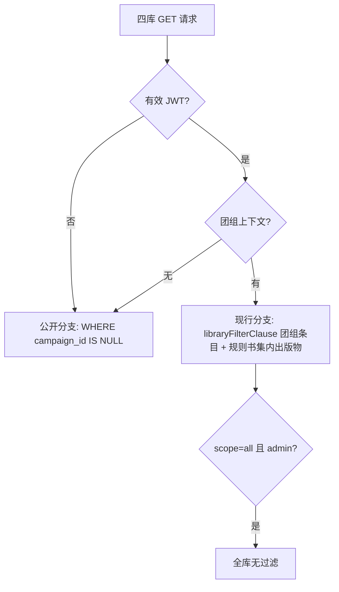

# 技术设计 — 团组之外的世界（outside-campaign-world）

Feature Name: outside-campaign-world
Updated: 2026-11-02
Requirements: 同目录 requirements.md

## Description

把站点重组为「前厅（团组外）+ 团组内」双层结构：四库出版物条目公开可读（未登录含无团组用户只读）；
`/` 改造为团组外主页（团组卡片墙 + 资料库入口 + 账号区）；团组内主页以团组 ID 寻址（`/c/:campaignId/home`），
按身份分流 DM 主页（原 DM 工作台内容）与玩家主页（原玩家首页内容）；DM 主页页内提供「回到主页」出口，
成员身份与当前团组记忆保留。

## Architecture

```mermaid
graph TD
    Subgraph["路由壳重组"]
    Root["/ 团组外主页 ProtectedRoute"]
    HomeR["/c/:campaignId/home 团组内主页 ProtectedRoute + 成员校验"]
    DM["DM 壳 ProtectedRoute requireAdmin + Layout"]
    Player["玩家壳 PlayerLayout"]
    Pub["公开壳 PublicLayout 无守卫"]
    Root --> HP["index: Home 团组外主页"]
    HomeR --> DMHome["isAdmin: DM 主页（原 Home 内容）"]
    HomeR --> PHome["其余: 玩家主页（原 PlayerHome 内容）"]
    DM --> DMRoutes["/characters /inventory /settings 等原 DM 路由"]
    Player --> PRoutes["/player/*（/player/home 重定向到 /c/:cid/home）"]
    Pub --> PubRoutes["/equipment /spells /monsters /options 列表与详情"]
    end
```



### 路由重组原则

- DM 专属路由保持现行绝对路径（`/characters`、`/settings/...` 等），仅父壳调整：从「`/` + requireAdmin」改为无 path 前缀的 layout route（requireAdmin + `RoleShell`），站内导航零改动。
- 团组内主页是唯一以团组 ID 寻址的团组内路由；URL 成为进入指定团组的入口，分桶 store 的当前团组在主页壳挂载时与 URL 对齐。
- 公开资料库路由从「ProtectedRoute + Layout」移到「PublicLayout」（无守卫）；未登录直接渲染，已登录顶栏显示「进入主页」。

### 视图分流模式准则（后续页面扩展遵循）

- **壳级分流**：DM 与玩家的页面集、导航结构不同 → 玩家版路由进 `/player/*`（PlayerLayout 壳），DM 版挂 DM 壳绝对路径。双路由命名空间隔离（现行 `/inventory` vs `/player/inventory` 即此模式），适用于视图差异大的页面。
- **页内身份分支**：同一入口 URL 双视图 → 单路由内按 `isAdmin` 渲染分支组件（`/c/:campaignId/home` 即此模式）。仅用于落地页 / 枢纽页，分支组件保持独立文件，避免单文件膨胀。
- **渐进扩展预留**：若未来团组内页面普遍需要以团组 ID 寻址（如 `/c/:cid/characters`），把主页壳的「URL cid 对齐 + 成员校验」逻辑抽为通用 `CampaignScopeRoute` 壳逐路由复用；分桶 store 的对齐机制不变。

## Components and Interfaces

### 新增 PublicLayout（src/components/PublicLayout.tsx）

- 顶栏：站名 + 资料库导航（装备 / 法术 / 怪物图鉴 / 角色选项）+ 右侧动作区。
- 动作区按登录态切换：未登录 →「登录 / 注册」按钮；已登录 →「进入主页」（链接 `/`）。
- 内容区 `<Outlet />`。
- 未登录访客写入口隐藏由各页面按 `isAuthenticated` 判断（见下）。

### Home 重写为团组外主页（src/pages/Home.tsx），原 DM 工作台内容迁至 src/pages/DmHome.tsx

- 团组外主页布局三区：
  1. 团组卡片墙：`useCampaign().campaigns` 渲染卡片（名称 / myRole / rulebooks 摘要），当前团组卡高亮；空态显示创建与邀请码加入引导（复用 `createCampaign` / `joinCampaign`）。
  2. 资料库入口区：四库链接卡片。
  3. 账号区：个人设置（`/account`）、修改密码（UserProfile 内）。
- 卡片点击：`window.location.assign(`/c/${c.id}/home`)`——统一入口，DM / 玩家分流交给团组内主页壳。
- DmHome 保留原 Home 全部内容与依赖，页头动作区加「回到主页」按钮（链接 `/`）。

### 新增团组内主页壳（src/pages/CampaignHome.tsx 或路由壳组件）

- 路由 `/c/:campaignId/home`，`ProtectedRoute` 包裹（仅需登录）。
- 挂载时对齐逻辑（URL 驱动的 switchCampaign）：
  1. `useCampaign().campaigns` 中查找 `:campaignId`；命中且 ≠ `getCampaignId()` → `setCurrentCampaignId(:campaignId)` 后 `window.location.reload()`（9 个分桶 store 重读新桶）。
  2. 未命中（被移出 / 不存在）→ `setCurrentCampaignId(首个成员团组)` 并导航至其 `/c/:cid/home`；列表为空 → 导航 `/`。
  3. 对齐完成后按身份分流：`isAdmin` → DmHome；其余 → PlayerHome 内容（原组件复用，路由 `/player/home` 改为重定向到 `/c/{getCampaignId()}/home`）。

### 顶栏网站图标与「回到主页」出口

- Layout（DM 壳）顶栏网站图标链接改为 `` `/c/${getCampaignId()}/home` ``（现行指向 `/`）；PlayerLayout 网站图标改为同款团组内主页地址（玩家主页分支承载）。
- 「回到主页」入口仅存在于 DM 主页页内（页头动作区按钮，链接 `/`）；Navbar / PlayerLayout / CampaignSwitcher 一律保持现状。
- 玩家在团组内通过 CampaignSwitcher 直接切换团组（切团组后落在目标团组内主页或保持当前页，见下）。

### 后端公开读分支（functions/_utils.ts + 四库端点）

- `functions/_utils.ts` 新增：

```ts
/** 公开访客分支：仅出版物条目（无 source 旧数据按出版物兜底） */
export function publicLibraryClause(): { clause: string; binds: string[] } {
  return { clause: 'WHERE campaign_id IS NULL', binds: [] };
}
```

- 四库 GET 列表端点（equipments / spells / options / npc_templates 的 `index.ts`）：认证失败时改用公开分支查询后直接返回；认证成功但 `resolveLibraryScope` 为 null（登录无团组）同样回退公开分支；`?scope=all` 管理视角保持现行判定。
- 四库 GET 详情端点（`[id].ts`）：无 JWT 或无团组上下文时，仅当条目 `campaign_id IS NULL` 返回 200，否则 404；有团组上下文走现行 `canReadEntry`。
- 写端点（POST / PUT / DELETE）维持现行认证与权限判定，零改动。

### 四库页面的写入口守卫（前端）

- `EquipmentList` / `SpellList` / `OptionsPage` / `MonsterList` 的新增按钮：
  - 未登录（`!isAuthenticated`）→ 整组写按钮隐藏。
  - 登录但 `useCampaign().current === null` → 按钮禁用 + 提示「加入或创建团组后再添加自定义条目」。

### 数据读取链路对未登录的兼容

- `api.ts` 的 `authHeaders()` 在无 token 时输出空认证头，后端落到公开分支，前端 `fetchAll` 200 返回出版物并写入本地缓存。
- 访客缓存落 `campaign-default` 分桶（campaignScope 现行兜底），登录同浏览器后作为首屏缓存被云端数据覆盖，语义无害。

## Data Models

- 零新表、零迁移。沿用 `campaigns` / `campaign_members` / 四库表现行结构。
- `LibraryScope`（functions/_utils.ts）保持现行类型；公开分支作为 GET 端点的独立查询路径，与 `resolveLibraryScope` 返回 null 的回退组合，不新增 scope 变体。

## Correctness Properties

1. 公开分支查询结果中的任意条目 `campaign_id` 均为 NULL（出版物），团组条目在任何公开响应中零出现。
2. 四库写端点在无有效 JWT 时一律 401；无团组上下文的登录用户写请求一律拒绝（后端）并被前端写入口守卫前置拦截。
3. 主页卡片墙条目集合 = `GET /api/campaigns` 成员列表，与 `campaign_members` 表一致。
4. 切换团组进入后，9 个分桶 store 的 localStorage 键全部落在目标团组桶（整页导航保证 `main.tsx` 渲染前重读分桶键）。
5. `campaignScope` 的持久化键（`dnd-current-campaign`）在「进入团组→回到主页→重新登录」全程保持，除非团组被移出触发回退。

## Error Handling

- 邀请码无效：团组外主页与 CampaignSwitcher 均以 alert 展示失败原因，卡片墙不变（现行行为）。
- 公开分支 DB 异常：四库 GET 返回 500，前端 `fetchAll` 静默回退本地缓存（现行模式，种子兜底）。
- 未登录访问团组内页面：`ProtectedRoute` 重定向登录页（现行行为，公开壳之外路径均挂守卫）。
- `:campaignId` 非成员或不存在：主页壳按对齐逻辑回退首个成员团组或导航 `/`，局部渲染空白状态出现前完成导航。
- 卡片点击时云端 `GET /api/campaigns` 已失败（CampaignContext 已捕获并置空列表）：团组外主页展示空态与重试提示，卡片点击不可达。

## Test Strategy

- 构建验证：`npx tsc -b` + `npm run build`（后台终端）。
- functions 语法校验：esbuild `--bundle --packages=external` 全量遍历（MEMORY 记录的既有命令）。
- 手动验证清单（部署后）：
  1. 无痕窗口未登录访问 `/monsters`：出版物条目可见、写按钮不可见、`/` 重定向登录页。
  2. 无痕窗口直接 GET `/api/equipments`：返回 JSON 全部为出版物条目。
  3. 登录无团组账号：团组外主页空态引导可见、四库只读出版物、新增按钮禁用有提示。
  4. 登录在团组账号：团组外主页卡片墙与规则书集摘要正确；点卡片进入 `/c/:cid/home`，admin 见 DM 主页、玩家见玩家主页。
  5. URL 驱动切换：直接输入另一成员团组的 `/c/:cid2/home`，整页刷新后各分桶数据切换到目标团组；非成员团组 cid 回退首个团组。
  6. DM 壳顶栏网站图标跳当前团组内主页；DM 主页「回到主页」可达且回去后原团组卡可再次进入；导航栏无主页常驻入口（切换团组走 CampaignSwitcher）。
  7. DM 路由回归：`/characters`、`/settings/data` 等绝对路径在 admin 登录下全部可用；`/player/home` 重定向到当前团组内主页。
  8. 未登录写端点直测：POST `/api/equipments` 返回 401。

## References

- functions/_utils.ts — `resolveLibraryScope`（L281）、`libraryFilterClause`（L299）、`canReadEntry`（L315）、`canWriteEntry`（L323）
- functions/api/equipments/index.ts — GET 现行认证流程（L9-31），四库同构改造的模板
- src/App.tsx — RoleShell（L54-61）、公共资料库壳（L110-132）、DM 壳与 DM 路由（L134-179）
- src/components/ProtectedRoute.tsx — requireAdmin 踢人逻辑（L20-26）
- src/contexts/CampaignContext.tsx — refresh 与 current 回退（L24-57）、switchCampaign 整页 reload（L59-66）
- src/components/CampaignSwitcher.tsx — 创建/加入入口与下拉结构（L25-56、L58-129）
- src/data/campaignScope.ts — 当前团组持久化键与分桶（L5-7、L64-80）
