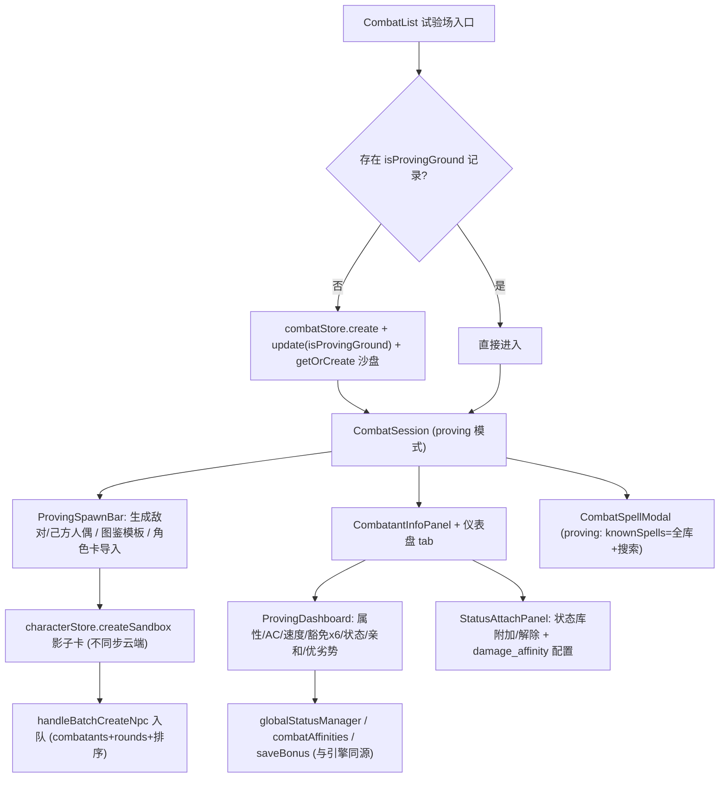

# Design — 试验场（Proving Grounds）

Feature Name: proving-grounds
Updated: 2026-10-24

## Description

在现有战斗系统上叠加一个「试验场」会话形态：一条 `isProvingGround` 战斗记录承载随时生成的人偶参战者；人偶底层挂 `isSandbox` 影子角色卡以复用完整 PC 装备/法术链路；试验场内法术对全员开放全库；参战者详情面板新增「仪表盘」tab（与战斗引擎同源的只读实际生效值 + 快捷豁免掷骰）与状态附加面板。入口在战斗列表页。

## Architecture

## Components and Interfaces

| 组件 | 职责 | 关键接口 |
|------|------|---------|
| `src/lib/saveBonus.ts`（新） | 豁免加值计算抽取（角色卡路径 + NPC 属性路径），SpellCheckStep 与仪表盘共用 | `computeSaveBonus(target, character, abilityKey): { total, formula, fromCharacter }` |
| `src/components/combat/ProvingDashboard.tsx`（新） | 只读实际生效值仪表盘 + 豁免快捷掷骰（d20+加值，含 detectAdvantage saving_throw 场景优劣势提示） | props: `record, combatant, character, combatInventory` |
| `src/components/combat/StatusAttachPanel.tsx`（新） | 状态库全部状态一键附加/解除；damage_affinity 通用状态配置注入；当前生效清单回显 | props: `recordId, combatant` |
| `CombatSession.tsx` | proving 分支：SpawnBar 工具条、InfoPanel/SpellModal 传参、进入即模式默认 | `record.isProvingGround` 判定 |
| `CombatSpellModal.tsx` | `isProvingGround` prop → knownSpells = `spellStore.getAll()` + 名称搜索框 | props 增 `isProvingGround?: boolean` |
| `CombatList.tsx` | 「进入试验场」按钮 + 记录卡片「试验场」徽标 | `combatStore.getAll().find(r => r.isProvingGround)` |

## Data Models

- `CombatRecord` += `isProvingGround?: boolean`（**combatStore.load() 白名单重建必须补该字段**，否则旧记录打开后丢失）
- `Character` += `isSandbox?: boolean`
- 人偶默认值：属性全 10、HP 20、AC 10、速度 30、先攻 1d20 随机、attacks = 徒手击打（+0 命中，1d4 钝击）
- 影子卡与参战者同名（`试验体·敌 1` / `试验体·友 1` 自动编号），`characterId` 引用影子卡，`isPc` 按敌我

## Correctness Properties

1. 仪表盘数值 = 战斗引擎同一函数计算（AC 用 `computeCombatantAc`、豁免用 `computeSaveBonus`、亲和用 `getCombatantAffinities`、状态用 `globalStatusManager.getActiveStatuses`），零二次推导。
2. 影子卡永不上云：`createSandbox` 跳过 `syncCharacterToBackend`；`replaceAllFromBackend` 合并时保留本地 `isSandbox` 卡；角色列表 UI 隐藏 `isSandbox`（`characterStore.getAllVisible()`）。
3. 状态附加只走 `globalStatusManager.applyEffect`（含能力标记联动），解除走 `declareEnd`，与正式战斗同一状态机。
4. proving 记录的模拟/放映行为与普通记录零差异（不改回合推进/动作/回溯代码路径）。
5. 非试验场记录的现有行为完全不变（所有 proving 分支以 `record.isProvingGround` 为前提）。

## Error Handling

- 影子卡创建失败（localStorage 异常）：alert 并中止生成。
- 状态附加时 statusLibrary 为空：面板显示空态提示。
- 豁免掷骰：`diceService` 失败时显示「掷骰失败」。

## Test Strategy

`npx tsc --noEmit` + `npm run build`；人工验证：入口创建/复用、人偶生成入队、影子卡隐藏与云端隔离、全库武器手持/护甲穿戴 AC 重算、全库法术施放、状态附加后台表实时刷新、豁免快捷掷骰、放映模式回合推进、战斗列表徽标、普通战斗回归不受影响。

## References

- 入队落点：`src/pages/CombatSession.tsx` handleBatchCreateNpc
- 豁免计算现状：`src/components/combat/SpellCheckStep.tsx:85-115`
- 状态 API：`src/data/statusManager.ts` applyEffect/declareEnd/getActiveStatuses
- 法术列表：`src/components/CombatSpellModal.tsx:185` knownSpells memo
- 云同步阻断点：`src/data/characterStore.ts:193,239`
