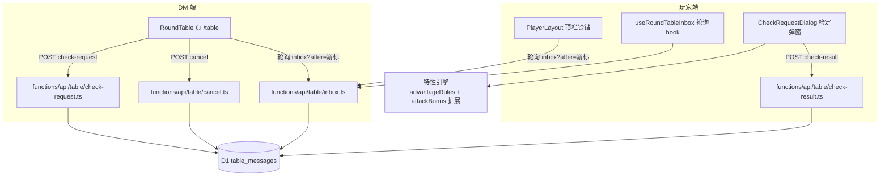
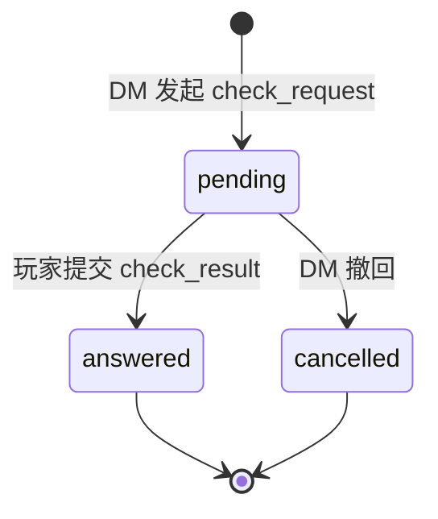

# 圆桌·通用检定 技术设计

Feature Name: round-table-checks
Updated: 2026-11-06

## Description

DM 与玩家之间新增「圆桌」消息通道，首批消息类型为通用检定（check_request / check_result）。DM 在独立页 `/table` 发起定向检定（属性/技能/豁免，固定 DC，三档 DC 可见性模式），玩家在玩家端信箱接收、投骰/填数、经特性引擎加工得出应用值并回传判定。传输层为 D1 单表消息信箱 + 游标增量轮询，消息不可变，状态机流转，type 字段开放为圆桌后续功能预留。

## Architecture





- **消息不可变**：check_request 与 check_result 是两条独立消息；result.reply_to 指向 request.id，request 上以 status + reply_message_id 回填（仅这两个状态字段可更新，payload 永不修改）。
- **游标增量**：双端均持 `lastSeenId`（消息 id 单调递增——用 `created_at` 排序 + id 兜底），inbox 按 `id > after` 拉取，断线重连不丢不重。
- **传输层可替换**：业务层只依赖「信箱语义」（不可变消息 + 游标 + 状态机），未来换 DO 推送时仅替换 inbox 的拉取方式。

## Components and Interfaces

### 前端新增

| 文件 | 职责 |
|------|------|
| `src/pages/RoundTable.tsx` | DM 圆桌页：左侧发起表单（角色选择[仅绑定玩家账号的角色]、检定类型、检定项、DC、dcMode、说明），右侧消息流（pending 等待 / answered 结果卡 / cancelled 标记）+ 撤回按钮 |
| `src/components/roundtable/CheckRequestDialog.tsx` | 玩家检定弹窗：检定描述、加值明细表、优劣势双骰 UI（复用 resolveRollMode）、一键掷骰（diceService）、手填 d20、提交回执 |
| `src/components/roundtable/RoundTableBadge.tsx` | PlayerLayout 顶栏未读角标（pending 数量） |
| `src/hooks/useRoundTableInbox.ts` | 轮询 hook：游标 state + 退避策略（聚焦 3s / 隐藏 15s / 连续 5 次空轮退避至 10s / 新消息重置）+ visibilitychange 监听；DM 端与玩家端共用（拉取范围不同由参数区分） |
| `src/lib/api.ts` | 新增 5 个客户端函数（见 API 端点） |
| `src/App.tsx` | 注册 `/table`（ProtectedRoute + requireAdmin + Layout）与 `/player/table`（ProtectedRoute + PlayerLayout） |

### 特性引擎接入（检定加工管线，`src/lib/checkPipeline.ts` 新文件）

```ts
export interface CheckPipelineResult {
  d20Kept: number;            // 优劣势裁决后保留的 d20
  rollMode: 'advantage' | 'disadvantage' | 'none';
  modeReasons: string[];      // 优劣势原因（妖精血统等检测器输出）
  bonuses: { label: string; value: number }[];
  appliedValue: number;       // d20Kept + Σbonuses
}

export function runCheckPipeline(
  character: Character,
  checkKind: 'ability' | 'skill' | 'save',
  checkKey: string,
  d20s: number[],             // 单骰或双骰
): CheckPipelineResult
```

加值来源按 checkKind 分派：

| checkKind | 加值项 |
|-----------|--------|
| ability | 能力调整 + 万事通（非熟练检定 +floor(prof/2)，复用 `computeInitiativeBonus` 同款判定逻辑抽公共函数） |
| skill | 能力调整 + 技能熟练（`proficient`）或专精（`expertise` 翻倍）或万事通（非熟练）+ `Skill.extra` |
| save | `characterStore.getSaveBonus` + 妖精血统检测（scene=saving_throw） |

优劣势判定：非战斗 `AdvantageContext`（scene = `ability_check` / `skill_check` / `saving_throw`，attackerCharacter = 玩家角色卡），复用 `detectAdvantage` + `resolveRollMode`。战斗内 `pendingAdvantageSources` 与状态奖惩随参战者/记录走，本管线天然拿不到（无 combatant），符合非战斗语义。

## Data Models

### 迁移 `migrations/0013_table_messages.sql`

```sql
CREATE TABLE IF NOT EXISTS table_messages (
  id TEXT PRIMARY KEY,
  campaign_id TEXT,
  from_user_id TEXT NOT NULL,
  to_user_id TEXT NOT NULL,
  type TEXT NOT NULL,
  payload TEXT NOT NULL,
  status TEXT NOT NULL DEFAULT 'pending',
  reply_message_id TEXT,
  created_at INTEGER NOT NULL,
  updated_at INTEGER NOT NULL
);
CREATE INDEX IF NOT EXISTS idx_table_messages_inbox
  ON table_messages(to_user_id, created_at, id);
CREATE INDEX IF NOT EXISTS idx_table_messages_outbox
  ON table_messages(from_user_id, created_at, id);
```

### payload 结构（JSON 字符串存储）

**check_request**：

```json
{
  "characterId": "…", "characterName": "…",
  "checkKind": "ability | skill | save",
  "checkKey": "strength | athletics | …",
  "checkLabel": "运动检定",
  "dc": 15,
  "dcMode": "open | hidden_dc | value_only",
  "note": "翻越城墙（DM 附言）"
}
```

**check_result**：

```json
{
  "replyTo": "<request.id>",
  "d20s": [14, 18], "d20Kept": 18,
  "rollMode": "advantage", "modeReasons": ["妖精血统（对魅惑豁免优势）"],
  "bonuses": [{ "label": "运动熟练", "value": 3 }],
  "appliedValue": 21,
  "autoOutcome": "success | fail | null",
  "submittedAt": 1730000000000
}
```

### 消息类型常量（前端 `src/types/roundTable.ts` + 后端 `_utils` 各自声明）

`type: 'check_request' | 'check_result'`（首批）；`status: 'pending' | 'answered' | 'cancelled'`。

## API 端点（functions/api/table/*）

| 端点 | 方法 | 认证 | 职责 |
|------|------|------|------|
| `check-request.ts` | POST | JWT + isAdmin | DM 发起：校验目标角色卡存在且在 user_characters 中有绑定 → 写 check_request |
| `check-result.ts` | POST | JWT | 玩家答复：校验 request 存在、to_user_id=当前账号、status=pending（409 幂等拒绝）→ 写 check_result + 回填 request.status=answered、reply_message_id |
| `cancel.ts` | POST | JWT + isAdmin | DM 撤回：校验 from_user_id=当前账号 且 status=pending → 置 cancelled |
| `inbox.ts` | GET | JWT | 双端共用：`?after=<id>` 游标拉取 to_user_id=当前账号的消息（玩家收任务+DM 收结果同语义）；`?outbox=1` 时改拉 from_user_id（DM 侧查看发起状态） |
| `my-characters.ts` | GET | JWT | 查当前账号 user_characters 绑定的角色卡（玩家端确定「我的角色」集合；DM 端发起表单的反向查询走现有 admin 端点） |

权限沿用 §5.4 双轨认证（`authenticateRequest`），写端点判断 `auth.isAdmin`。

### 角色绑定查询 SQL（check-request 校验 + my-characters 共用）

```sql
SELECT 1 FROM user_characters WHERE user_id = ? AND character_id = ?
```

## Correctness Properties

1. **幂等性**：同一 check_request 至多一条 check_result——`check-result.ts` 以 `UPDATE table_messages SET status='answered' WHERE id=? AND status='pending'` 的受影响行数作为抢占判据，行数为 0 即 409。
2. **消息不可变**：除 request 的 `status` / `reply_message_id` / `updated_at` 外任何字段永不更新；check_result 一经写入只读。
3. **游标单调**：消息 id 采用 `crypto.randomUUID()` 但排序键用 `created_at`（同毫秒用 id 兜底排序），游标返回「最后一条消息的排序键」，inbox `WHERE (created_at, id) > (?, ?)`（D1 不支持元组比较，落地为 `WHERE created_at > ? OR (created_at = ? AND id > ?)`）。
4. **投递定向性**：inbox 仅按 `to_user_id = JWT 账号` 拉取，无跨账号泄漏。
5. **绑定一致性**：check-request 发起时校验绑定关系；绑定解除后 pending 消息仍可答复（玩家已收到），但新任务无法再发给该角色。
6. **退避正确性**：页面隐藏（document.hidden）时轮询间隔 ≥ 15s；聚焦恢复立即触发一次拉取。

## Error Handling

| 场景 | 处理 |
|------|------|
| 玩家提交时任务已撤回 | check-result 409 + message「任务已被 DM 撤回」，弹窗关闭并刷新信箱 |
| 玩家重复提交 | check-result 409 + message「该检定已答复」，幂等不报错刷新 |
| DM 发起时角色未绑定 | check-request 400 + 前端表单已预过滤（双保险） |
| 轮询网络失败 | 静默保留游标，下一周期重试；连续失败 3 次在 UI 显示「连接中断」灰点 |
| 登录过期（401） | 停止轮询，由全局认证层跳转登录 |
| 非法 payload（类型/字段缺失） | 后端白名单校验字段（checkKind 枚举 / dc 1-30 / dcMode 枚举），400 返回首个错误字段 |

## Test Strategy

- **构建验证**：`npx tsc --noEmit` + `npm run build`（每轮提交前）。
- **手动 E2E 清单**（双浏览器：DM 账号 + 玩家账号）：
  1. DM 发起技能检定（明牌 DC）→ 玩家 3s 内角标亮起 → 弹窗加值明细正确（熟练 3 + 万事通 0）→ 掷骰提交 → DM 端结果卡 d20/应用值/判定一致
  2. 隐藏 DC 模式：玩家见「成功/失败」不见 DC 数值
  3. 仅回传数值模式：DM 端自行判定
  4. 优势检定：妖精血统角色收魅惑法术名检定 → 双骰 UI 出现且取高
  5. 幂等：玩家开两个标签页提交同一任务 → 后到者 409 提示
  6. 撤回：DM 撤回 pending → 玩家端任务消失/置灰，提交报已撤回
  7. 断线恢复：玩家断网 30s 重连 → 游标补拉不丢消息
  8. 退避：页面切后台 30s → 网络面板确认轮询间隔 15s
- **回归**：战斗内优劣势弹窗（CombatAttackModal/CombatSpellModal）行为不变——detectPassiveFeature 只在传入 sourceSpellName 的 saving_throw 场景触发，本次管线不传法术名。

## References

[^1]: (Filename#L640) - src/types/combat.ts CheckScene 定义（ability_check/skill_check/saving_throw 已齐）
[^2]: (Filename#L134) - src/types/character.ts Skill 结构（proficient/extra/expertise）
[^3]: (Filename#L2) - functions/api/admin/users/[id]/characters/index.ts user_characters 绑定查询先例
[^4]: (Filename#L46) - src/data/advantageRules.ts AdvantageContext（新增 sourceSpellName 已就绪）
[^5]: (Filename) - AGENTS.md §5.4 双轨认证 / §7 新端点约定
