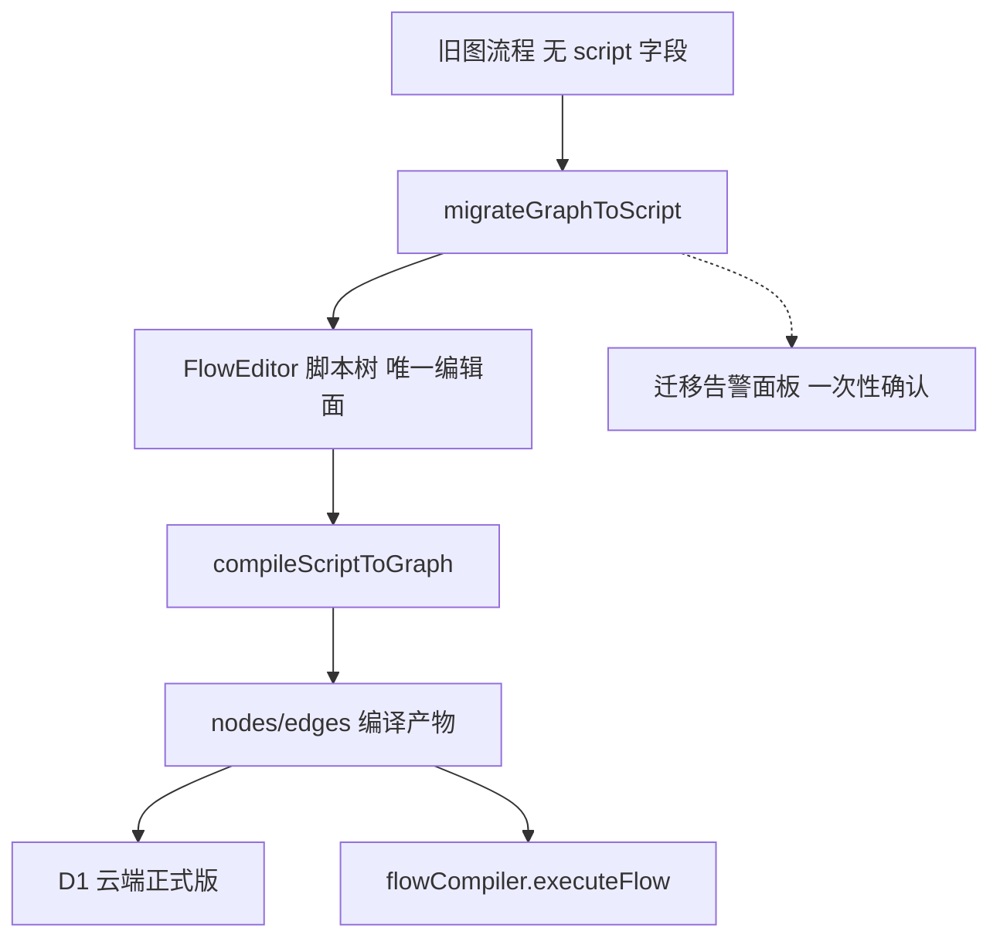

# Scratch 式积木化流程编辑器 — 技术设计

Feature Name: scratch-block-flow-editor
Updated: 2026-11-18

## Description

以脚本树（Script Tree）取代「nodes + edges 自由图」作为编辑器唯一读写格式。节点拓扑由积木堆叠与嵌套直接编码，画布坐标消失；保存/发布时编译回 nodes/edges 图，云端 D1、`flowCompiler.executeFlow`、战斗引擎消费链（FlowRunStep）零改动。已确认的三项决策：

1. **运行时策略**：编译桥接（P0），原生树遍历留待后续评估。
2. **循环语义**：回流边按死代码丢弃（`flowCompiler.ts:262` visited 防环使回流边当前即不生效，丢弃行为等价）。
3. **旧画布**：新积木画布上线即退役，脚本树迁移报告在编辑器内一次性确认。

## Architecture



- **加载**：无 `script` 字段的流程经迁移器转为脚本树（lazy，不回写旧字段）。
- **编辑**：全部结构操作只作用于脚本树。
- **发布**：编译器产出图与脚本树一并提交；绑定门禁（`BindingService.bindSpellToFlow`）对编译产物图执行校验。
- **查看**：FlowView 优先渲染脚本树；仅有图时回退现有图视图。

### 块形状注册表（BLOCK_SHAPE_REGISTRY）

| 节点类型 | 块形状 | C 形双体语义 | 对应 trigger 对 |
|---|---|---|---|
| cast_start | 帽子块（唯一） | — | — |
| select_target / apply_effect / scaled_effect / concentration_check / custom / cast_end | 堆叠块 | — | on_complete 链 |
| condition_branch | C 形块 | 满足体 / 否则体 | on_true / on_false |
| saving_throw | C 形块 | 通过体 / 未通过体 | on_success / on_failure |
| attack_roll | C 形块 | 命中体 / 未命中体 | on_success / on_failure |

依据：`flowCompiler.ts:136` `triggerMatches` 中 on_true/on_false 与 on_success/on_failure 两组各自互斥（`result.output.result === true/false` 与 `result.status === success/failure`），C 形块双体在一次执行中至多展开一个，与 Scratch if/else 语义一致。`on_partial` 无插槽：现实数据零使用（种子流程仅 fireball，全 on_complete），迁移遇 on_partial 出边记告警并丢弃。

## Components and Interfaces

### 数据与算法层（纯函数，前后端可共用）

| 模块 | 职责 |
|---|---|
| `src/types/flowScript.ts` | 脚本树类型 + `BLOCK_SHAPE_REGISTRY`（节点类型 → 块形状、C 形体标签、trigger 映射） |
| `src/lib/flowScriptMigrate.ts` | `migrateGraphToScript(flow): { script, warnings, lossless }` |
| `src/lib/flowScriptCompile.ts` | `compileScriptToGraph(script, meta): FlowDefinition`（复用 `cleanFlowDefinition` 深度清理） |

### 迁移器算法骨架（图 → 树）

```
migrateGraphToScript(flow):
  hat ← cast_start 节点（缺失 → 返回失败 + 告警）
  visited ← { cast_start.id }
  body ← collectChain(cast_start.id, visited)
  孤儿节点（未进入 visited）→ 告警丢弃
  返回 { script: { hat, body }, warnings, lossless: warnings 中无行为损失项 }

collectChain(nodeId, visited):
  blocks ← []
  cur ← nodeId
  循环:
    cur 已 visited（汇合点）→ 返回 blocks, join=cur
    visited.add(cur)
    node ← nodeById[cur]
    IF node 属 C 形形状:
      trueEdge ← 首条 on_true/on_success 出边; falseEdge ← 首条 on_false/on_failure 出边
      混入其他 trigger 的出边 → 告警丢弃
      { body: trueBody,  join: tj } ← collectBranch(trueEdge.to, visited)
      { body: falseBody, join: fj } ← collectBranch(falseEdge.to, visited)
      blocks.push(C块(node, trueBody, falseBody))
      cur ← (tj === fj ? tj : tj ?? fj)  // 汇合点提升；不对称汇合 → 告警 + 贪心取存在侧
      cur 为空 → 返回 blocks, join=null
    ELSE:
      blocks.push(堆叠块(node))
      next ← 首条 on_complete 出边 ?? 首条其他匹配出边（非 on_complete 出边替代 → 告警）
      cur ← next?.to ?? null
```

关键退化规则：

1. **汇合点提升**：双分支链在第一个共同节点汇合时，该节点提升到 C 块之后的父序列（标准 if/else 公共尾）。
2. **不对称汇合**（仅一侧链触及共同节点）：告警 + 贪心延续存在侧链；`lossless=false`。执行序差异由黄金对照测试输出差异报告，供人工一次性确认。
3. **回流边**（目标在 chainPath 上）：丢弃 + 告警（死代码，行为等价）。
4. **多入口/孤儿子图**：丢弃 + 告警（visited 语义下本就不参与执行，行为等价）。

### 编译器语义（树 → 图）

1. 帽子 → `cast_start` 节点；序列相邻块 → `on_complete` 链。
2. C 形块 → 本体节点 + `on_true|on_success` 边（指向满足体首块或汇合点）+ `on_false|on_failure` 边（同理）。
3. 汇合点 = C 块在父序列中的下一个块，逐级上溯至根序列；根尾无后续 → 空/终结路径无出边（原图无匹配出边 = 执行自然结束，行为一致）。
4. 空 C 形体 → 对应 trigger 边直接指向汇合点。
5. 节点 id 沿用脚本树块 id（迁移时沿用原节点 id），执行日志 `nodeId` 保持可对照。
6. 编译产物自保证：引用完整、无自环、无重复边、无孤立节点。

### 编辑器组件层

| 组件 | 职责 |
|---|---|
| `FlowScriptCanvas.tsx` | 脚本树垂直渲染 + 缩放平移（复用现有画布交互经验，结构为列表，复杂度大幅下降） |
| `FlowBlockCard.tsx` | 三种块形态渲染：帽子（顶部帽沿造型）、堆叠（凸凹槽造型）、C 形（双插槽体 + 条件六边形插槽内嵌） |
| `FlowDropSlot.tsx` | 插入点感应 + 阴影高亮（Scratch drop-shadow 语义） |
| `use-script-dnd.ts` | 拖拽状态机：拖起（含整串子树）、插入索引计算、吸附提交为不可变树更新 |
| `FlowNodePalette.tsx` | 改造为块面板：按 BLOCK_SHAPE_REGISTRY 出块，帽子块已在脚本时禁用 |
| `FlowEditor.tsx` | 状态源切换为 `flow.script`；保存时编译；属性面板复用 `FlowPropertiesNodeEditor` |

## Data Models

**块形态语义分层（2026-11-22 用户观察确立，不可照搬 if/else 逻辑树）**：战斗流程节点有意设计为非最小逻辑单元——
- `saving_throw` / `attack_roll` 是**结果信号发射器**：结果（成功/失败、命中/未命中）沿链传递给下游，默认堆叠形态；
- `apply_effect` 是**结果信号反应器**：`halfDamageOnSave` 等配置由效果节点自行消化上游结果（「成功时伤害减半」是效果分配的自身逻辑，非图级分支）；
- `scaled_effect` 是**内嵌条件的作用器**：分档/公式取值即条件分支与作用器的结合，恒为堆叠；
- `condition_branch` 是唯一的**显式控制分流**原语，恒为 C 形。

检定块 C 形（`onTrue`/`onFalse` 体）仅在两个结果要走完全不同效果链时使用；编辑器右侧栏提供形态切换（`convertBlockForm`）。**分支形态三态（2026-11-22 用户观察追加）**：堆叠（信号传递）/ 单分支 `detour`（满足走小路汇合回主链、未满足直接向下——D&D 法术绝大多数是单边特殊效果，`form: "detour"` 且 `onFalse` 恒空，编译语义 = 双分支且否则体为空，零编译器改动）/ 双分支 `ifelse`（缺省形态）。`condition_branch` 默认 detour，无堆叠形态；检定块默认堆叠（`buildNewBlock`）。收敛守卫：分支体非空不可丢（detour→堆叠需清满足体，ifelse→detour 需清否则体）。

```ts
// src/types/flowScript.ts
export interface ScriptHat {
  kind: 'hat';
  id: string;                      // 沿用节点 id（编译后日志可对照）
  label: string;
  config?: Record<string, any>;
  notes?: string;
}

export interface ScriptStep {
  kind: 'step';
  nodeType: FlowNodeType;          // 限堆叠形状类型
  id: string;
  label: string;
  config?: Record<string, any>;
  notes?: string;
}

export interface ScriptIf {
  kind: 'if';
  nodeType: FlowNodeType;          // condition_branch | saving_throw | attack_roll
  id: string;
  label: string;
  condition?: string;              // condition_branch 必填；检定块由结果分流，无条件参数
  onTrue: ScriptBlock[];           // 满足体/通过体/命中体
  onFalse: ScriptBlock[];          // 否则体/未通过体/未命中体
  notes?: string;
}

export type ScriptBlock = ScriptStep | ScriptIf;
export interface FlowScript {
  hat: ScriptHat;
  body: ScriptBlock[];
}
```

`FlowDefinition` 增量字段（`src/types/flow.ts`）：

```ts
/** 脚本树：编辑器唯一读写格式；发布时编译为 nodes/edges */
script?: FlowScript;
```

D1 无 schema 迁移：流程内容为 JSON 列，`script` 随 JSON 内嵌存储。

## Correctness Properties

1. **黄金对照**：对每条存量流程，`compileScriptToGraph(migrateGraphToScript(flow).script)` 在相同 `FlowExecutionContext` 下的执行日志与原流程完全一致（lossless 流程强制全绿；有告警流程输出差异报告供人工确认）。
2. **执行序列等价**：脚本树按 C 形互斥语义的展开序 ≡ 原图 DFS（visited）执行序。
3. **单次执行结构性保证**：块在树中位置唯一 → 编译产物每节点恰一入链路径 → 「每节点至多执行一次」由结构成立，防御式 visited 仅作双保险。
4. **丢弃守恒**：迁移丢弃的每类图特征（回流边、孤儿、on_partial 边、歧义出边）均写入 warnings；`lossless=false` 时编辑器展示告警面板并要求确认。
5. **校验同源**：绑定门禁消费的 `validateForPublish` 对含 `script` 的流程走脚本树校验（配置必填 + 帽子唯一 + 条件非空），拓扑类检查对脚本流程跳过（结构不可能），对纯图流程保留旧检查。

## Error Handling

| 场景 | 处理 |
|---|---|
| 迁移遇 cast_start 缺失 | 迁移失败，编辑器以告警面板呈现原因，阻止编辑（保留旧画布只读渲染兜底） |
| 迁移有损（lossless=false） | 编辑器一次性确认面板列出告警；确认后进入积木编辑 |
| 编译抛错（防御式，结构上不应发生） | 保存被阻止并提示具体块 id；与绑定门禁「保存放行」策略一致仅针对校验，编译失败属数据损坏级错误 |
| 脚本树损坏（老数据字段缺失） | `load` 容错兜底（沿用 store 模式），不可修复时回退图视图 |

## Test Strategy

1. **单测**：`flowScriptMigrate` / `flowScriptCompile` 对拍——覆盖线性链、单层 C 形、嵌套 C 形、汇合提升、空体、不对称汇合、回流边、孤儿子图、on_partial 丢弃。
2. **黄金对照探针**：`scripts/probes/` 模式（`QUIET=1`），对 `data/flows/*.flow.json` 与云端拉取流程全量执行「迁移→编译→执行日志比对」，只输出 FAIL 与汇总。
3. **E2E 冒烟探针**：编辑器拖拽吸附（拖块入序列、C 形体嵌套、帽子唯一约束）、发布后绑定门禁联动。
4. **既有探针回归**：`sh scripts/probes/run.sh` 基线全绿。

## 实施分期

| 阶段 | 内容 | 验收 |
|---|---|---|
| P0 数据层 | `flowScript.ts` 类型 + 迁移器 + 编译器 + 黄金对照探针；`validateForPublish` 按 script 分流 | 探针全绿；fireball 迁移 lossless |
| P1 编辑器 | FlowScriptCanvas / FlowBlockCard / FlowDropSlot / use-script-dnd / palette 改造；FlowEditor 状态切换；迁移告警面板 | 旧画布退役；拖拽吸附冒烟通过 |
| P2 上下游 | FlowView 按脚本树渲染；`skills/流程生成器` 拓扑配方改产脚本树（配方表达力增强：检定块即 C 形） | 生成流程直入发布管线 |
| P3 清理 | 移除 position / tidyFlowLayout / nodesOverlap / findNonOverlappingPosition / 视口快照 / 拓扑类校验分支 | `tsc -b` 无残留引用 |

## References

[^1]: (src/types/flow.ts#L32) FlowNodeDef / FlowEdgeDef / FlowDefinition 现有图模型
[^2]: (src/lib/flowCompiler.ts#L136) triggerMatches 六态匹配
[^3]: (src/lib/flowCompiler.ts#L233) executeFlow DFS + visited 防环
[^4]: (src/utils/flow-editor/validation.ts#L143) validateForPublish（绑定门禁校验源）
[^5]: (skills/流程生成器/SKILL.md#L91) 检定块 on_success/on_failure 拓扑配方
[^6]: (data/flows/fireball.flow.json) 种子流程 trigger 分布（全 on_complete）
