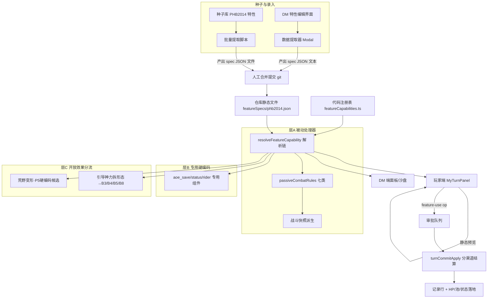

# 技术设计：技能全周期引擎（skill-fullcycle-engine）

Feature Name: skill-fullcycle-engine
Updated: 2026-11-18
状态：定稿 v1（决策记录 2026-11-18）

## Description

三层接入架构：被动处理器零操作（层 A）、主动技能按结算模式引擎化 + 数据提取器（层 B）、复杂技能专用硬编码（层 B 保留）。核心目标：玩家异步提交前一切数值静态可得，DM 审批零手填。

决策记录（2026-11-18 用户拍板）：
- 决策 1（数据形态）：**技能 spec 全部硬编码入库（git 仓库静态文件）**，与种子库同构（public/seed/*.json 模式）。提取器产出的 spec 提交进仓库，随构建分发。已废弃早期草案的云端 D1 配置表方案（迁移 0017 + feature-configs API 不建）——规则书数据是静态内容，走 git 版本管理（可 review/回溯），运行时可变配置不符合其性质。
- 决策 2（开放效果分流）：引导神力拆形态接入既有引擎；荒野变形 P5 硬编码候选；神圣干预另议；奥术回想/魔能掌控非战斗后置。裁定队列机制本轮不建。
- 决策 3（骰值归属）：玩家端掷（与 attack d20 玩家填值先例一致），结果随 op 提交，DM 入账直接采用、零额外操作。依据：线下 DND 工具定位。
- 决策 4（架构归属，2026-11-18 补确认）：**技能为核心，调用时将技能数据导入引擎**。技能是开放集合（294 名，仓库静态 spec 数据），引擎是封闭集合（8 类结算模式，无状态处理器代码）。见下方文件架构与调用时序。
- 附带修正：原「站点默认+团组覆盖」作用域方案随决策 1 作废——spec 是站点级仓库文件；团组级自定义规则若未来确有需求另议。

## Architecture



解析顺序（R5）：代码注册表（专用硬编码）→ 仓库 spec 文件（提取器产出，静态）→ manual 兜底（现有行为）。开放效果技能按 R6 分流（拆形态/硬编码候选/范围外标记）。

### 文件架构（决策 4：技能为核心）

```
src/data/
├── featureSpecs.ts        # spec 类型定义（8 渠道 schema）+ engineRegistry：channel → 处理器
├── engines/               # 无状态处理器，一渠道一文件
│   ├── healEngine.ts          execute(feature, spec, ctx) → SettlementResult
│   ├── resourceConvEngine.ts
│   ├── checkModifierEngine.ts   （从 featureCapabilities 迁出）
│   └── ...
├── featureCapabilities.ts # 解析链（REGISTRY 专用硬编码 → cloudConfigs → manual），键=技能名
└── featureExtract.ts      # 提取正则集，产出单位=技能 spec
```

归属原则：技能是开放集合（仓库静态 spec 数据 + 提取器产出，增长零代码改动）；引擎是封闭集合（结算模式处理器，execute/settle 均为 `(skillSpec, ctx) => result` 纯函数）。专用硬编码条目同样以技能为键登记在 REGISTRY。

### 调用时序（一次发动）

```
玩家点「回气」
→ resolveFeatureCapability('回气')        → { source:'cloud', channel:'heal', spec }
→ computeFeaturePreview(spec, ctx)        → 技能数据导入引擎求值 → 区间预览
→ 玩家掷骰 → op { featureName, channel, specRef, params }
→ turnCommitApply → engineRegistry['heal'].settle(op, spec, ctx) → HP/池/记录行
```

## 引擎类型清单（定稿口径）

### 层 A：被动处理器（复用 passive-engine 冻结七类，扩容方式 = 配置表）

| # | 处理器 | 已有派生入口 | 扩容方式 |
|---|--------|-------------|---------|
| A1 | 豁免优劣势（含灵光） | advantageRules `passive-feature` 检测器 | 配置表条目（trait 名 → {save, advantage, 条件, 门槛}） |
| A2 | 伤害抗性/免疫 | `deriveCharacterAffinities` | 配置表（伤害类型 + 抗/免） |
| A3 | 无甲防御 AC | `resolveUnarmoredAc` | 公式配置 |
| A4 | 速度修正 | `deriveSpeedModifier` | 数值配置 |
| A5 | 被动检定三件套 | `derivePassiveChecks` | 加值配置 |
| A6 | 黑暗视觉 | `deriveDarkvision` | 距离配置 |
| A7 | 先攻优劣势 | `deriveInitiativeAdvantage` | 配置条目 |

现覆盖约 15 名 → 目标 156 名被动数值类全接入（display-only 设定类 112 名仅标记「设定型」，进引擎）。

### 层 B：主动技能功能引擎

| # | 引擎 | 状态 | spec 要点 | 参照技能 |
|---|------|------|----------|---------|
| B1 | 检定加骰 checkModifier | 已有 | {pool, dice, 适用范围(检定/攻击/豁免/法术), 有效期} | 诗人激励/卓越战技/战斗激励/精-class |
| B2 | 优劣势声明 advantage | 已有 | {target: self/attack, duration} | 鲁莽攻击 |
| B3 | 自体治疗 heal | 新增 | {dice, flat, 等级系数, 或 tempHp} | 回气(1d10+战士等级)、矮人体魄类 |
| B4 | 命中触发 attack_rider | 已有 | {damage dice+type, 触发条件, 环级升级} | 至圣斩/震慑拳 |
| B5 | 范围豁免 aoe_save | 已有(专用) | {shape, dice+type, dcFormula, saveHalf} | 吐息武器 |
| B6 | 状态切换 status | 已有 | {status, 门槛, 期间效果(抗性/优势集)} | 狂暴 |
| B7 | 资源转换 resource_conv | 新增 | {convert: {from, to}, 一次性效果集} | 动作如潮(附赠→主动作)、灵巧动作(bonus→疾走/撤消/躲藏) |
| B8 | 反应处理器 reaction | 已有 | {trigger: attack/spell_cast/damage, effect, 成本} | 拨挡飞弹/轻身坠/直觉闪避/护盾术（数据面由提取器/种子填充） |

### 层 B 保留：专用硬编码（效果逻辑无法 spec 表达）

已有：吐息武器（B5 几何交互）、狂暴（B6 复合状态）、震慑拳（rider+豁免挂状态）、至圣斩（环级升级）。
新增立项评估：空灵体（四气多效应）、混元体（伤害类型切换）、渗透劲/暗影技艺（命中 debbuff）、灵魂力量。
判据：多效应组合 / 特殊时点 / 专用 UI 交互 → 硬编码；纯数值表达 → spec 引擎。

## Components and Interfaces

### 1. spec 数据层（P1）：仓库静态文件

**spec 数据文件 `src/data/featureSpecs/phb2014.json`（决策 1：硬编码入库，与种子库同构）：**

```jsonc
{
  "回气": {
    "channel": "heal",
    "spec": { "dice": "1d10", "levelFactor": 1, "levelAttr": "战士等级", "type": "hp" },
    "source": "extractor",
    "confidence": 0.9
  },
  "动作如潮": {
    "channel": "resource_conv",
    "spec": { "convert": { "from": "bonus", "to": "action" } },
    "source": "extractor",
    "confidence": 0.9
  }
}
```

- 键 = 特性名（与角色卡/种子库特性名同源）；`source`/`confidence` 记录提取来源供 review。
- 提取器产出的 JSON 由人工合并提交 git，随构建分发；规则变更走 commit review，与种子库同流程。
- 体积预估：294 名全量 spec 约 30-60KB，打包静态加载无压力；按需可拆职业/种族多文件（同目录 index 聚合）。

**resolveFeatureCapability 数据化（`src/data/featureCapabilities.ts`）：**

```
resolveFeatureCapability(feature, ctx):
  1. REGISTRY（代码注册表，现有 6 条 + 专用硬编码——代码优先，可覆盖 spec 文件）
  2. SPEC_DB（import featureSpecs/phb2014.json，模块级加载，构建时校验 schema）
  3. 无配置 → manual 兜底（现有行为：池扣自动化 + 手动结算提示 + 「未接入」标记）
```

- 构建期校验：vite 插件或独立脚本在 build 时对 spec 文件跑渠道 schema 校验（`featureSpecs.ts` 类型守卫），非法 spec 直接构建失败——把数据正确性左移到 CI。
- 离线天然可用（静态资源），无缓存/回退逻辑。

### 2. 数据提取器（P2）

**组件 `src/components/FeatureExtractorModal.tsx`：**
入口：CharacterDetail 特性区「接入引擎」按钮（DM 权限）+ 数据页种子库批量入口。
流程：选引擎类型（按描述关键词预推荐 channel）→ 文本提取（命中片段 `<mark>` 高亮 + 表单预填）→ 低置信项逐项「需人工确认」标记 → 确认生成（schema 校验）→ **输出 spec JSON 文本（复制/下载）**，人工合并进 `src/data/featureSpecs/phb2014.json` 提交 git——运行时 UI 产出物，仓库为准（决策 1）。
批量路径（主路径）：`scripts/extract-features-batch.mjs` 直接读写仓库 spec 文件，无需 UI。

**提取正则集（`src/data/featureExtract.ts`，纯函数可单测）：**

| 目标 | 正则/规则 |
|------|----------|
| 骰式 | `/(\d*)\s*d\s*(\d+)(\s*[+＋-]\s*[\d]+)?/g` |
| DC | `/DC\s*(\d+)/` 与 `8+熟练+{属性}调整值` 公式 |
| 恢复量 | `/恢复\s*(\d+d\d+(?:\s*[+＋]\s*\d+)?|\d+)\s*点?生命/` |
| 临时HP | `/获得\s*(\d+d\d+(?:\s*[+＋]\s*\d+)?|\d+)\s*点?临时生命/` |
| 伤害类型 | 火焰|闪电|毒液|寒冰|光耀|黯蚀|雷鸣|力场|心灵|酸液|钝击|穿刺|挥砍 |
| 范围形状 | 复用 `describeAoeSpec`/`parseAoeSpec`（锥状/线状/半径球状/立方） |
| 属性关联 | `(力量|敏捷|体质|智力|感知|魅力)调整值` |
| 池推断 | `每回合|每日|短休|长休` + `等于.*等级` → poolKey/refreshPolicy |
| 门槛 | 职业等级公式（`第N级`/`N级`）→ minLevel |

置信度规则：骰式+类型双命中=0.9；单命中=0.6；公式推断=0.5；缺命中=0（标记人工）。

**批量脚本 `scripts/extract-features-batch.mjs`：** 读种子 36 显式条目 + 被动 156 名分类清单 → 跑正则集 → 输出逐条报告（成功/低置信/失败清单）→ 成功项写入 `src/data/featureSpecs/phb2014.json`（预填，`source: 'seed_batch'`），diff review 后提交 git。

### 3. 引擎补齐（P3：B3 heal + B7 resource_conv）

**spec schema（`src/data/featureSpecs.ts`）：**

```ts
// B3 heal
interface HealSpec { dice?: string; flat?: number; levelFactor?: number;
  levelAttr?: '职业等级'|'武僧等级'|...; type: 'hp'|'temp'; }
// B7 resource_conv
interface ResourceConvSpec { convert?: { from: 'bonus'|'action'; to: 'action'|'dash'|'disengage'|'hide'|'bonus' };
  grants?: { action?: boolean; bonusRestore?: boolean; }[]; }
```

**玩家端静态预览 `computeFeaturePreview(feature, spec, ctx)`（combatStore 纯函数）：** 返回 {消耗, 恢复区间, DC, 描述}，MyTurnPanel/MyCombatantPanel 特性按钮 hover/展开展示。

**op 协议扩展（决策 3：玩家端掷）：** `feature-use` op 增 `channel` + `specRef`(spec 名或 registry key) + `params`（含玩家已掷骰值，如 heal 的 `diceRolls`）。玩家预览先展示区间，掷骰后展示确定值，提交前最终确认。turnCommitApply 增分支：
- heal → hp += op.params.diceRolls 求和（DM 入账直接采用，可复核），记录行含骰值明细
- resource_conv → combatant actions/bonusActions 调整
- spec 缺失/解析失败 → manual 兜底（R7.3 零回归）

### 4. 开放效果技能分流（P5，决策 2）

- **引导神力**：容器特性选择弹窗（四选一）→ 子形态映射引擎（生命→B3、毁灭→B4、不灭信念→B8 reaction、光辉→B5）；池扣除按引导神力次数计。
- **荒野变形**：专用硬编码候选——变身 = 参战者数据替换（HP/AC/攻击形态按野兽数据表），P5 内评估立项，超预期则顺延。
- **神圣干预**：标记「裁定型·另议」，本轮范围外。
- **奥术回想/魔能掌控**：标记「非战斗·后置」，本轮范围外。

## Data Models

- spec 数据：`src/data/featureSpecs/phb2014.json`（仓库静态文件，键=特性名，值=channel+spec+source+confidence），结构按渠道 schema（`featureSpecs.ts` 类型定义，构建期校验）。
- combat 开战快照新增 `featureConfigs: Record<featureName, ResolvedCapability>`（随记录回溯可重算；来源标记 registry/spec_db）。
- 特性编辑界面（CharacterDetail）展示接入徽标：「已接入·heal」/「未接入」（R1.3/R1.4）。

## Correctness Properties

1. 解析确定性：同名特性在任何端解析结果一致（代码注册表 > 仓库 spec 文件 > manual 兜底）。
2. 预览=结算一致：玩家预览的消耗（池/动作）与 turnCommitApply 扣减量恒等。
3. 源不可变性：引擎结算只写 CombatRecord/equipmentChanges，源角色卡不受影响（既有不变量）。
4. 数据可信性：spec 文件构建期 schema 校验失败即构建失败；非法数据无法进入产物（R3.4/R7 的左移形态）。
5. 提取器无静默默认：置信度低于阈值的字段必须人工确认后才入库。
6. 骰值单次确认：op 携带的骰值由玩家端一次性掷出并锁定，DM 入账原样采用（可复核记录行），结算不再重掷。

## Error Handling

- spec schema 校验失败：构建期直接失败（vite 插件/校验脚本）；提取器 UI 生成前逐项标红。
- op 结算时 spec 缺失（DM 端比玩家端旧）：op 携带 spec 快照，DM 端优先用快照结算，缺失再降级 manual 兜底。
- 种子批量提取失败项：报告清单输出，人工补录入口（不阻塞批次）。
- spec 文件与种子特性名漂移（改名/删除）：构建期校验器对 spec 键与种子特性名做交叉检查，孤儿 spec 告警。

## Test Strategy

- 探针扩展（`probe-active-skills.cjs`）：
  - 第 14 段：解析顺序（REGISTRY 覆盖 spec 文件 / spec 文件生效 / 无配置 manual 兜底）
  - 第 15 段：提取器流程（提取→确认→产出 JSON→合并生效）
  - 第 16 段：heal/resource_conv 全周期（玩家 op → DM 入账 → HP/动作变化 + 记录行 + 预览一致）
- `probe-passive2.cjs` 扩展：被动规则表扩容条目派生断言（A1-A7 各抽新条目）
- 单测性质正则集：featureExtract 纯函数在探针内跑样本断言（无需测试框架）
- 每阶段验证：`npx tsc -p tsconfig.app.json --noEmit` + `npm run build`（background_terminal）+ 全量 `run.sh` ALL PROBES OK

## 实施阶段（开发计划）

| 阶段 | 内容 | 主要文件 | 验证 |
|------|------|---------|------|
| P1 spec 数据层 | spec 文件结构 + 构建期 schema 校验 + resolveFeatureCapability 数据化（REGISTRY→SPEC_DB→manual）+ 6 条注册平移验证 | src/data/featureSpecs/phb2014.json、src/data/featureSpecs.ts、src/data/featureCapabilities.ts、vite 校验脚本 | 探针 1-13 回归 + 14 段 |
| P2 数据提取器 | 正则集 + 批量脚本跑种子产出 spec 文件 + UI 单项流程（产出 JSON 文本） | src/data/featureExtract.ts、scripts/extract-features-batch.mjs、src/components/FeatureExtractorModal.tsx | 15 段 + 批量报告 |
| P3 引擎补齐一 | B3 heal + B7 resource_conv（schema/预览/op/入账） | src/data/engines/{healEngine,resourceConvEngine}.ts、combatStore、turnCommitApply、MyTurnPanel | 16 段 |
| P4 被动扩容 | A1-A7 规则表数据化（仓库文件/常量表）+ 156 被动分批接入 + 徽标 | passiveCombatRules/advantageRules 读取 spec 数据、CharacterDetail | probe-passive2 扩展 |
| P5 收尾 | 专用硬编码批次（空灵体/混元体等）+ 引导神力拆形态 + 荒野变形评估 + 反应数据面 + 已有通道 spec 化机会评估 | 专用引擎组件、引导神力选择弹窗 | 全量探针 + progress.md 回写 |

每阶段独立分支（feature/fullcycle-pN）+ 原子提交 + 合并前全绿。P1/P2 为基建优先；P3 后每阶段结束都有可验收的用户价值增量。

## References

[^1]: `.monkeycode/specs/passive-engine/progress.md` — 七类口径冻结与探针基线
[^2]: `.monkeycode/specs/active-skills-engine/progress.md` — 层 1 六条与通道现状
[^3]: `src/data/featureCapabilities.ts` — 现有注册表
[^4]: `src/lib/turnCommitApply.ts` — 审批入账分支
[^5]: `src/data/advantageRules.ts` — 注册式优劣势引擎
[^6]: `src/data/passiveCombatRules.ts` — 七类被动派生
[^7]: `scripts/annotate-feature-resources.mjs` — 现有种子标注脚本（POOLED 21 池主映射）

## 附录：反应数据面四期规划（2026-11-20 决策定稿：全量扩枚举，分四期落地）

种子 19 条反应语义特性全量自动化的分期路线。数据面第 1 期已全覆盖（种子 traits reaction 声明 11 条 + 纯文本 5 条 + 误标排除 3 条）。

### 第 1 期（已完成，feat/reaction-data）

- **直连 2 条**（现有枚举零/微改动）：
  - 报偿 `damage_taken/attack`——反应攻击链复用（CombatAttackModal reactionMode）
  - 投射守御 `damage_taken/damage_modifier`——DamageAbsorbModal 吸收量手填，累计进伤害结算（absorbedDamage）
- **manual 可弹 6 条**（trigger 对上现有检测器，弹窗提示 DM 按描述裁定）：守御闪光（attack_targeted）、风暴狂怒（damage_taken）、幻影化形（attack_targeted）、直觉魅惑（attack_targeted）、法术窃贼（spell_cast）、雾遁（damage_taken）
- **纯文本 5 条**（trigger 枚举缺位，reaction.prompt 已记意图待激活）：战神祝福（需 any_attack）、斗转星移（需 status_applied）、无情复仇（需 opportunity_hit）、复仇之魂（需 foe_attacked）、灵机一斩（需 any_attacked）
- **误标排除 3 条**（featureExtractCore REACTION_FALSE_POSITIVE）：出神（长休替代）、遁术（探索）、散打技巧（attack_rider 待办）

### 第 2 期：attack_modifier 家族

- 新 resolution `attack_modifier`：攻击检定修正（劣势/强制 miss/加值），交互窗口=攻击 d20 填值前（守御闪光）或看骰后（战神祝福）
- 新 trigger `any_attack`：任意攻击检定事件（不限目标关系），战神祝福（+10 引导神力池）激活
- 落地：守御闪光（劣势）、幻影化形（强制 miss）从 manual 升级；战神祝福补 trigger 激活
- 直觉魅惑（重定向）拆第 3 期（含豁免链）

### 第 3 期：target_save 家族

- 新 resolution `target_save`：施动者填 DC → 目标填豁免 d20 → 失败落效应（伤害/取消/反施）
- 新 trigger `status_applied`：状态施加事件（斗转星移）
- 落地：风暴狂怒（2d8 自选伤害）、法术窃贼（豁免+取消+窃取）、斗转星移（反施魅惑）、直觉魅惑（转攻最近者）

### 第 4 期：特殊触发与复合效应

- 新 trigger：`opportunity_hit`（借机命中）、`foe_attacked`（誓言敌攻击）、`any_attacked`（任意生物被命中）
- 落地：无情复仇（movement 变体：借机命中后移动半速）、复仇之魂（attack）、灵机一斩（attack）
- 复合效应：雾遁（隐形 status + 传送 movement 二选一或串联）

### 通用约束

- 所有期沿用「引擎零暗骰」：骰值（豁免 d20/伤害/吸收量）一律手填
- 弹窗确认时扣资源（反应次数 combatStore.consumeReaction 恒扣；池/法术位按声明），放弃零损失
- damage_taken 窗口只在攻击伤害弹窗链插桩；effect 类伤害（handleApplyDamage 直调）无反应窗口——第 4 期评估是否补插桩
