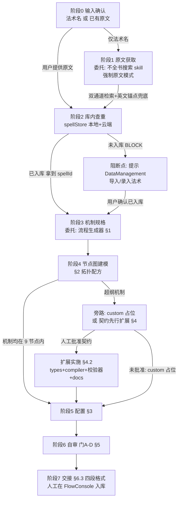

# 法术流程流水线（spell-flow-pipeline）技术设计

Feature Name: spell-flow-pipeline
Updated: 2026-10-18

## Description

新建第三个 agent skill「法术流程流水线」，编排既有两个 skill 形成端到端管线：**法术名 → 不全书搜索（原文模式）→ 法术库绑定确认（阻断点）→ 机制规格 → 节点图建模 → 配置 → 自审 → 交接人工入库**。协同 skill 只承载编排逻辑与阶段间数据契约；检索执行细节委托「不全书搜索」，建模/配置/自审/扩展细节委托「流程生成器」。超纲机制走契约先行的人工批准旁路。

## Architecture



三文档分工（编排与执行分离）：

| 文档 | 职责 | 绝对职责边界 |
|------|------|------------|
| `skills/法术流程流水线/SKILL.md`（新建） | 阶段流转、阶段间数据契约、阻断点、异常分支 | 零重复机制细节，全部章节号引用 |
| `skills/不全书搜索/SKILL.md`（+1 处入口提示） | 双通道检索、GBK 处理、多书源裁决 | 增「产出将用于流程生成时走流水线」切换提示 |
| `skills/流程生成器/SKILL.md`（+1 处入口提示） | 抽取归一化、节点/边、配置、自审、扩展、人机分工 | §0.1 增「输入为法术名时转流水线」提示 |

## Components and Interfaces

### 1. 协同 SKILL.md 结构（新建文件）

```
skills/法术流程流水线/
├── SKILL.md
└── templates/
    └── spell-packet.md        # 法术原文包模板（阶段 2 产物契约）
```

SKILL.md 版块规划：

| 版块 | 内容 |
|------|------|
| 0 定位与前提 | 三文档分工表；前置条件（DND5e_chm 存在、DND5e_chm 缺失时按不全书搜索 §数据源 clone）；适用判断（何时进流水线 vs 单独用两个 skill） |
| 1 阶段总图 | 上图 mermaid 的文本表格版：每阶段列 输入 → 动作（引用章节）→ 输出 → 失败分支 |
| 2 阶段契约 | 法术原文包 schema（见 Data Models）；阻断点规则；恢复点规则 |
| 3 异常分支表 | 逐异常 → 处置 → 恢复位置（见 Error Handling） |
| 4 扩展旁路 | 引用流程生成器 §4；补充流水线视角的触发判定（可泛化原子 vs 一次性机制）与契约审批等待行为 |
| 5 交接产物 | 引用流程生成器 §6.3 四段格式；补充 spellId 绑定信息段 |
| 6 维护规则 | 弱耦合引用原则（按章节号引用，被引用文档变更无需同步） |

### 2. 既有 SKILL.md 改动（最小侵入）

- `skills/不全书搜索/SKILL.md` 末尾「执行约束」后新增一节「出口路由」：3 行以内，说明「数据将用于生成流程/DSL/节点图 → 改用 `skills/法术流程流水线/SKILL.md`，本 skill 保留为纯检索工具」。
- `skills/流程生成器/SKILL.md` §0.1「何时使用」追加一条：用户给出**法术名**（而非文本）要求生成流程 → 转 `skills/法术流程流水线/SKILL.md`（搜索与库内绑定由流水线编排）。

### 3. 流水线依赖的既有接口（只读复用，零代码改动）

| 接口 | 位置 | 流水线用途 |
|------|------|-----------|
| 双通道检索流程 | 不全书搜索 SKILL.md §标准查询流程 | 阶段 1 执行体 |
| 抽取清单/归一化 | 流程生成器 §1.1–1.3 | 阶段 3 执行体 |
| 拓扑配方/图规则 | 流程生成器 §2.3–2.5 | 阶段 4 执行体 |
| 配置规范 | 流程生成器 §3 | 阶段 5 执行体 |
| 五道自审门 | 流程生成器 §5 | 阶段 6 执行体 |
| 四段交接格式 | 流程生成器 §6.3 | 阶段 7 输出格式 |
| 扩展改动清单 | 流程生成器 §4.2/4.3/4.4 | 扩展旁路执行体 |
| spellStore 查询 | `src/data/spellStore.ts` `getAll/getByName` | 阶段 2 查重 |
| FlowConsole 三模式 | `src/components/FlowConsole.tsx` | 人工入库（agent 只交接） |

## Data Models

### 法术原文包（阶段 1→2→3 传递的契约产物）

存于 `skills/法术流程流水线/templates/spell-packet.md`，Markdown 结构（agent 产出与消费均为文本，无 JSON 序列化需求）：

```markdown
# 法术原文包：<中文名>｜<English Name>
## 元数据
- 书源：玩家手册 2014（文件：玩家手册/魔法/法术详述/三环.html）
- 环阶与学派：三环 塑能
- 职业：<职业列表>
- spellId：<已入库的 id | UNBOUND>
## 原文字段（逐字保留）
- 施法时间 / 施法距离 / 成分 / 持续时间：…
- 效果描述：…
- 升环施法：…（或「无」）
## 待裁决项
- <多书源差异 / 译名歧义，如无则「无」>
```

要点：
- `spellId` 为 `UNBOUND` 时流水线处于阻断态，原文包之外不得产出 FlowDefinition。
- 原文模式逐字保留（不全书搜索 §第 3 步），保证阶段 3 抽取可回溯到原文。

### 阻断-恢复状态机（文档级约定，无运行时状态）

```
RUNNING → BLOCKED(UNBOUND) ──用户确认已入库──→ RUNNING(从阶段 3 恢复)
RUNNING → BLOCKED(SUBCLASS_APPROVAL) ──批准──→ RUNNING(扩展实施)
RUNNING → DONE(交接四段)
```

状态只存在于会话上下文中；跨会话恢复 = 从法术原文包/机制规格表产物重建。

## Correctness Properties

1. **职责单一**：协同 skill 正文不出现节点配置键名、GBK 命令、抽取清单等细节——只允许出现对两个既有 skill 的章节号引用。
2. **阻断完备**：`spellId === UNBOUND` 的会话上下文中不存在 FlowDefinition 产物（阶段 3 前阻断）。
3. **门禁继承**：流水线产物的合法性完全由流程生成器门 A–D 定义，协同 skill 不引入第二套标准。
4. **引用稳定性**：协同 skill 对被引用文档的引用一律带章节号（如「流程生成器 §3.1」）；被引用文档章节重排时只需更新协同 skill 的引用表（版块 6 维护规则中明示）。
5. **人工门禁不可绕过**：入库（FlowConsole 写操作）与新节点类型实施（types/flow.ts 改动）均需人工显式批准，与流程生成器 §6.4 禁止条款一致。

## Error Handling

| 异常 | 检测位置 | 处置 | 恢复位置 |
|------|---------|------|---------|
| DND5e_chm 目录缺失 | 阶段 1 前置 | 按不全书搜索 §数据源 clone | 阶段 1 |
| 双通道均无命中 | 阶段 1 | 英文锚点重搜 → 书源目录浏览 → 请用户确认书源 | 阶段 1 |
| GBK 转码失败 | 阶段 1 | 改 `-f GB18030`（不全书搜索既有规则） | 阶段 1 |
| 多书源译名冲突 | 阶段 1 | 并列展示，用户裁决（默认 2014 PHB） | 阶段 1 |
| 法术未入库 | 阶段 2 | **阻断**：保留原文包，提示 DataManagement 导入/录入 | 用户确认后从阶段 3 恢复 |
| 超纲机制 | 阶段 4 | custom 占位 + 记录；可泛化原子 → 产出契约等待批准 | 批准后实施 §4.2 |
| 门 A–D 任一失败 | 阶段 6 | 按流程生成器 §5.6 常见失败修正后重跑 | 阶段 6 内循环 |
| 用户中途打断 | 任意 | 已产出中间产物（原文包/规格表）随消息留存，可续跑 | 对应阶段 |

## Test Strategy

纯文档交付，无构建产物；验收采用**端到端走查**：

1. **主路径走查**：选一个 spells.json 已收录的法术（如「火球术」），按新 SKILL.md 逐阶段执行，验证：原文包字段完整、spellId 拿到、拓扑配方命中（线性直伤+敏捷豁免）、四段交接完整、门 A–D 全绿。
2. **阻断路径走查**：选一个仅存在于 chm、spells.json 没有的法术（如某个塔莎法术），验证阻断点触发、提示语正确、人工导入后从阶段 3 恢复。
3. **超纲路径走查**：选一个带复杂持续效果的法术（如「火墙术」区域持续），验证 custom 占位与契约产出路径。
4. **弱耦合审查**：grep 协同 SKILL.md 确认无 GBK 命令、无配置键名（`autoChecks`/`maxCount` 等）、无直接代码路径（除引用表中的接口定位）。
5. **回归**：两个既有 SKILL.md 的改动仅各 +1 节提示，`git diff` 审查不触碰既有章节语义。

## References

[^1]: (Filename) - `skills/不全书搜索/SKILL.md` — 检索工作流与书源导航
[^2]: (Filename) - `skills/流程生成器/SKILL.md` — 建模/配置/自审/扩展权威规范（§0.4 文档与代码差异表必须遵守）
[^3]: (Filename#L11-L20) - `src/types/flow.ts` — FlowNodeType 9 种合法类型
[^4]: (Filename) - `src/components/FlowConsole.tsx` — 人工入库三模式
[^5]: (Filename) - `src/data/spellStore.ts` — 法术库查重接口
