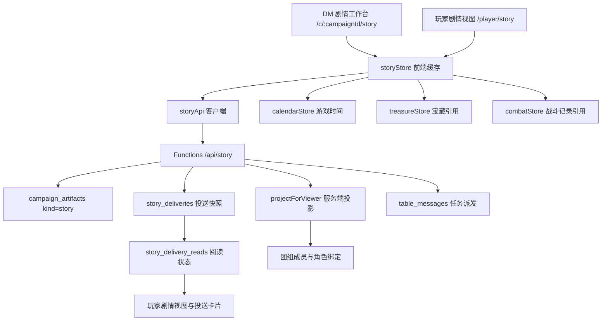
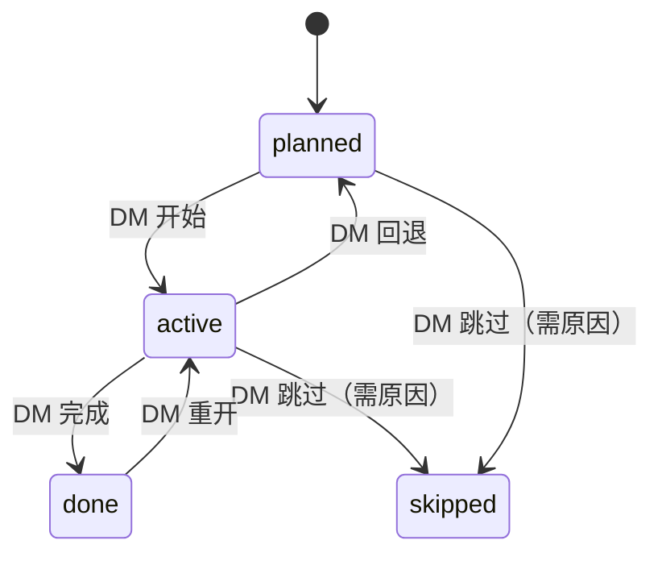

# 剧情全周期管理 — 技术设计

Feature Name: story-management
Updated: 2026-11-27
Related: `requirements.md`（本目录）、`docs/roadmap/v0.9.md`（V9-2）

## Description

以团组为作用域，提供「剧情线 → 章节 → 场景」三级内容管理。场景（一段剧情）是核心实体，承载时间、空间、团队、任务、奖励五轴，并带状态、因果、揭晓、结果四类支撑信息。DM 在站点内编写与推进，玩家按揭晓范围只读查看。

模块定位：**内容准备 + 定向投送 + 即兴补写**。DM 提前把既有剧情整理成结构化场景，按需投送给指定玩家；玩家提出剧本外要求时，DM 用快速卡片在几步内产出并投送。讲述与扮演发生在桌面现场，模块只管理内容与信息流。

设计目标：

1. 剧情数据单点权威（服务端），前端本地缓存只作离线展示
2. 玩家可见内容在服务端裁剪，前端不承担保密职责
3. 投送快照不可变，内容后续编辑不影响已投送版本
4. 与既有模块松耦合：宝藏、战斗记录、圆桌任务、日历、沙盘通过标识引用
5. 单 DM 作者模型，避免协同编辑的冲突复杂度
6. 快速路径优先：新建并投送只需标题，其余字段有默认值

## Architecture



职责划分：

| 层 | 职责 |
|----|------|
| `functions/api/story/index.ts` | 鉴权、团组校验、读写、投影 |
| `functions/api/story/_shared.ts` | 类型同构、默认值、投影函数、投送校验（纯函数，便于单测） |
| `functions/api/story/deliver.ts` | 创建投送、撤回投送、阅读回执 |
| `src/lib/storyImport.ts` | 纯文本导入解析（分隔符切分、标题兜底） |
| `src/lib/storyApi.ts` | 客户端请求封装（GET 列表 / GET 单弧 / PUT / DELETE） |
| `src/data/storyStore.ts` | 本地缓存 + 发布订阅 + 保存/冲突处理 |
| `src/pages/StoryBoard.tsx` | DM 工作台（剧情线列表 + 场景编辑器） |
| `src/pages/PlayerStory.tsx` | 玩家只读视图（章节 + 已揭晓场景与线索） |

## Data Models

存储复用 `campaign_artifacts`（`migrations/0011_campaigns.sql`），`kind='story'`，`id=arcId`，整条剧情线序列化为 `data` JSON。收益：剧情树复用既有表与 `idx_artifacts_lookup(campaign_id, kind)`，无需为三级结构建表；代价：单条上限受 D1 行大小约束，剧情线规模在数百场景内安全。投送记录因需要跨角色读取与已读回写，单独建表（见 Migration）。

```ts
// src/types/story.ts（与 functions/api/story/_shared.ts 同构）
export type StorySceneStatus = 'planned' | 'active' | 'done' | 'skipped';
export type KnowledgeLevel = 'rumor' | 'witnessed' | 'detailed';
export type StoryObjectiveKind = 'main' | 'side' | 'personal';

export interface StoryTime {
  gameDate?: string;      // YYYY-MM-DD（团组日历）
  gameMinute?: number;    // 0-1439
  sessionNo?: number;     // 第几次跑团
  order: number;          // 章节内剧情顺序
}

export interface StoryLocation {
  name: string;
  region?: string;
  battlegroundId?: string;
}

export interface StoryReward {
  currency?: { pp: number; gp: number; ep: number; sp: number; cp: number };
  items?: { name: string; quantity: number; equipmentId?: string }[];
  experience?: number;
  clueIds?: string[];
}

export interface StoryObjective {
  id: string;
  kind: StoryObjectiveKind;
  title: string;
  assigneeIds: string[];   // characterId
  status: 'open' | 'submitted' | 'done' | 'cancelled';
  messageId?: string;      // 圆桌任务消息
  cancelReason?: string;
  confirmedAt?: number;
}

export interface StoryClue {
  id: string;
  sceneId: string;
  title: string;
  content: string;
  revealedTo: string[];    // userId；空数组 = 仅 DM
  knowledgeLevel: KnowledgeLevel;
}

export interface StoryScene {
  id: string;
  chapterId: string;
  title: string;
  summary: string;
  status: StorySceneStatus;
  time: StoryTime;
  location: StoryLocation;
  roster: { characterIds: string[]; npcIds: string[]; absentCharacterIds: string[] };
  objectives: StoryObjective[];
  plannedReward: StoryReward;
  actualReward?: { treasureId?: string; note?: string; settledAt?: number };
  clues: StoryClue[];
  revealedTo: string[];
  knowledgeLevel: KnowledgeLevel;
  dependsOn: string[];     // sceneId
  resultNotes?: string;
  combatRecordId?: string;
  skipReason?: string;
  createdAt: number;
  updatedAt: number;
}

export interface StoryChapter {
  id: string;
  title: string;
  summary: string;
  order: number;
  scenes: StoryScene[];
  createdAt: number;
  updatedAt: number;
}

export interface StoryArc {
  id: string;
  campaignId: string;
  title: string;
  summary: string;
  status: 'planned' | 'active' | 'closed';
  chapters: StoryChapter[];
  createdBy: string;
  createdAt: number;
  updatedAt: number;
}
```

```ts
export interface StoryDelivery {
  id: string;
  campaignId: string;
  arcId?: string;            // 快速卡片可为空
  sceneId?: string;          // 快速卡片可为空
  targetUserIds: string[];   // 空数组表示全团
  title: string;
  body: string;
  imageUrl?: string;
  clueIds?: string[];
  createdBy: string;
  createdAt: number;
  recalledAt?: number;
}

export interface StoryDeliveryRead {
  deliveryId: string;
  userId: string;
  readAt: number;
}

export interface StoryReply {
  id: string;
  campaignId: string;
  deliveryId: string;
  fromUserId: string;
  body: string;
  handledAt?: number;        // DM 标记已处理
  createdAt: number;
}
```

设计要点：

- **场景与投送分离**：场景是结构化内容源，投送是呈现快照；DM 编辑场景不改变已投送卡片
- **快速卡片**：`arcId` 与 `sceneId` 均可空，字段与投送记录同构，归档时再补关联
- **时间三字段并存**：`gameDate + gameMinute`、`sessionNo`、`order` 相互独立，均可缺省；`order` 作为章节内排序必填
- **团队两层**：长期团队来自 `user_characters` 绑定（现成 API `bound-characters`），场景只存 `roster`；奖励归属走长期团队，可见性走 `revealedTo`
- **奖励双轨**：`plannedReward` 为纯数据；`actualReward` 只保存 `treasureId` 与结算时间，分配明细以宝藏模块（`types/treasure.ts` 的 `DistributionRecord`）为权威，避免双份账本
- **线索独立**：`StoryClue` 既可作为奖励内容（通过 `clueIds` 引用），也可独立存在于场景
- **NPC 引用**：`npcIds` 使用 `NpcTemplate.id`；临时 NPC 允许直接写入名称字符串（`npc-<timestamp>` 前缀区分）

## Interfaces

### HTTP API

| 方法 | 路径 | 权限 | 说明 |
|------|------|------|------|
| GET | `/api/story?campaignId=` | 团组成员 | 返回该团组全部剧情线，按查看者投影 |
| GET | `/api/story?campaignId=&arcId=` | 团组成员 | 返回单条剧情线，按查看者投影 |
| PUT | `/api/story` | 团组 DM | 整体覆盖保存一条剧情线（含乐观锁） |
| DELETE | `/api/story?campaignId=&arcId=` | 团组 DM | 删除整条剧情线 |
| POST | `/api/story/deliver` | 团组 DM | 创建投送（生成不可变快照） |
| GET | `/api/story/deliveries?campaignId=` | 团组成员 | 玩家仅返回目标含自己的记录，DM 返回全部 |
| DELETE | `/api/story/deliver?id=` | 团组 DM | 撤回投送（仅当无目标已读） |
| POST | `/api/story/delivery-read` | 团组成员 | 标记一条投送为已读 |
| POST | `/api/story/reply` | 团组成员 | 玩家提交提问或回应 |
| PATCH | `/api/story/reply` | 团组 DM | 标记回应已处理 |

PUT 请求体：

```json
{
  "campaignId": "cmp-xxx",
  "arc": { "...": "StoryArc" },
  "baseUpdatedAt": 1732690000000
}
```

- `baseUpdatedAt` 与服务端 `updated_at` 不一致 → 409，前端提示刷新
- 服务端写入前校验：所有场景 `chapterId` 归属正确、`order` 章节内唯一、`dependsOn` 指向同弧场景、`roster.characterIds` 属于团组绑定角色、`combatRecordId` 存在（允许空）

### 投影（`projectForViewer`）

纯函数，输入 `StoryArc` 与查看者上下文 `{ userId, isDm, memberCharacterIds }`，输出裁剪后的 `StoryArc`：

| 字段 | DM | 玩家 |
|------|----|------|
| 场景主体 | 全部 | 仅 `revealedTo` 含 userId 的场景 |
| `summary` | 全部 | 按 `knowledgeLevel` 降级：`rumor` 只给标题，`witnessed` 给摘要，`detailed` 全量 |
| `roster` | 全部 | 仅当事人可见自己的在场信息 |
| `objectives` | 全部 | 仅 `assigneeIds` 命中自己绑定角色 |
| `plannedReward` | 保留 | 移除 |
| `actualReward` | 保留 | 仅当该玩家绑定角色出现在宝藏分配记录中时保留引用 |
| `clues` | 全部 | 仅 `revealedTo` 含 userId 的线索 |
| `resultNotes` | 保留 | `detailed` 层级才返回 |
| `dependsOn` / `skipReason` | 保留 | 移除 |

玩家响应中不出现 `notes` 类私记字段（模型本版不设场景私记，DM 私记统一放 `summary` 的 DM 视角或后续扩展的 `dmNotes`）。

投送记录独立于剧情树投影：`GET /api/story/deliveries` 只返回 `targetUserIds` 为空或含当前用户的记录，并附带该用户的 `readAt`；撤回记录（`recalledAt` 非空）对玩家不返回。

## State Machines

场景状态：



目标状态：`open → submitted → done`，任意状态可 `cancelled`（需原因）。

约束：`active` 前全部 `dependsOn` 场景为 `done`；跳过时记录 `skipReason`。

## Correctness Properties

1. **投影保密**：玩家响应不包含未揭晓场景、未揭晓线索、未指派目标、计划奖励
2. **写权限**：非团组 DM 的 PUT/DELETE 返回 403
3. **顺序唯一**：同一章节内场景 `time.order` 唯一
4. **引用完整**：`roster.characterIds` 属于团组；`dependsOn` 与 `combatRecordId` 指向存在实体
5. **计划奖励不可变**：结算写入 `actualReward` 时 `plannedReward` 字节级不变
6. **乐观锁**：`baseUpdatedAt` 过期时不覆盖，返回 409
7. **级联删除**：删除章节时下属场景与线索一并移除
8. **容错默认**：读取时缺失字段按默认值补齐（`status='planned'`、`time.order=0`、数组为空）
9. **投送快照不可变**：编辑场景或线索不改变已生成的投送快照
10. **投送目标隔离**：玩家只能读取目标列表为空或包含自己的投送记录
11. **撤回生效**：撤回后玩家读取不再返回该记录，且撤回只能发生在零已读时
12. **阅读状态单调**：已读时间一旦写入，重复标记不改变原值
13. **回应时序**：回应按 `createdAt` 排序，投送记录与其回应不互相改写

## Error Handling

| 场景 | 处理 |
|------|------|
| 未登录 | 401，前端跳转登录 |
| 非团组成员 | 403，前端提示无权限 |
| 非 DM 写入 | 403，编辑入口在 UI 层隐藏，服务端兜底 |
| 校验失败 | 400，返回字段级错误列表，前端高亮对应输入 |
| 乐观锁冲突 | 409，前端提示「剧情已被其他窗口修改」，提供刷新 |
| 撤回时已有玩家已读 | 409，返回已读人数，前端提示改为发送更正卡片 |
| 投送目标不在团组 | 400，返回非法用户列表 |
| 网络失败 | 前端保留草稿，提示重试；展示最近一次本地缓存 |
| 数据损坏 | 服务端返回 500 并记录日志；前端展示只读缓存与告警 |

## Test Strategy

- **数据级探针** `scripts/probes/probe-story.cjs`：直接调用 `projectForViewer` 与校验函数（通过页面 `evaluate` 导入纯函数），断言 8 条 Correctness Properties
- **API 权限探针**：页面内 `fetch` 携带玩家 token / DM token 分别请求 GET/PUT，断言 403 与投影字段缺失
- **人工验收**：DM 建弧 → 章 → 场景，玩家端逐步揭晓；刷新与换端一致性；离线缓存展示
- **回归**：`scripts/probes/run.sh` 全量保持绿；本功能不触碰战斗与圆桌既有逻辑

## Migration

`migrations/0017_story_delivery.sql`：

- `story_deliveries(id, campaign_id, arc_id, scene_id, target_user_ids, data, created_by, created_at, recalled_at)`，`data` 存投送快照 JSON，`target_user_ids` 存 JSON 数组
- `story_delivery_reads(delivery_id, user_id, read_at)`，复合主键
- `story_replies(id, campaign_id, delivery_id, from_user_id, body, handled_at, created_at)`
- 索引：`idx_story_deliveries_campaign(campaign_id, created_at)`、`idx_story_replies_delivery(delivery_id, created_at)`

剧情树本体继续复用 `campaign_artifacts`（`kind='story'`），索引已由 `migrations/0011_campaigns.sql` 提供。

## Rollout

1. P1：类型 + 服务端 API + 投影 + migration 0017（投送/已读/回应）+ 探针（无 UI，可用 curl 验证）
2. P2：DM 工作台（列表 / 大纲 / 场景编辑器）+ 文本导入 + 快速卡片
3. P3：玩家视图 + 投送卡片 + 已读回执 + 回应
4. P4：联动（圆桌任务派发、战斗跳转、游戏时间同步、通知）
5. P5：时间线回顾与导出

## References

[^1]: `migrations/0011_campaigns.sql` — `campaign_artifacts` 表与索引
[^2]: `functions/api/artifacts/[kind]/[id].ts` — 制品读写端点先例
[^3]: `src/types/treasure.ts` — 宝藏与 `DistributionRecord`
[^4]: `src/data/calendarStore.ts` — 团组日历
[^5]: `src/data/gameTimeStore.ts` — 游戏内时间
[^6]: `src/types/roundTable.ts` — 圆桌消息类型
[^7]: `docs/roadmap/round-table-hub.md` — 任务插件与权限原则
