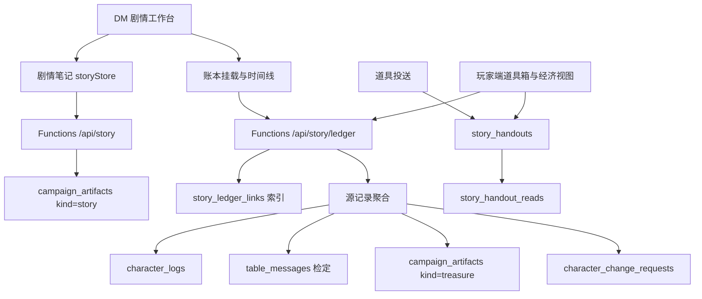
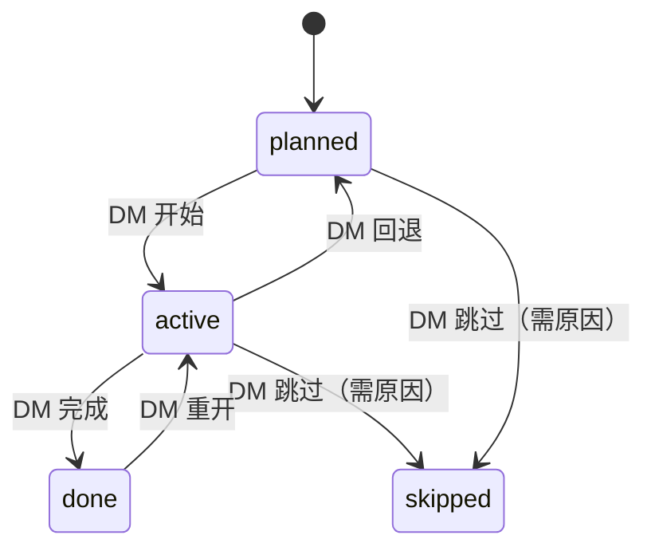

# 剧情全周期管理 — 技术设计（DM 笔记 + 战役经济账本）

Feature Name: story-management
Updated: 2026-11-27
Related: `requirements.md`（本目录）、`docs/roadmap/v0.9.md`（V9-2）

## Description

模块由两个域组成，共用「剧情线 → 章节 → 场景」骨架：

- **剧情笔记域**：DM 私有。导入既有剧情文本、组合片段、引用规则实体、写私记，并提供 DM 阅读视图。玩家端永远拿不到场景文本。
- **战役经济账本域**：以场景为挂载点，把检定、物资、宝藏、施法、成长五类经济事件串成时间线。源记录（角色日志、检定消息、宝藏、变更请求）保持权威，本模块只存引用索引，读取时聚合。

玩家侧只有两类内容：与自己角色相关的经济事件，以及 DM 投送的道具型文本（信件/地图/告示）。

设计目标：

1. 笔记与账本解耦：笔记是 DM 的准备材料，账本是战役的事实流水
2. 源记录单一权威：索引不复制数值，避免双账本漂移
3. 服务端裁剪：玩家请求在接口层就移除笔记与越权事件
4. 单 DM 作者模型，避免协同编辑复杂度
5. 与既有模块松耦合：检定、战斗、宝藏、日志、审批按标识引用

## Architecture



| 层 | 职责 |
|----|------|
| `functions/api/story/index.ts` | 笔记树读写（DM 写，成员只读且投影为空） |
| `functions/api/story/_shared.ts` | 类型同构、默认值、校验、投影（纯函数） |
| `functions/api/story/ledger.ts` | 索引 CRUD + 源记录聚合查询 |
| `functions/api/story/handout.ts` | 道具 CRUD、投送、阅读与收藏回执 |
| `src/lib/storyApi.ts` | 客户端请求封装 |
| `src/data/storyStore.ts` | 笔记缓存 + 订阅 + 保存冲突处理 |
| `src/lib/storyImport.ts` | 纯文本导入解析（分隔符切分、标题兜底） |
| `src/pages/StoryBoard.tsx` | DM 工作台：弧/章/场景、导入、私记、阅读视图 |
| `src/pages/StoryLedger.tsx` | DM 账本时间线与场景汇总 |
| `src/pages/PlayerStory.tsx` | 玩家道具箱 + 自己的经济事件 |

## Data Models

### 笔记域（复用 `campaign_artifacts`，`kind='story'`，一弧一行）

```ts
// src/types/story.ts（与 functions/api/story/_shared.ts 同构）
export type StorySceneStatus = 'planned' | 'active' | 'done' | 'skipped';
export type KnowledgeLevel = 'rumor' | 'witnessed' | 'detailed'; // 仅 DM 侧标注

export interface StorySnippet {
  id: string;
  text: string;
  refs?: { kind: 'equipment' | 'spell' | 'monster' | 'rule'; id: string; label: string }[];
}

export interface StoryTime {
  gameDate?: string;      // YYYY-MM-DD
  gameMinute?: number;    // 0-1439
  sessionNo?: number;
  order: number;          // 章节内顺序，必填
}

export interface StoryLocation {
  name: string;
  region?: string;
  battlegroundId?: string;
}

export interface StoryPlannedObjective {
  id: string;
  kind: 'main' | 'side' | 'personal';
  title: string;
  assigneeIds: string[];
  outcome?: 'pending' | 'met' | 'missed' | 'dropped';
}

export interface StoryPlannedReward {
  currency?: { pp: number; gp: number; ep: number; sp: number; cp: number };
  items?: { name: string; quantity: number; equipmentId?: string }[];
  experience?: number;
  notes?: string;
}

export interface StoryScene {
  id: string;
  chapterId: string;
  title: string;
  status: StorySceneStatus;
  time: StoryTime;
  location: StoryLocation;
  roster: { characterIds: string[]; npcIds: string[]; absentCharacterIds: string[] };
  snippets: StorySnippet[];          // 组合后的讲述片段，仅 DM 可见
  dmNotes?: string;                  // DM 私记
  plannedObjectives: StoryPlannedObjective[];
  plannedReward: StoryPlannedReward;
  dependsOn: string[];
  resultNotes?: string;
  settlementSummary?: string;        // 场景完成时生成
  combatRecordId?: string;
  skipReason?: string;
  createdAt: number;
  updatedAt: number;
}

export interface StoryChapter {
  id: string;
  title: string;
  summary: string;
  order: number;
  scenes: StoryScene[];
  createdAt: number;
  updatedAt: number;
}

export interface StoryArc {
  id: string;
  campaignId: string;
  title: string;
  summary: string;
  status: 'planned' | 'active' | 'closed';
  chapters: StoryChapter[];
  createdBy: string;
  createdAt: number;
  updatedAt: number;
}
```

### 账本域（新表，migration 0017）

```ts
export type LedgerSourceKind = 'check' | 'item' | 'treasure' | 'spell' | 'growth';

export interface StoryLedgerLink {
  id: string;
  campaignId: string;
  sceneId: string;
  sourceKind: LedgerSourceKind;
  sourceId: string;          // 源记录主键；宝藏为 treasureId
  characterId?: string;      // 归属角色（宝藏分配必填）
  note?: string;             // DM 归类备注
  occurredAt?: number;       // 覆盖源记录时间（用于排序）
  createdBy: string;
  createdAt: number;
}

export interface LedgerEntryView {
  linkId: string;
  sourceKind: LedgerSourceKind;
  sourceId: string;
  characterId?: string;
  title: string;
  amountText?: string;
  occurredAt: number;
  invalid?: boolean;         // 源记录缺失
}
```

### 道具域（新表，migration 0017）

```ts
export type HandoutKind = 'letter' | 'map' | 'notice' | 'other';

export interface StoryHandout {
  id: string;
  campaignId: string;
  sceneId?: string;
  kind: HandoutKind;
  title: string;
  body: string;
  imageUrl?: string;
  targetUserIds: string[];   // 空数组表示全团
  createdBy: string;
  createdAt: number;
  recalledAt?: number;
}

export interface StoryHandoutRead {
  handoutId: string;
  userId: string;
  readAt: number;
  favoritedAt?: number;
}
```

## Ledger Source Mapping

| sourceKind | 权威来源 | 主键 | 展示字段 | 写入触发 |
|------------|----------|------|----------|----------|
| `check` | `table_messages`（check_request/check_result） | message id | 检定名称、DC、结果值 | DM 在场景内抛送或对已有检定挂载 |
| `item` | `character_logs`（category=item/general） | log id | 日志标题（获得/移除/数量/钱币） | DM 从最近日志中挑选挂载 |
| `treasure` | `campaign_artifacts kind='treasure'` + `DistributionRecord` | treasureId + characterId | 宝藏标题、分配金额/物品 | 宝藏分配后挂载 |
| `spell` | `character_logs`（category=spell） | log id | 施法/法术位变化摘要 | 战斗结算或施法记录后挂载 |
| `growth` | `character_change_requests` + `character_logs`（category=growth） | request/log id | 等级变化、审批结果 | 升级审批通过后挂载 |

**挂载策略**：DM 手动挑选（默认），并在场景处于 `active` 时提供「本场次最近记录」推荐列表。系统不自动写索引，避免归错场景。

## Aggregation Algorithm

`GET /api/story/ledger?campaignId=&sceneId=` 流程：

1. 读取该场景全部 `story_ledger_links`
2. 按 `source_kind` 分组，批量查询源表（每类一次 `IN (...)`）
3. 组装 `LedgerEntryView[]`，源记录缺失时置 `invalid=true` 并保留索引
4. 按 `occurredAt` 升序排序；同时间按 `createdAt` 稳定排序
5. 生成汇总：物资件数、钱币合计、经验合计、法术位消耗环级统计

玩家请求时，服务端先按 `characterId ∈ 该玩家绑定角色` 过滤索引，再执行聚合。

## Interfaces

| 方法 | 路径 | 权限 | 说明 |
|------|------|------|------|
| GET | `/api/story?campaignId=` | 团组成员 | DM 返回完整笔记树；玩家返回空章节与空场景（仅保留状态占位） |
| PUT | `/api/story` | 团组 DM | 覆盖保存一条剧情线（带 `baseUpdatedAt` 乐观锁） |
| DELETE | `/api/story?campaignId=&arcId=` | 团组 DM | 删除剧情线及其索引 |
| GET | `/api/story/ledger?campaignId=&sceneId=` | 团组成员 | 聚合账本（玩家按角色过滤） |
| POST | `/api/story/ledger` | 团组 DM | 创建索引 |
| DELETE | `/api/story/ledger?id=` | 团组 DM | 解除索引 |
| POST | `/api/story/handout` | 团组 DM | 创建并投送道具 |
| GET | `/api/story/handouts?campaignId=` | 团组成员 | 玩家仅目标含自己，DM 全部 |
| DELETE | `/api/story/handout?id=` | 团组 DM | 撤回未读道具 |
| POST | `/api/story/handout-read` | 团组成员 | 标记已读 / 收藏 |

PUT `/api/story` 请求体：

```json
{
  "campaignId": "cmp-xxx",
  "arc": { "...": "StoryArc" },
  "baseUpdatedAt": 1732690000000
}
```

服务端校验：场景 `chapterId` 归属、`time.order` 章节内唯一、`dependsOn` 同弧、`roster.characterIds` 属于团组绑定角色、`combatRecordId` 存在（可空）。

## Projection Rules

| 内容 | DM | 玩家 |
|------|----|------|
| 剧情线/章节/场景 | 全部 | 空数组（不暴露存在性） |
| 账本条目 | 全部 | 仅 `characterId` 属于自己绑定角色的条目 |
| 道具 | 全部 | 仅 `targetUserIds` 为空或含自己的未撤回道具 |
| 结算摘要 | 全部 | 移除 |

`GET /api/story` 对玩家返回空数组：连剧情线存在性与数量都不暴露，前端类型仍为 `StoryArc[]`。

## State Machines



约束：`active` 前全部 `dependsOn` 场景为 `done`；`done` 时生成 `settlementSummary`。

## Correctness Properties

1. **笔记保密**：玩家响应不含 `snippets`、`dmNotes`、计划奖励、场景状态与时间
2. **账本角色隔离**：玩家只能读取 `characterId` 属于自己绑定角色的账本条目
3. **道具目标隔离**：玩家只能读取目标为空或包含自己的未撤回道具
4. **源记录权威**：索引行不含金额/物品明细等业务数值，展示值在读取时从源记录取得
5. **失效引用保留**：源记录删除后索引保留并标记 `invalid`，DM 可手工解除
6. **级联删除**：删除章节/场景时删除其账本索引；删除道具时删除阅读状态
7. **计划不可变**：结算摘要生成不修改 `plannedObjectives` / `plannedReward`
8. **撤回幂等**：撤回后玩家读取不再返回；零已读才允许撤回
9. **阅读状态单调**：已读时间重复写入不改变原值；收藏与已读独立
10. **时间线稳定**：按 `occurredAt` 升序，同时间按 `createdAt` 稳定排序

## Error Handling

| 场景 | 处理 |
|------|------|
| 未登录 / 非团组成员 | 401 / 403 |
| 非 DM 写笔记、索引、道具 | 403，前端隐藏入口，服务端兜底 |
| 乐观锁冲突 | 409，提示「剧情已被其他窗口修改」，提供刷新 |
| 索引源类别非法 | 400，返回允许集合 |
| 索引指向不存在源记录 | 读取时标记 `invalid`，不阻断其他条目 |
| 撤回时已有玩家已读 | 409，返回已读人数，提示发送更正道具 |
| 网络失败 | 保留本地草稿与最近缓存，提示重试 |

## Test Strategy

- `scripts/probes/probe-story-notes.cjs`：笔记树 CRUD、默认值、顺序唯一、级联删除、玩家投影为空
- `scripts/probes/probe-story-ledger.cjs`：五类挂载、聚合排序、角色过滤、失效引用、汇总口径
- `scripts/probes/probe-story-handout.cjs`：目标隔离、已读/收藏、零已读撤回、撤回后不可见
- API 权限探针：玩家 token 请求笔记（空）、账本（仅自己角色）、道具（仅目标）
- 人工验收：导入既有文本 → 组合 → DM 阅读视图；场景内挂载检定/物资/宝藏 → 时间线；玩家道具箱
- 回归：`scripts/probes/run.sh` 全量保持绿

## Migration

`migrations/0017_story_ledger_handouts.sql`：

```sql
CREATE TABLE IF NOT EXISTS story_ledger_links (
  id TEXT PRIMARY KEY,
  campaign_id TEXT NOT NULL,
  scene_id TEXT NOT NULL,
  source_kind TEXT NOT NULL,
  source_id TEXT NOT NULL,
  character_id TEXT,
  note TEXT,
  occurred_at INTEGER,
  created_by TEXT NOT NULL,
  created_at INTEGER NOT NULL
);
CREATE INDEX IF NOT EXISTS idx_story_ledger_scene ON story_ledger_links(campaign_id, scene_id, occurred_at);

CREATE TABLE IF NOT EXISTS story_handouts (
  id TEXT PRIMARY KEY,
  campaign_id TEXT NOT NULL,
  scene_id TEXT,
  kind TEXT NOT NULL,
  target_user_ids TEXT NOT NULL DEFAULT '[]',
  data TEXT NOT NULL,
  created_by TEXT NOT NULL,
  created_at INTEGER NOT NULL,
  recalled_at INTEGER
);
CREATE INDEX IF NOT EXISTS idx_story_handouts_campaign ON story_handouts(campaign_id, created_at);

CREATE TABLE IF NOT EXISTS story_handout_reads (
  handout_id TEXT NOT NULL,
  user_id TEXT NOT NULL,
  read_at INTEGER NOT NULL,
  favorited_at INTEGER,
  PRIMARY KEY (handout_id, user_id)
);
```

笔记树继续复用 `campaign_artifacts`（`kind='story'`），索引已由 `migrations/0011_campaigns.sql` 提供。

## Rollout

1. P1：笔记类型 + `_shared.ts` + `/api/story` 读写与投影 + 探针
2. P2：账本索引表 + 聚合端点 + 探针
3. P3：DM 工作台（导入 / 组合 / 私记 / 阅读视图）+ 账本挂载 UI
4. P4：道具投送 + 玩家道具箱 + 玩家经济视图
5. P5：结算摘要 + 时间线与筛选 + Markdown 导出

## References

[^1]: `migrations/0011_campaigns.sql` — `campaign_artifacts` 表与索引
[^2]: `src/types/characterLog.ts` — 角色全周期日志（item/spell/growth）
[^3]: `src/types/changeRequest.ts` — 成长与变更审批
[^4]: `src/types/treasure.ts` — 宝藏与 `DistributionRecord`
[^5]: `src/types/roundTable.ts` — 检定消息
[^6]: `functions/api/character-logs/index.ts` — 日志查询接口
[^7]: `docs/roadmap/round-table-hub.md` — 权限与信箱原则
