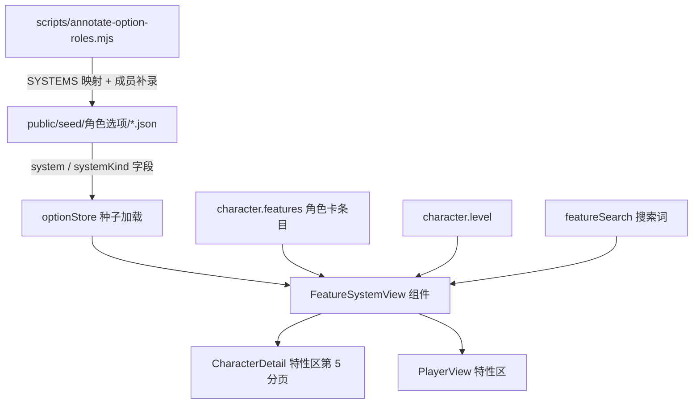

# 体系视图（职业玩法体系分页）

Feature Name: system-view
Updated: 2026-11-11

## Description

在角色卡「特性与特质」区新增「体系」分页（DM 端 CharacterDetail 与玩家端 PlayerView 两端同步），按玩法体系聚合展示角色职业相关的选择型体系：容器介绍 + 选项库全量成员 + 角色已选高亮 + 未达等级未解锁置灰。体系归属由种子新增显式 `system` / `systemKind` 字段判定，缺省成员条目由标注脚本补录进种子。

## Architecture



数据流：种子是体系全貌的唯一事实源；角色卡 features 是「已选」的判定源；渲染层按 `system` 分组、按卡上同名条目标已选、按 `level <= character.level` 判解锁。

## Components and Interfaces

### 新组件 `src/components/FeatureSystemView.tsx`

无路由、无 store CRUD 直写，数据全部 props 传入（符合组件层约定）：

```ts
interface Props {
  features: Feature[];          // 角色卡全部特性（调用方先过滤等级门槛/隐藏项）
  characterLevel: number;       // 判定未解锁
  search: string;               // 与特性搜索框联动
  renderBadge?: (f: Feature) => ReactNode;  // 作用方式徽章（两端样式一致）
}
```

内部逻辑：
1. 从 optionStore 读取该角色职业/子职业/背景相关的全部种子条目（复用 `collectOptionFeatureEntries` 的数据源或直接读种子分片），筛出带 `system` 的条目
2. 按 `system` 分组：`systemKind === 'container'` 条目为组头（渲染体系名 + text 介绍），其余为成员
3. 成员合并：库成员 ∪ 卡上带同 system 的手录条目（按 `名称+来源` 去重），卡上已存在者标「已选」
4. 成员排序：level 升序 → 已选优先
5. 未解锁：`level > characterLevel` → 整卡置灰 + 「未解锁（第X级）」徽章，内容可见，入卡按钮禁用
6. 一键入卡：DM 端未选且已解锁成员显示「加入角色卡」按钮，点击后按 `collectOptionFeatureEntries` 同构构造 Feature（crypto.randomUUID() 生成 id，携带 role/level/system/systemKind/category/source）写入 features，走 CharacterDetail 现有保存 + 云端同步路径；PlayerView 只读无此按钮
7. 搜索过滤：体系名或成员名/描述命中即保留整组，组内高亮命中成员

### 类型层 `src/types/characterOption.ts` + `src/types/character.ts`

- `OptionTrait` 增加 `system?: string; systemKind?: 'container' | 'member'`
- `Feature`（角色卡条目）同步增加两字段，随派生链透传入卡

### 派生链透传（4 处，与 role 透传同路径）

`src/data/optionFeatures.ts` 的 `collectOptionFeatureEntries` / applyOptionTraits 链路、`src/pages/CharacterDetail.tsx` 的 `handleBackgroundSelect` / `handleRefreshOptionFeatures` fresh 重建——全部透传 `system` / `systemKind`。

### 种子标注 `scripts/annotate-option-roles.mjs`

- 新增 `SYSTEMS` 映射：`体系名 → { container: '来源|名称', members: [...] }`
- 对容器条目写 `system = 体系名, systemKind = 'container'`
- 对成员条目写 `system = 体系名, systemKind = 'member'`
- 新增成员补录数据（从 PHB 2014 文本摘录，name/nameEn/text/level/role/system/systemKind），补录校验随现有未覆盖检查
- 索引版本 bump

## Data Models

需补录进种子的体系成员（PHB 2014，约 76 条）：

| 体系 | 容器（现有） | 成员数 | 成员等级 |
|------|------------|--------|---------|
| 卓越战技 | 战斗大师\|卓越战技 | 13 | L3 |
| 超魔法 | 术士\|超魔法 | 8 | L3 |
| 魔能祈唤 | 魔契师\|魔能祈唤 | 24 | L2/L10/L15 |
| 引导神力（牧师领域） | 牧师\|引导神力 | 10（已在库） | L2/L6 |
| 引导神力（圣武士誓言） | 古贤之誓/复仇之誓/奉献之誓\|引导神力 | 6 | L3 |
| 猎人战术 | 猎人\|致命的猎人 | 16（防御战术 9 + 多重攻击 4 + 抵御魔法 3） | L7/L11/L15 |
| 图腾精魄 | 图腾武者道途\|图腾精魄 | 9（L3/L6/L14 各 3 选 1） | L3/L6/L14 |

条目结构沿用种子现有三字段（name/nameEn/text）+ level + role + system/systemKind。

## Correctness Properties

1. 体系分组的完整性：库中每个带 `system` 的条目必属于且仅属于一个体系组；无 `system` 的条目绝不出现在体系分页
2. 已选判定一致性：角色卡上带 `system` 的条目在对应体系组内必呈现为「已选」，不产生重复卡片
3. 手录兜底：卡上成员在库中无同名对应时仍展示（标注「手录/自定义」），体系组不因库缺数据而丢失已选信息
4. 未解锁只影响呈现，不影响入卡数据：未解锁成员的置灰纯渲染态，衍生逻辑（攻击/动作）零参与
5. 标注脚本幂等：重跑覆盖写回，缺 system 映射的选择型体系条目触发未覆盖报错

## Error Handling

- 职业无任何体系条目：体系分页显示空态文案「当前职业暂无玩法体系」
- 种子加载失败/版本回退：optionStore 现有容错路径兜底，体系分页降级为仅显示卡上已选成员
- 卡上条目 system 字段缺失（旧数据）：按名称前缀约定（「容器名：成员名」）做二次推断，仍失败则归入「未归类体系」组尾

## Test Strategy

- `npx tsc --noEmit` 类型验证
- `npm run build` 构建验证
- 标注脚本重跑幂等 + 分布校验（system 条目计数 == 预期容器+成员总数）
- 手工验证：新建战斗大师角色 → 体系分页展示 13 战技全貌、已选高亮、L10 未解锁置灰；PlayerView 只读一致

## References

- 特性区分页现状：src/pages/CharacterDetail.tsx:2918-2965（featureRoleFilter chips + 分组渲染）
- role 派生链：src/data/optionFeatures.ts:32-113（四处透传）
- 类型定义：src/types/characterOption.ts:19（OptionTrait.role）
- 标注脚本：scripts/annotate-option-roles.mjs
