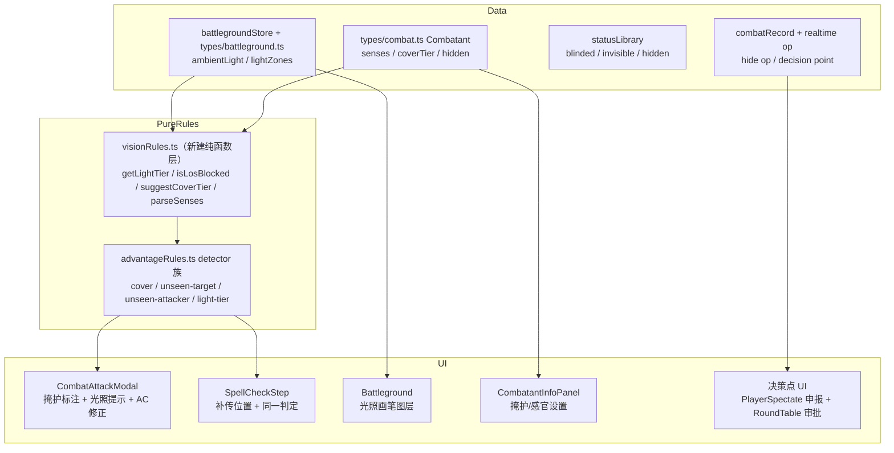

# 技术设计 — 视野系统（vision-system）

Feature Name: vision-system
Updated: 2026-11-23
Status: design v1（P1 掩护 → P2 光线/感官 → P3 隐身/决策点）

## Description

在现有优劣势引擎（advantageRules）与沙盘（Battleground）之上，叠加三体系：掩护标注与命中修正、光照档位与感官降档、躲藏隐身闭环；并新增通用「回合中途决策点」机制（复用圆桌信箱）。判定模式为混合式：几何计算（paintedCells 视线遮挡、光照区域覆盖）产出提示，DM 在弹窗内裁定最终等级并落账。

## Architecture



分层原则沿袭项目惯例：visionRules 为纯计算层（仿 zoneRules），combatStore/页面为交互层；所有优劣势输出统一走 detector 注册进 resolveRollMode；掩护 AC 修正在命中判定单点生效。

## Components and Interfaces

### C1 visionRules.ts（新建，纯函数层）

仿 `zoneRules.ts` 模式，全部函数无副作用、可被探针直调：

- `parseSenses(text: string): CombatantSenses` — NPC senses 文本解析（正则：`黑暗视觉(\d+)尺`、`盲视(\d+)尺`、`真实视觉(\d+)尺`、`震颤感知(\d+)尺`；兼容中文顿号/逗号分隔）。复用 passiveRules.ts 尺数正则先例。
- `getLightTierAt(bg, cell, combatant): { tier, source }` — 区域覆盖 > 环境默认 → 感官降档（darkvision/blindsight/truesight 尺数内 darkness→dim；truesight dim→bright；tremorsense 不改变光照档位，仅在黑暗场景提供「可定位」豁免）。
- `isLosBlocked(bg, from, to): boolean` — paintedCells Bresenham 直线（格中心连线）判定墙体遮挡；相邻格（切比雪夫距离 1）直接返回 false。
- `suggestCoverTier(bg, from, to): 'blocked' | 'obscured' | null` — LOS 判定的包装输出：全遮挡建议 total、部分遮挡建议 DM 裁定半身/3/4。

### C2 数据模型扩展

**types/battleground.ts**：
```ts
ambientLight?: 'bright' | 'dim' | 'darkness';        // 环境光照，默认 bright（load 兜底）
lightZones?: { id: string; cells: string[]; tier: LightTier; label?: string }[];
```
复用 paintedCells（已有墙体语义）做遮挡几何；光照区域独立数组（与 zones 战斗区域分层渲染，图层切换按钮扩展一档）。

**types/combat.ts Combatant**：
```ts
senses?: { darkvision?: number; blindsight?: number; truesight?: number; tremorsense?: number };
coverTier?: 'half' | 'three_quarters' | 'total' | null;   // DM 标注，弹窗可单次覆盖
```
PC 派生：现有 `deriveDarkvision`（passiveCombatRules.ts:207-223）迁入 senses.darkvision（旧字段保留读取兼容）。NPC 感官在入战钩子（useInitiative）调用 `parseSenses(template.senses)` 写入。

**statusLibrary 新状态**：
- `blinded`：effects `sight_block: true`（types/status.ts:42 枚举已预留）+ `appliesTo 'incoming'` attack 优劣势由 detector 按 sight_block 消费；combatantPatch 无（目盲感知仍可用）。
- `invisible`：标记型状态（无 effects），可见性判定由 detector 读取状态实例。
- `hidden`：标记型状态同上 + 一攻揭晓由攻击结算后 `declareEnd`。

### C3 advantageRules detector 族（注册式，模块尾部统一注册）

| detector | 场景 | 逻辑 |
|----------|------|------|
| `cover-ac-note` | attack | 目标 coverTier → 不产生 roll mode，输出 AC 修正备注（AC 修正在命中判定处单独叠加） |
| `cover-save` | saving_throw(dex) | 目标 coverTier → 豁免加值 +2/+5（走 checkPipeline 加值明细） |
| `light-visibility` | attack | 双方 getLightTierAt → 任一方有效 darkness 且无 tremorsense/blindsight → 攻方劣势 + 守方优势（两个 pending source） |
| `unseen-target` | attack | 目标 hidden/invisible 且攻方无对应感官 → 攻方劣势 |
| `unseen-attacker` | attack | 攻击者 hidden/invisible 且守方无对应感官 → 攻方优势 |
| `dim-perception` | skill_check(察觉)/passive | 有效档位 dim → 劣势 |

全部 detector 接受 `roundCtx`/位置参数；`AdvantageContext` 已含 attackerPos/targetPos/distanceCells（CombatAttackModal.tsx:478-501 现成）。`SpellCheckStep` 补传三字段（侦查 E3 缺口）。

**AC 修正落点**：命中判定处（CombatAttackModal 命中计算与 getAttackStatus 旁路）`effectiveAc = ac + coverAcBonus(tier)`；total 掩护时 getAttackStatus 返回「无法直接瞄准」并阻断。

**stealthDisadvantage 半成品补全**：detectEquipment（advantageRules.ts:146-167）加 stealth_disadvantage 分支（skill_check 场景 ability=dexterity 且技能=隐匿时劣势）——数据链已通，只缺消费。

### C4 决策点机制（复用圆桌信箱）

现成基础：RoundTable request 消息不可变、仅 status/replyMessageId 可回填（functions/api/table/*），checkPipeline 管检定加值（skill_check stealth 已在 SKILL_LABELS）。

流程：
1. 玩家 PlayerSpectate 回合面板新增「请求裁定」入口（首个使用方：躲藏）→ 创建 table request（kind: `check` / payload 含 CheckKind stealth、发起 combatantId、关联 recordId）。
2. DM 端 RoundTable 即时可见（信箱轮询 3-5s）→ 转发骰子或 DM 录入结果 → 回填 status + replyMessageId。
3. 玩家端轮询到结果 → 落账（hidden 状态挂载走 turnCommitApply hide 分支或直接 combatStore.update）→ 面板解除等待标记。
4. 回合末 op 流含 hide op 时，回合末审批卡（PlayerActionReviewCard）展示决策点结果摘要（来源 replyMessageId）。

等待标记状态：record 内新增 `pendingDecisions?: { id, combatantId, kind, requestId, createdAt }[]`（load 兜底 + 决策点完成时移除）。

### C5 UI 接入点

- **CombatAttackModal**：掩护标注行（继承目标 coverTier 预填 + 单次覆盖下拉）+ 光照提示区（getLightTierAt/isLosBlocked 结果 + DM 覆盖开关，仿 AdvDisadvToggle 手动覆盖最高优先级惯例）+ AC 修正展示。
- **CombatantInfoPanel**：动作区 hide 按钮启用（ALL_ACTIONS 已有枚举，白名单加 hide）+ 掩护等级设置项 + 感官展示行。
- **Battleground**：光照画笔图层（第三图层，复用 paintedCells 画笔交互链——触摸事件链已验证稳定）+ 环境光照档位切换。
- **PlayerSpectate**：回合面板「请求裁定（躲藏）」按钮 → 决策点申报。
- **RoundTable（DM）**：决策点审批卡（request kind 区分）。

## Data Models

见 C2。迁移零 SQL（全部 localStorage/record 内嵌字段 + 沙盘 JSON 扩展），load 兜底模式：`ambientLight: bg.ambientLight ?? 'bright'`、`senses: c.senses ?? {}`、`coverTier: c.coverTier ?? null`、`pendingDecisions: r.pendingDecisions ?? []`。

## Correctness Properties

1. **引擎零暗骰**：所有 detector 只产出优劣势/修正明细，骰值来源始终为玩家申报或 DM 录入。
2. **DM 覆盖最高优先级**：手动覆盖 > 状态实例 > 几何推导（沿袭 AdvDisadvToggle 惯例）；互斥优劣势抵消规则由 resolveRollMode 统一处理。
3. **掩护修正单点生效**：AC 修正只在命中判定处叠加一次；Dex 豁免修正在 checkPipeline 加值明细叠加一次；两处独立、无重复。
4. **hidden 一攻揭晓**：hidden 状态挂载后首次攻击结算必须 declareEnd；invisible 状态豁免此规则。
5. **光照档位单一来源**：格子档位 = lightZones 覆盖 > ambientLight；感官降档只影响该参战者的有效档位，修改区域原始档位。
6. **旧数据兼容**：所有新字段可选 + load 兜底；旧战斗记录回放（startPlayback）不受新判定影响（detector 读取字段为空时返回空明细）。

## Error Handling

| 场景 | 处理 |
|------|------|
| NPC senses 文本无法解析 | parseSenses 返回空对象，DM 面板手动录入入口（R3.2） |
| paintedCells 缺失/旧沙盘 | isLosBlocked 视为无遮挡（false），提示区显示「无墙体数据」 |
| 决策点 request 超时（DM 未处理） | 等待标记保留，玩家可撤回请求（request status 回填 withdrawn） |
| 回合回溯（startPlayback）含决策点 | 快照还原 pendingDecisions；已落账结果随快照回滚 |
| darkvision 字段旧值（PC） | deriveDarkvision 迁移读取兼容：senses.darkvision ?? 旧 darkvision 字段 |

## Test Strategy

按 AGENTS.md 8.2 分层：

- **引擎/数据断言（探针）**：visionRules 纯函数直调（parseSenses 样例文本、getLightTierAt 感官降档矩阵、isLosBlocked 墙体用例）；detector 断言走 evaluate 直调（构造 AdvantageContext 断言 pending 明细）；决策点走 store 级断言（request 创建/回填/等待标记生命周期）。
- **UI 交互链（手动验收）**：攻击弹窗掩护标注流程、光照画笔触摸链、玩家决策点申报-审批-恢复全流程。
- **每期验收**：`npx tsc -p tsconfig.app.json --noEmit` + `npm run build` + `sh scripts/probes/run.sh` 基线全绿 + 本期新增探针。

## References

- advantageRules 注册式引擎：src/data/advantageRules.ts（registerDetector / resolveRollMode / sceneMatches / collectSideConditions）
- 检测器注册先例：src/data/passiveCombatRules.ts:289-321（detectPassiveFeatureRules）
- 尺数正则先例：src/data/passiveRules.ts:160-213
- zoneRules 纯函数先例：src/data/zoneRules.ts
- 状态实例 untilNextTurn 锚定：src/data/statusManager.ts:261-319（dodging 先例）
- op 落账分支范式：src/lib/turnCommitApply.ts（dash/dodge 先例）
- 圆桌信箱：src/pages/RoundTable.tsx / src/hooks/useRoundTableInbox.ts / functions/api/table/*
- 攻击弹窗位置上下文：src/components/CombatAttackModal.tsx:478-501（buildAdvantageContext）
- 法术弹窗缺口：src/components/combat/SpellCheckStep.tsx:145-160
- 沙盘图层与画笔：src/components/Battleground.tsx（paintedCells 画笔交互链 / projectionOverlay 插槽）
- 决策点机制需求来源：本 specs requirements.md R5
