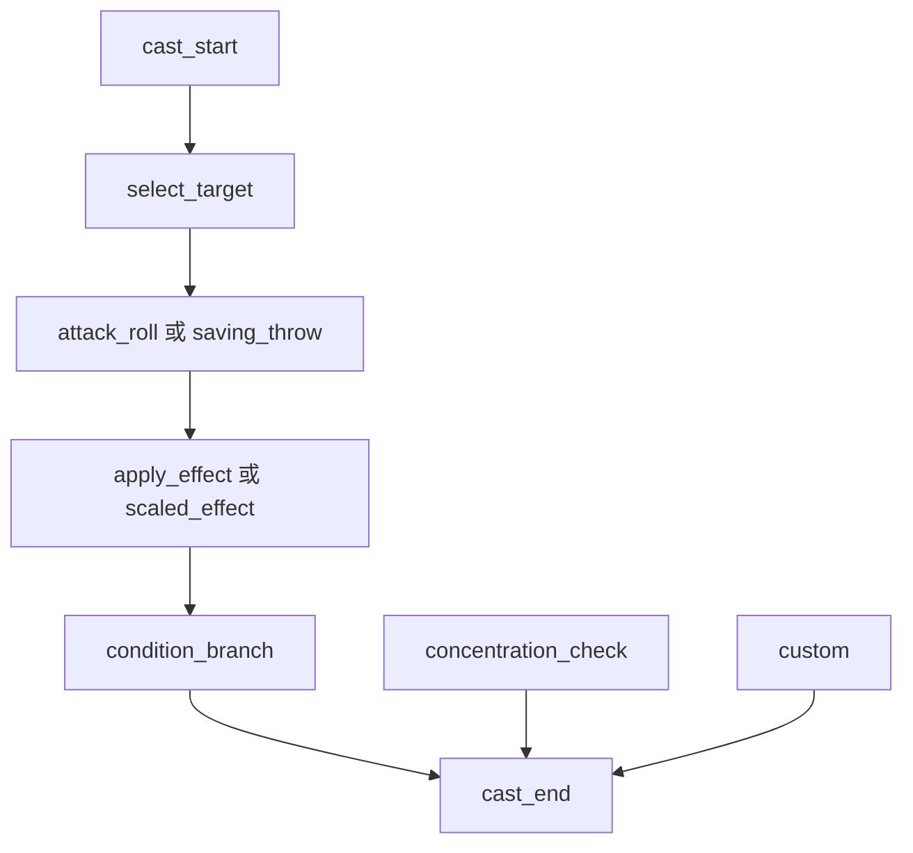

# 节点类型总览

## 概述

D&D DSL 编译器把法术/机制流程编码为有向图：节点是环节，边是触发关系。当前 `FlowNodeType` 共 10 种，节点元数据与配置表分别定义在 `src/types/flow.ts` 的 `NODE_TYPE_REGISTRY` 与 `NODE_CONFIG_SCHEMA`，执行逻辑在 `src/lib/flowCompiler.ts`。

## 节点分类

| 分类 | 节点 | 作用 |
|------|------|------|
| 核心环节 | `cast_start` | 施法入口，执行成分/射程/施法时间前置检查 |
| 核心环节 | `select_target` | 校验已选目标数量与模式 |
| 核心环节 | `cast_end` | 流程收尾，写完成日志 |
| 检定 | `saving_throw` | 目标属性豁免检定 |
| 检定 | `attack_roll` | 施法者法术攻击检定对抗目标 AC |
| 检定 | `concentration_check` | 施法者体质专注检定（DC 10） |
| 控制流 | `condition_branch` | 安全表达式条件分支 |
| 效果 | `apply_effect` | 伤害/治疗/状态数值结算（含抗性） |
| 效果 | `scaled_effect` | 按角色等级或法术环位选档后结算 |
| 扩展 | `custom` | 直接执行自定义脚本（eval 逃逸舱） |

`apply_damage` 仅存在于历史设计稿，不在 `FlowNodeType` 中，运行时不会执行；伤害请使用 `apply_effect` 或 `scaled_effect`。

## 节点关系图

图中的连接是推荐结构；实际走向完全由 `flow.edges` 的 `trigger` 决定。

## 执行模型

1. 入口固定为第一个 `cast_start` 节点；缺失时 `executeFlow` 抛错“流程缺少施法开始节点”。
2. 从入口按出边深度优先遍历，每个节点至多执行一次（`visited` 防环），并有 `节点数 × 边数` 的步数上限。
3. 节点返回 `{ status: 'success' | 'failure' | 'partial', output }`，输出缓存进 `context.results`，同时追加一条 `FlowLogEntry` 到 `context.log`。
4. 出边按 `trigger` 匹配：

| trigger | 命中条件 |
|---------|----------|
| `on_complete` | 总是命中 |
| `on_success` | `status === 'success'` |
| `on_failure` | `status === 'failure'` |
| `on_partial` | `status === 'partial'` |
| `on_true` | `output.result === true`（条件分支） |
| `on_false` | `output.result === false`（条件分支） |

5. 编译器只做纯计算：效果结算给出 `oldHp/newHp`，不会直接写角色卡或战斗记录，HP 由战斗弹窗确认后回写。

## 上下文

`FlowExecutionContext` 主要字段：

| 字段 | 说明 |
|------|------|
| `casterId` | 施法者身份（参战者 ID；非战斗场景可直接是角色卡 ID） |
| `spellId` | 当前法术 ID（流程级绑定，`cast_start` 依赖它） |
| `targets` | 已选目标 ID 列表 |
| `results` | 节点输出缓存（`Map<nodeId, output>`） |
| `stateSnapshot` | 只读游戏状态快照 |
| `combatants` | 参战者映射（可选，存在时按参战者解析） |
| `positions` | 沙盘坐标（可选，用于射程校验） |
| `damageSource` | 伤害来源（默认按法术=魔法） |
| `log` | 执行日志 |

身份解析规则：`combatants` 存在时，`id` 视为参战者 ID，PC 经 `characterId` 回落角色卡，纯 NPC 无角色卡；`combatants` 不存在时，`id` 直接当角色卡 ID（旧行为）。

## 配置与校验

- 可视化编辑器的字段来自 `NODE_CONFIG_SCHEMA`，`select` 的 `value` 是存入 config 的 DSL 值，`label` 仅用于展示。
- `validateFlowDefinition` 校验基础结构与边连接；`validateForPublish` 额外要求存在 `cast_start`，并提示缺少 `cast_end`、豁免缺属性、伤害效果缺 `damageType` 等问题。
- 伤害节点缺少 `damageType` 仍可运行，但结算时不应用抗性/易伤/免疫。

## 各节点文档

- [cast_start](./cast_start.md)
- [select_target](./select_target.md)
- [saving_throw](./saving_throw.md)
- [attack_roll](./attack_roll.md)
- [condition_branch](./condition_branch.md)
- [apply_effect](./apply_effect.md)
- [scaled_effect](./apply_effect.md#scaled_effect)
- [concentration_check](./concentration_check.md)
- [cast_end](./cast_end.md)
- [custom](./custom.md)
- [apply_damage（历史）](./apply_damage.md)
