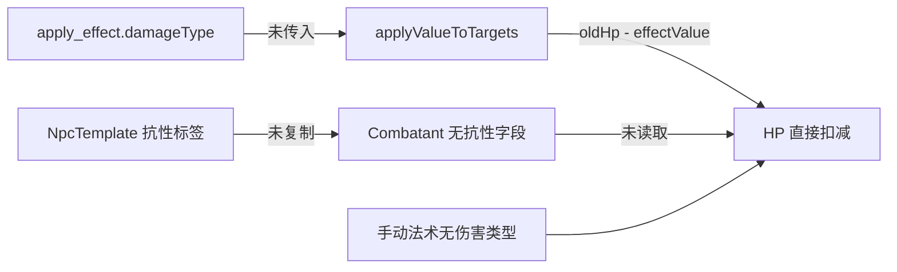

# 抗性机制全生命周期设计

> 范围：伤害抗性、易伤、免疫在「数据模型 → 流程节点 → DSL 编译器 → 战斗场景」四层的统一落地。
>
> 规则基线：《玩家手册 2014》「伤害的抗性与易伤」。
>
> 目标：让武器攻击、流程法术、手动法术三条伤害路径共用同一套结算规则，并让怪物图鉴里的抗性数据真正参与战斗。

---

## 0. 结论摘要

1. 规则本身已经明确：抗性减半、易伤加倍、免疫归零；三者都在伤害加值之后结算，抗性先于易伤，除法向下取整，同类型重复来源只算一次。
2. 当前代码存在三个断点：
   - 抗性数据停在 `NpcTemplate`，没有进入 `Combatant`；
   - `apply_effect` 节点有 `damageType` 配置，编译器没有把它传进伤害结算；
   - 编译器、武器伤害弹窗、手动法术步骤都直接执行 `currentHp - amount`，没有读取任何抗性字段。
3. 方案核心是一个纯函数 `resolveDamage()`，三条伤害路径统一调用；数据在创建参战者时从模板解析并快照到 `Combatant`；编译器保持纯计算，HP 仍由战斗宿主回写。
4. 伤害类型需要先做规范化。当前 UI 与种子数据同时存在「寒冷 / 冰冻」「黯蚀 / 暗蚀」「强酸 / 酸蚀」「雷鸣 / 声波」「光耀 / 光」等写法，必须收敛到 13 个标准类型加别名表。

---

## 1. 规则基线

### 1.1 原文要点

来源：`data/DND5e_chm/玩家手册/战斗/伤害与治疗.htm`「伤害的抗性与易伤」。

- 目标对某种伤害具有抗性时，受该类型伤害数值减半。
- 目标对某种伤害具有易伤时，受该类型伤害数值加倍。
- 抗性先作用于易伤，两者都在伤害加上所有适用调整值之后应用。
- 重复获得同一伤害类型的抗性或易伤效应时，只算一个作用。原文示例：对火焰伤害和所有非魔法伤害都有抗性的生物，受到非魔法火焰伤害时减半，不会减到四分之一。
- 免疫在怪物卡与法术条目中定义，效果是该类型伤害归零。

### 1.2 结算顺序

单次伤害的完整顺序：

```text
伤害骰结果
  → 加上所有伤害调整值（属性、武器加值、暴击加骰等）
  → 按伤害类型拆分成独立分量
  → 逐分量判定免疫
  → 逐分量判定抗性并向下取整
  → 逐分量判定易伤并加倍
  → 汇总为最终伤害
  → 临时生命值吸收
  → 当前生命值扣减
```

关键点：

- 抗性在易伤之前。两者同时存在时按「先减半取整，再翻倍」计算，结果可能低于原始值。
- 每个伤害类型独立结算。火焰抗性只影响火焰分量，不影响同一击里的冷冻分量。
- 同类型抗性只应用一次。多个来源命中同一类型时，最终只减半一次。
- 免疫优先于抗性与易伤。命中免疫的分量直接归零。

### 1.3 取整

来源：`data/DND5e_chm/玩家手册/简介/如何进行游戏.htm`「向下取整」。

任何除法出现小数都向下取整。抗性结算使用 `Math.floor(amount / 2)`。

示例：21 点火焰伤害，抗性后为 10；7 点伤害同时有抗性与易伤，先变 3，再变 6。

### 1.4 免疫与抗性、易伤的关系

| 目标同时具有 | 最终结果 |
|---|---|
| 抗性 | `floor(amount / 2)` |
| 易伤 | `amount * 2` |
| 抗性 + 易伤 | `floor(amount / 2) * 2` |
| 免疫 + 抗性 | `0` |
| 免疫 + 易伤 | `0` |
| 同类型多个抗性 | 只减半一次 |
| 同类型多个易伤 | 只加倍一次 |

### 1.5 与半伤、暴击的关系

- 半伤（豁免成功减半）属于抗性之前的伤害倍率。正确顺序是「基础伤害 × 半伤倍率 → 抗性 → 易伤」。当前流程内核尚未实现 `halfDamageOnSave`，本设计在 `resolveDamage()` 入参上保留 `amount` 为「已含半伤与暴击的伤害」，后续接入半伤时无需改抗性逻辑。
- 暴击加骰同样属于抗性之前的调整值。当前 `CombatDamageModal` 只显示重击标记，没有把伤害骰翻倍，这是相邻缺口，需在接入抗性时一并修正，否则抗性结果会建立在错误的基数上。

---

## 2. 现状盘点

### 2.1 数据层

| 位置 | 字段 | 现状 |
|---|---|---|
| `src/types/combat.ts` `NpcTemplate` | `damageResistances?: string[]` | 已有，中文标签，含限定词 |
| 同上 | `damageImmunities?: string[]` | 已有 |
| 同上 | `damageVulnerabilities?: string[]` | 已有 |
| 同上 | `conditionImmunities?: string[]` | 已有，属于状态免疫，本次不处理 |
| `src/types/combat.ts` `Combatant` | 无抗性字段 | 缺口 |
| `src/types/status.ts` `EffectType` | `damage_resistance` / `damage_vulnerability` / `damage_immunity` | 仅预留，未实现 |
| `src/data/npcTemplateStore.ts` | `normalizeTemplate()` 保留四个原始数组 | 数据可读 |
| `src/data/npcTemplates.json` | 421 条模板 | 抗性字段大量为空数组，非空值带限定词 |
| `scripts/parse-monsters.mjs` | 解析怪物卡四字段 | 已写入种子数据 |

种子数据中的抗性标签分布（非空条目）：

| 类型 | 条目数 | 典型值 |
|---|---:|---|
| 抗性 | 22 | `穿刺`、`挥砍`、`寒冷`、`非魔法攻击的钝击`、`非镀银武器且非魔法攻击的钝击`、`法术伤害`、`闪电。非魔法攻击的钝击` |
| 免疫 | 14 | `毒素`、`火焰`、`非魔法攻击的钝击`、`非精金武器且非魔法攻击的钝击` |
| 易伤 | 7 | `火焰`、`钝击`、`由善良生物的攻击造成的穿刺伤害` |

这些值包含三类信息：

1. 纯伤害类型：`火焰`、`穿刺`。
2. 类型 + 来源限定：`非魔法攻击的钝击`、`非镀银武器且非魔法攻击的钝击`、`魔法武器的钝击`。
3. 来源限定或无法自动判定的描述：`法术伤害`、`由善良生物的攻击造成的穿刺伤害`。

### 2.2 流程节点层

`src/types/flow.ts`：

- `FlowNodeType` 包含 `apply_effect` 与 `scaled_effect`。
- `NODE_CONFIG_SCHEMA.apply_effect` 有 `effectType`（`damage` / `healing` / `status`）、`value`（骰式）、`damageType`（13 个英文值）。
- `NODE_CONFIG_SCHEMA.scaled_effect` 同样有 `damageType`，并额外有 `scaleBy` 与 `tiers`。
- 两个节点的 `damageType` 都是 `required: false`，`scaled_effect` 还提供「（未指定）」空值。
- `docs/nodes/apply_damage.md` 描述了抗性处理，但 `apply_damage` 不在 `FlowNodeType` 中，属于无效节点文档。实现时统一使用 `apply_effect`。

### 2.3 DSL 编译器层

`src/lib/flowCompiler.ts`：

- `executeApplyEffectNode()`（约 802 行）读取 `effectType` 与 `value`，调用 `applyValueToTargets()`。
- `executeScaledEffectNode()`（约 837 行）读取 `damageType`，只把它放进输出，没有传给 `applyValueToTargets()`。
- `applyValueToTargets()`（约 921 行）对每个目标直接执行 `newHp = Math.max(0, oldHp - effectValue)`，没有伤害类型、没有抗性、没有免疫、没有易伤。
- 伤害骰一次掷出，全目标共用，这个语义正确。抗性需要按目标分别结算，不能共用最终值。
- 当前 `FlowRunStep` 只把单个目标写入 `context.targets`，编译器已经按目标循环，多目标路径在数据层预留。
- 编译器保持纯计算，HP 变化只写入 `results`，由战斗宿主确认后回写。这个边界需要保留。

条件分支的表达式作用域在 `executeConditionBranchNode()` 中构造，暴露 `results`、`spell`、`caster`、`targets`、`prev`。表达式引擎 `src/lib/flowExpression.ts` 支持成员访问 `a.b.c`，不支持数组下标。因此抗性摘要必须以标量字段挂在节点输出根上，条件分支才能读取。

### 2.4 战斗场景层

三条伤害路径：

| 路径 | 入口 | 现状 |
|---|---|---|
| 武器攻击 | `CombatAttackModal` → `CombatDamageModal` | `CombatDamageModal` 解析 `attack.damage`，算 `newHp = currentHp - damage`，直接回调 `onApplyDamage`；没有读取 `target` 的抗性 |
| 流程法术 | `CombatSpellModal` → `FlowRunStep` → `flowCompiler` | 编译器直接给出 `newHp`，`FlowRunStep` 把 `effectValue` 当最终伤害显示并回传 |
| 手动法术 | `CombatSpellModal` → `SpellEffectStep` → `SpellFinishStep` | `SpellEffectStep` 只有伤害/治疗与骰式，没有伤害类型；`SpellFinishStep` 直接 `currentHp - amount` |

统一落地在 `src/hooks/combat/useDamageAndHp.ts` 的 `handleApplyDamage(event: DamageApplication)`。事件由攻击方构造，携带结算后的最终伤害量（抗性/易伤后、临时 HP 吸收前）、来源与致命状态；hook 负责临时 HP 吸收、HP 写入、死亡豁免、专注豁免与回合占位。抗性结算应发生在它之前。治疗走独立的 `handleApplyHealing(targetId, amount)`。

### 2.5 伤害类型写法漂移

| 位置 | 写法 |
|---|---|
| `src/types/flow.ts` | `寒冷`、`酸蚀`、`黯蚀`、`雷鸣`、`光耀` |
| `src/components/EquipmentEditor.tsx` | `冰冻`、`光`、`黯蚀`、`声波`、`神力` |
| `src/components/NpcCreator.tsx` | `冰冻`、`雷鸣`、`光耀`、`暗蚀` |
| `src/components/AttackEditor.tsx` | 独立数组，写法与上表不完全一致 |
| 种子抗性数据 | `寒冷`、`暗蚀`、`强酸`、`雷鸣`、`光耀` |

这会导致「攻击写冰冻、怪物抗性写寒冷」时匹配失败。必须先建立唯一事实源。

### 2.6 断点链路



---

## 3. 目标架构

### 3.1 分层职责

```text
┌──────────────────────────────────────────────────────────────┐
│ 表现层                                                       │
│ CombatDamageModal / FlowRunStep / SpellEffectStep            │
│ 负责收集骰值、展示抗性明细、确认结算                         │
├──────────────────────────────────────────────────────────────┤
│ 结算层（纯函数，无副作用）                                   │
│ src/data/damageRules.ts                                      │
│ parseDamageAffinities / normalizeDamageType / resolveDamage  │
├──────────────────────────────────────────────────────────────┤
│ 适配层                                                       │
│ src/data/combatAffinities.ts                                 │
│ 从 Combatant 或 templateId 取抗性，合并状态效果              │
├──────────────────────────────────────────────────────────────┤
│ 落地层                                                       │
│ useDamageAndHp.handleApplyDamage                             │
│ 写 HP、昏迷/死亡、死亡豁免、专注豁免                         │
└──────────────────────────────────────────────────────────────┘
```

原则：

- 规则计算集中在 `damageRules.ts`，三条路径共用。
- 编译器继续只算不写。抗性结果进入节点输出，HP 回写仍由宿主完成。
- 数据在参战者创建时快照，避免模板后续编辑改变正在进行的战斗。
- 旧战斗记录通过 `templateId` 回退解析，保证兼容。

### 3.2 核心类型

新增 `src/types/damage.ts`：

```ts
export type DamageType =
  | 'acid'
  | 'bludgeoning'
  | 'cold'
  | 'fire'
  | 'force'
  | 'lightning'
  | 'necrotic'
  | 'piercing'
  | 'poison'
  | 'psychic'
  | 'radiant'
  | 'slashing'
  | 'thunder';

export type DamageAffinityKind = 'resistance' | 'immunity' | 'vulnerability';

export interface DamageSource {
  kind: 'weapon' | 'spell' | 'environment' | 'other';
  magical: boolean;
  silvered?: boolean;
  adamantine?: boolean;
}

export interface DamageAffinityEntry {
  kind: DamageAffinityKind;
  types: DamageType[];
  requires?: {
    magical?: boolean;
    silvered?: boolean;
    adamantine?: boolean;
    sourceKind?: DamageSource['kind'];
  };
  raw: string;
  unsupported?: string;
}

export interface DamageAffinitySet {
  entries: DamageAffinityEntry[];
}

export interface DamageComponent {
  type: DamageType;
  amount: number;
}

export interface DamageComponentResult {
  type: DamageType;
  base: number;
  final: number;
  affinity: 'none' | 'resistance' | 'vulnerability' | 'both' | 'immunity';
  reasons: string[];
}

export interface DamageResolution {
  base: number;
  final: number;
  components: DamageComponentResult[];
  anyResisted: boolean;
  anyImmune: boolean;
  anyVulnerable: boolean;
  notes: string[];
}
```

字段说明：

| 字段 | 用途 |
|---|---|
| `types` | 空数组表示「所有伤害类型」，用于 `法术伤害` 这类来源限定条目 |
| `requires.magical` | `true` 表示只对魔法来源生效，`false` 表示只对非魔法来源生效 |
| `requires.silvered` | 对应「非镀银武器」限定 |
| `requires.adamantine` | 对应「非精金武器」限定 |
| `requires.sourceKind` | 对应「法术伤害」「魔法武器」这类来源限定 |
| `unsupported` | 无法自动判定的限定词原因，结算时忽略并写入 `notes` |

### 3.3 结算算法

```ts
function resolveDamage(
  components: DamageComponent[],
  affinities: DamageAffinitySet,
  source: DamageSource,
): DamageResolution {
  const results = components.map(component => {
    const base = Math.max(0, Math.floor(component.amount));
    const matched = affinities.entries.filter(entry =>
      matchesEntry(entry, component.type, source),
    );

    const immune = matched.some(entry => entry.kind === 'immunity');
    const resisted = matched.some(entry => entry.kind === 'resistance');
    const vulnerable = matched.some(entry => entry.kind === 'vulnerability');

    let final = base;
    let affinity: DamageComponentResult['affinity'] = 'none';

    if (immune) {
      final = 0;
      affinity = 'immunity';
    } else {
      if (resisted) {
        final = Math.floor(final / 2);
        affinity = 'resistance';
      }
      if (vulnerable) {
        final = final * 2;
        affinity = affinity === 'resistance' ? 'both' : 'vulnerability';
      }
    }

    return {
      type: component.type,
      base,
      final,
      affinity,
      reasons: unique(matched.map(entry => entry.raw)),
    };
  });

  return {
    base: sum(results.map(r => r.base)),
    final: sum(results.map(r => r.final)),
    components: results,
    anyResisted: results.some(r => r.affinity === 'resistance' || r.affinity === 'both'),
    anyImmune: results.some(r => r.affinity === 'immunity'),
    anyVulnerable: results.some(r => r.affinity === 'vulnerability' || r.affinity === 'both'),
    notes: collectNotes(affinities),
  };
}
```

`matchesEntry()` 的判定顺序：

```text
entry.unsupported 存在 → 不匹配
entry.types 非空且不包含当前类型 → 不匹配
entry.requires.magical 存在且与 source.magical 不一致 → 不匹配
entry.requires.silvered 存在且与 source.silvered 不一致 → 不匹配
entry.requires.adamantine 存在且与 source.adamantine 不一致 → 不匹配
entry.requires.sourceKind 存在且与 source.kind 不一致 → 不匹配
其余情况 → 匹配
```

注意：`matched` 同时包含抗性与易伤时，先减半再翻倍；`affinity` 标记为 `resistance`，展示层可以同时列出两条原因。

### 3.4 限定词解析

`parseDamageAffinities(raw: string[]): DamageAffinitySet` 的处理流程：

1. 按 `。`、`；`、`;`、`、`、`，`、`,`、换行拆分复合条目。种子数据里的 `闪电。非魔法攻击的钝击` 会拆成两条。
2. 去掉括号注释。`挥砍（带石肤术）` 解析为挥砍，注释写入 `notes`。
3. 在剩余文本中匹配伤害类型别名。一条文本可以匹配多个类型。
4. 识别限定词：
   - `非魔法`、`非魔法攻击`、`非魔法武器` → `requires.magical = false`
   - `魔法武器`、`魔法攻击` → `requires.magical = true`，并视情况设置 `requires.sourceKind = 'weapon'`
   - `非镀银`、`非银质` → `requires.silvered = false`
   - `镀银`、`银质` → `requires.silvered = true`
   - `非精金` → `requires.adamantine = false`
   - `精金` → `requires.adamantine = true`
   - `法术伤害` → `types = []`，`requires.sourceKind = 'spell'`
5. 无法识别的限定词（例如 `由善良生物的攻击造成的穿刺伤害`）写入 `unsupported`，结算时忽略，并在 `notes` 中提示 DM 手动处理。
6. 纯文本无法匹配任何类型时，保留原始条目并标记 `unsupported`，避免静默丢失。

解析结果示例：

| 原始值 | 解析结果 |
|---|---|
| `火焰` | `{ kind: resistance, types: ['fire'] }` |
| `非魔法攻击的钝击` | `{ types: ['bludgeoning'], requires: { magical: false } }` |
| `非镀银武器且非魔法攻击的钝击` | `{ types: ['bludgeoning'], requires: { magical: false, silvered: false } }` |
| `魔法武器的钝击` | `{ types: ['bludgeoning'], requires: { magical: true, sourceKind: 'weapon' } }` |
| `法术伤害` | `{ types: [], requires: { sourceKind: 'spell' } }` |
| `由善良生物的攻击造成的穿刺伤害` | `{ types: ['piercing'], unsupported: '阵营限定' }` |

### 3.5 伤害类型规范化

新增 `DAMAGE_TYPES`、`DAMAGE_TYPE_LABELS`、`DAMAGE_TYPE_ALIASES`，作为唯一事实源：

| 标准值 | 标准中文 | 别名 |
|---|---|---|
| `acid` | 强酸 | 酸蚀、酸 |
| `bludgeoning` | 钝击 | 钝器 |
| `cold` | 寒冷 | 冰冻、冰霜 |
| `fire` | 火焰 | 火 |
| `force` | 力场 | 力场伤害 |
| `lightning` | 闪电 | 电击 |
| `necrotic` | 黯蚀 | 暗蚀、死灵 |
| `piercing` | 穿刺 | 刺击 |
| `poison` | 毒素 | 毒 |
| `psychic` | 心灵 | 精神 |
| `radiant` | 光耀 | 光、神圣 |
| `slashing` | 挥砍 | 斩击 |
| `thunder` | 雷鸣 | 声波、音波 |

`normalizeDamageType(raw: string): DamageType | null` 先查标准中文，再查别名，再查英文值。无法识别返回 `null`，调用方按「无类型伤害」处理并记录警告。

所有 UI 的 `DAMAGE_TYPES` 数组改为从 `types/damage.ts` 导入，消除各处手写漂移。

---

## 4. 改造方案

### 4.1 类型与数据

#### 4.1.1 `Combatant` 增加抗性快照

在 `src/types/combat.ts` 的 `Combatant` 增加：

```ts
damageAffinities?: DamageAffinitySet;
```

保留 `NpcTemplate` 的四个原始数组作为编辑与展示的事实源。`Combatant` 存解析后的结构化快照，原因是：

- 战斗记录是临时副本，模板后续编辑不应改变正在进行的战斗。
- 结算时无需反复解析字符串。
- 旧记录没有该字段时，通过 `templateId` 回退。

#### 4.1.2 模板到参战者

`src/components/NpcCreator.tsx`：

- `NpcEditState` 增加 `damageResistances`、`damageImmunities`、`damageVulnerabilities` 三个 `string[]`。
- `createStateFromTemplate()` 从模板复制三个数组。
- `stateToCombatant()` 调用 `parseDamageAffinities()`，把结果写入 `damageAffinities`。
- 批量创建路径复用 `stateToCombatant()`，自动获得抗性。
- 模板保存路径 `handleSave()` 保留三个数组，避免编辑模板时丢失抗性。

`src/components/MonsterEditor.tsx` 当前在保存时重建 `NpcTemplate` 对象，只写入基础属性与攻击，抗性、豁免熟练、生命骰等扩展字段都会被丢弃。必须在 `newTemplate` 中透传 `damageResistances`、`damageImmunities`、`damageVulnerabilities`、`conditionImmunities`，并保留其余可选字段，避免编辑怪物时清空抗性。

#### 4.1.3 旧记录兼容

新增 `src/data/combatAffinities.ts`：

```ts
export function getCombatantAffinities(combatant: Combatant): DamageAffinitySet {
  if (combatant.damageAffinities) return combatant.damageAffinities;
  if (combatant.templateId) {
    const template = npcTemplateStore.getAll()
      .find(t => t.templateId === combatant.templateId);
    if (template) return parseTemplateAffinities(template);
  }
  return { entries: [] };
}
```

`combatStore.ts` 的 `load()` 会逐字段重建参战者对象，必须在该映射中保留 `damageAffinities`，防止旧数据打开时被清空。

#### 4.1.4 武器与 NPC 攻击的来源标记

`src/types/character.ts` 的 `Attack` 增加：

```ts
magical?: boolean;
silvered?: boolean;
adamantine?: boolean;
```

`src/types/combat.ts` 的 `NpcAttack` 同样增加这三个可选字段。

来源推导：

| 路径 | `kind` | `magical` | `silvered` / `adamantine` |
|---|---|---|---|
| PC 武器攻击 | `weapon` | `equipment.magicCategory === '魔法物品'` | 装备属性或自定义标记 |
| NPC 攻击 | `weapon` | `note` 或 `properties` 含「魔法武器」 | 解析 `note` 或自定义标记 |
| 流程法术 | `spell` | `true` | `false` |
| 手动法术 | `spell` | `true` | `false` |
| 环境/陷阱 | `environment` | `false` | `false` |

`AttackEditor.parseWeaponData()` 在生成 `Attack` 时写入 `magical`，来源是 `weapon.magicCategory`。当前装备库没有镀银/精金标记，这两个字段先保留，后续装备属性扩展时直接使用。

### 4.2 流程节点设计

#### 4.2.1 `apply_effect` 配置

保留现有字段，补充：

| 字段 | 类型 | 必填 | 默认 | 说明 |
|---|---|---|---|---|
| `effectType` | `damage` / `healing` / `status` | 是 | `damage` | 本次只处理 `damage` 与 `healing` |
| `value` | 骰式字符串 | 是 | `8d6` | 伤害/治疗基数 |
| `damageType` | 13 个标准值 | 伤害时必填 | 无 | 治疗时忽略 |
| `damageSource` | `auto` / `magical` / `nonmagical` | 否 | `auto` | `auto` 表示由执行上下文推断 |

`damageSource` 的语义：

- 流程由法术施放触发时，`auto` 解析为 `{ kind: 'spell', magical: true }`。
- 非法术流程（陷阱、环境、职业特性）由宿主在 `FlowExecutionContext` 中提供来源；没有提供时按 `{ kind: 'other', magical: false }`。
- `magical` / `nonmagical` 是显式覆盖，用于 DM 明确知道来源魔法性的场景。

`scaled_effect` 使用同一套 `damageType` 与 `damageSource` 配置。

#### 4.2.2 输出契约

`apply_effect` 与 `scaled_effect` 的输出在现有字段上扩展：

```ts
{
  effectType: 'damage' | 'healing',
  value: string,
  damageType: string,
  damageSource: DamageSource,
  dice: DiceDetail | null,
  results: Array<{
    targetId: string,
    targetName: string,
    effectType: 'damage' | 'healing',
    damageType: string,
    effectValue: number,
    finalValue: number,
    oldHp: number,
    newHp: number,
    effectApplied: boolean,
    isCombatant: boolean,
    breakdown: DamageComponentResult[],
    affinitySummary: 'none' | 'resistance' | 'vulnerability' | 'both' | 'immunity',
  }>,
  totalFinal: number,
  anyResisted: boolean,
  anyImmune: boolean,
  anyVulnerable: boolean,
  notes: string[],
  message: string,
}
```

兼容规则：

- `effectValue` 继续表示抗性前的原始数值，避免破坏已有读取方。
- `finalValue` 表示抗性后的实际伤害，新代码一律读这个字段。
- `totalFinal`、`anyResisted`、`anyImmune`、`anyVulnerable` 是标量，供 `condition_branch` 通过 `results.<节点ID>.anyResisted` 读取。
- 治疗路径的 `finalValue` 等于 `effectValue`，`breakdown` 为空数组。

#### 4.2.3 节点 schema 与校验

`src/types/flow.ts`：

- `apply_effect` 的 `damageType` 改为 `required: true`，选项从 `DAMAGE_TYPE_OPTIONS` 生成。
- 增加 `damageSource` 选择项，选项为 `auto` / `magical` / `nonmagical`。
- `scaled_effect` 同步修改，删除「（未指定）」选项。
- 标签统一使用标准中文（`强酸`、`寒冷`、`黯蚀`、`雷鸣`、`光耀`），值保持英文不变。

`src/utils/flow-validation.ts`：

- 对 `apply_effect` 与 `scaled_effect`，当 `effectType === 'damage'` 时校验 `damageType` 是否属于标准集合。
- 缺失或非法时写入 `errors`，阻止发布。
- 对旧流程，编译期给出 `partial` 日志并跳过抗性结算，保证已发布流程仍可运行。

### 4.3 DSL 编译器

#### 4.3.1 上下文

`src/types/flow.ts` 的 `FlowExecutionContext` 增加：

```ts
damageSource?: DamageSource;
```

`FlowRunStep` 构造上下文时注入：

```ts
damageSource: { kind: 'spell', magical: true },
```

非战斗场景或非法术流程由调用方按实际情况提供。

#### 4.3.2 执行节点

`executeApplyEffectNode()`：

1. 读取 `config.damageType` 与 `config.damageSource`。
2. 用 `normalizeDamageType()` 得到标准类型；无法识别时记录警告，按无类型处理。
3. 调用 `applyValueToTargets(effectType, effectValue, context, damageType, source)`。

`executeScaledEffectNode()` 做同样处理，修复当前 `damageType` 只进输出、不进结算的问题。

#### 4.3.3 逐目标结算

`applyValueToTargets()` 改为：

```ts
for (const targetId of context.targets) {
  const combatant = this.resolveCombatant(targetId, context);
  const character = this.resolveCharacter(targetId, context);

  if (effectType === 'healing') {
    // 保持现有治疗逻辑，不做抗性结算
  }

  const affinities = combatant
    ? getCombatantAffinities(combatant)
    : { entries: [] };

  const resolution = resolveDamage(
    [{ type: damageType, amount: effectValue }],
    affinities,
    source,
  );

  const newHp = Math.max(0, oldHp - resolution.final);
  // 写入 results，包含 finalValue / breakdown / affinitySummary
}
```

关键点：

- 伤害骰只掷一次，`effectValue` 全目标共用。
- `resolveDamage()` 在每个目标上独立执行，抗性结果可以不同。
- 编译器不写 HP，继续只返回 `oldHp` / `newHp`。
- `damageType` 为空时跳过抗性结算，`finalValue = effectValue`，并在 `notes` 中记录「未指定伤害类型」。

#### 4.3.4 条件分支可读字段

由于表达式引擎不支持数组下标，以下标量必须挂在输出根：

```text
results.<nodeId>.totalFinal
results.<nodeId>.anyResisted
results.<nodeId>.anyImmune
results.<nodeId>.anyVulnerable
```

示例：`results.effect_1.anyImmune == true` 可以在条件分支中直接使用。

### 4.4 战斗场景

#### 4.4.1 武器攻击：`CombatDamageModal`

改动点：

1. 从 `attack.damageType` 取类型，调用 `normalizeDamageType()`。
2. 从 `attack` 推导 `DamageSource`：
   - `kind: 'weapon'`
   - `magical: attack.magical === true`
   - `silvered` / `adamantine` 取同名字段
3. 用 `getCombatantAffinities(target)` 取目标抗性。
4. `computeTotal()` 得到抗性前基数，调用 `resolveDamage()` 得到最终伤害。
5. `newHp` 使用 `resolution.final`。
6. 在伤害数字下方展示明细：
   - `火焰 24 → 12（抗性）`
   - `火焰 24 → 0（免疫）`
   - `火焰 12 → 24（易伤）`
   - 同时有抗性与易伤时显示 `抗性 + 易伤`。
7. `onApplyDamage` 回调增加 `resolution` 字段，供战斗日志记录。

注意：`CombatDamageModal` 当前用 `isCritical` 只做展示，没有翻倍伤害骰。接入抗性时需要在 `computeTotal()` 里先完成重击加骰，再调用 `resolveDamage()`。

#### 4.4.2 流程法术：`FlowRunStep`

改动点：

1. `handleApply` 读取 `r.finalValue` 作为最终伤害，`r.effectValue` 只用于展示原始值。
2. 摘要文本使用 `finalValue`；有抗性时追加 `（抗性 24→12）`，有免疫时追加 `（免疫）`，有易伤时追加 `（易伤 12→24）`。
3. `FlowCastTargetResult` 增加 `baseValue`、`finalValue`、`affinitySummary`，`CombatSession` 仍只消费 `newHp`。
4. `payload.amount` 使用主目标的 `finalValue`。

#### 4.4.3 手动法术：`SpellEffectStep` 与 `SpellFinishStep`

当前手动路径没有伤害类型，抗性无法生效。改动点：

1. `SpellEffectStep` 增加 `damageType` 选择器，仅在 `effectType === 'damage'` 时显示。
2. `CombatSpellModal` 增加 `damageType` 状态，默认值按以下顺序取：
   - 法术元数据中的 `damageType`（如果后续给 `Spell` 增加该字段）；
   - 从法术描述中解析出的唯一伤害类型；
   - 空值，要求 DM 选择。
3. 效果确认时，`CombatSpellModal` 用 `resolveDamage()` 计算最终值，把 `resolvedAmount` 存为最终伤害，同时保存 `resolution`。
4. `SpellFinishStep` 展示最终伤害与抗性明细，`newHp` 使用最终值。
5. `onCastResolved` 的 `info.amount` 使用最终值，宿主日志显示实际伤害。

如果 DM 跳过伤害类型选择，按无类型伤害处理，不结算抗性，并在结算卡片上提示「未指定伤害类型，未应用抗性」。

#### 4.4.4 手动记录：`ManualRecordDialog`

手动记录是 DM 的兜底入口，当前输入自由文本伤害值。建议保持「手动值即最终值」的语义，不自动应用抗性，避免 DM 已经口算后又被二次减半。后续可以增加可选伤害类型与「应用抗性」复选框，作为增强项。

#### 4.4.5 战斗日志

`CombatSession` 的 `recordOperation` 文本需要区分原始值与最终值：

```text
对 石像鬼 的攻击命中，用长剑造成 12 点挥砍伤害（抗性 24→12）
```

流程与手动法术同理。日志保留原始值，方便 DM 回查抗性是否正确。

### 4.5 状态效果扩展

`src/types/status.ts` 已预留 `damage_resistance`、`damage_vulnerability`、`damage_immunity`。第一阶段不实现，接口预留：

- `getCombatantAffinities()` 接受可选的 `extraEntries`，把状态实例转换为 `DamageAffinityEntry` 合并。
- 状态定义中增加 `damageType` 与 `requires` 字段，复用同一套匹配逻辑。
- 状态到期后自动失效，无需清理 `Combatant` 上的模板抗性。

### 4.6 后端与持久化

- `npc_templates.data` 是完整 JSON，增加可选字段不需要数据库迁移。
- `flows` 的节点配置同样是 JSON，增加 `damageSource` 不需要迁移。
- `functions/api/templates` 与 `functions/api/flows` 都是透传 JSON，无需改动。
- 战斗记录当前以本地存储为主，`damageAffinities` 作为可选字段随记录保存；读取时做字段兜底。

---

## 5. 契约变更清单

| 位置 | 旧契约 | 新契约 | 兼容策略 |
|---|---|---|---|
| `apply_effect` 输出 | `effectValue` 即最终值 | `effectValue` 为原始值，`finalValue` 为最终值 | 新代码读 `finalValue`；旧读取方行为不变 |
| `FlowCastTargetResult` | `effectValue` | `baseValue` + `finalValue` + `affinitySummary` | 内部类型，直接改名并同步消费方 |
| `payload.amount` | 原始伤害 | 最终伤害 | 日志与摘要改用最终值 |
| `CombatDamageModal.onApplyDamage` | `damage` | `damage` 为最终值，新增 `resolution` | 宿主只读 `damage` 与 `newHp`，新增字段可选 |
| `Attack` / `NpcAttack` | 无来源标记 | `magical` / `silvered` / `adamantine` | 可选字段，缺省 `false` |
| `Combatant` | 无抗性 | `damageAffinities?` | 可选字段，旧记录通过 `templateId` 回退 |
| 流程校验 | 只校验结构 | 伤害节点校验 `damageType` | 发布时阻断；运行时降级 |

---

## 6. 实施计划

### P0：规则内核

任务：

1. 新增 `src/types/damage.ts`。
2. 新增 `src/data/damageRules.ts`，实现 `normalizeDamageType`、`parseDamageAffinities`、`resolveDamage`。
3. 建立规则测试矩阵，覆盖第 7 节全部用例。

验收：

- 纯函数测试全部通过。
- 21 点抗性伤害得到 10，7 点抗性加易伤得到 6。
- 同类型多来源只减半一次。

### P1：数据链路

任务：

1. `Combatant` 增加 `damageAffinities`。
2. `NpcCreator` 的编辑态、模板复制、参战者创建、批量创建、模板保存全部透传抗性。
3. `MonsterEditor` 保存时保留四字段。
4. 新增 `combatAffinities.ts`，实现 `templateId` 回退。
5. `combatStore` 读取时保留 `damageAffinities`。

验收：

- 从图鉴创建石像鬼，参战者携带 `damageAffinities`。
- 刷新页面后抗性仍在。
- 旧战斗记录没有字段时，通过模板回退仍能正确减半。

### P2：DSL 编译器

任务：

1. `FlowExecutionContext` 增加 `damageSource`。
2. `apply_effect` 与 `scaled_effect` 把 `damageType` 传入结算。
3. `applyValueToTargets` 逐目标调用 `resolveDamage`。
4. 输出增加 `finalValue`、`breakdown`、`affinitySummary` 与四个标量。
5. `flow-validation` 增加伤害类型校验。
6. `NODE_CONFIG_SCHEMA` 更新选项与必填状态。

验收：

- 火球术流程对火焰免疫目标造成 0。
- 对火焰抗性目标伤害减半。
- 条件分支可读取 `results.<nodeId>.anyImmune`。
- 未指定伤害类型的旧流程仍可执行，日志出现降级提示。

### P3：战斗场景

任务：

1. `CombatDamageModal` 接入 `resolveDamage`，展示明细，重击先加骰。
2. `FlowRunStep` 改用 `finalValue`，摘要展示抗性。
3. `SpellEffectStep` 增加伤害类型选择。
4. `CombatSpellModal` 计算最终伤害并传给 `SpellFinishStep`。
5. `CombatSession` 日志记录原始值与最终值。

验收：

- 武器攻击、流程法术、手动法术三条路径对同一目标得到一致结果。
- 魔法武器绕过「非魔法攻击的钝击」抗性。
- 抗性明细在三个界面可见。

### P4：扩展与收尾

任务：

1. 状态效果抗性接入 `getCombatantAffinities`。
2. 多类型伤害分量（如穿刺 + 冷冻）在节点配置中扩展。
3. 半伤 `halfDamageOnSave` 接入，位置在 `resolveDamage` 之前。
4. 临时生命值吸收逻辑与伤害落地统一。
5. 更新 `docs/nodes/apply_effect.md`，标注 `apply_damage.md` 为历史设计稿。

验收：

- 多类型伤害逐分量抗性正确。
- 半伤与抗性叠加顺序正确。
- 临时生命值先于当前生命值扣减。

---

## 7. 测试矩阵

### 7.1 纯规则用例

| 编号 | 场景 | 输入 | 期望 |
|---|---|---|---|
| R1 | 无亲和 | 20 火焰，无抗性 | 20 |
| R2 | 抗性取整 | 21 火焰，火焰抗性 | 10 |
| R3 | 易伤 | 7 火焰，火焰易伤 | 14 |
| R4 | 免疫 | 20 毒素，毒素免疫 | 0 |
| R5 | 抗性 + 易伤 | 7 火焰，火焰抗性 + 火焰易伤 | 6 |
| R6 | 同类型重复抗性 | 20 非魔法火焰，火焰抗性 + 非魔法伤害抗性 | 10 |
| R7 | 非魔法限定不匹配 | 20 魔法火焰，仅非魔法火焰抗性 | 20 |
| R8 | 非魔法限定匹配 | 20 非魔法钝击，非魔法攻击的钝击抗性 | 10 |
| R9 | 镀银限定 | 20 非镀银钝击，非镀银武器且非魔法攻击的钝击抗性 | 10 |
| R10 | 镀银绕过 | 20 镀银钝击，同一抗性 | 20 |
| R11 | 法术来源限定 | 20 火焰法术，法术伤害抗性 | 10 |
| R12 | 法术来源不匹配武器 | 20 火焰武器，法术伤害抗性 | 20 |
| R13 | 多分量 | 10 火焰 + 10 冷冻，仅火焰抗性 | 5 + 10 = 15 |
| R14 | 未知类型 | 20 未知类型 | 20，带警告 |
| R15 | 无法识别限定词 | 20 穿刺，善良生物限定 | 20，带警告 |
| R16 | 治疗 | 20 治疗，火焰抗性 | 20 |
| R17 | 零伤害 | 0 火焰，火焰易伤 | 0 |
| R18 | 负数钳制 | -5 火焰，火焰抗性 | 0 |

### 7.2 解析用例

| 编号 | 原始值 | 期望 |
|---|---|---|
| P1 | `火焰` | `fire`，无 `requires` |
| P2 | `非魔法攻击的钝击` | `bludgeoning`，`magical: false` |
| P3 | `非镀银武器且非魔法攻击的钝击` | `bludgeoning`，`magical: false`，`silvered: false` |
| P4 | `非精金武器且非魔法攻击的钝击` | `bludgeoning`，`magical: false`，`adamantine: false` |
| P5 | `魔法武器的钝击` | `bludgeoning`，`magical: true`，`sourceKind: 'weapon'` |
| P6 | `法术伤害` | `types: []`，`sourceKind: 'spell'` |
| P7 | `闪电。非魔法攻击的钝击` | 拆成两条 |
| P8 | `挥砍（带石肤术）` | `slashing`，注释写入 `notes` |
| P9 | `由善良生物的攻击造成的穿刺伤害` | `piercing`，`unsupported` |
| P10 | `冰冻` | `cold` |
| P11 | `暗蚀` | `necrotic` |
| P12 | `声波` | `thunder` |

### 7.3 集成用例

| 编号 | 路径 | 场景 | 期望 |
|---|---|---|---|
| I1 | 武器 | 长剑挥砍攻击石像鬼 | 伤害减半，弹窗显示明细 |
| I2 | 武器 | 魔法长剑攻击仅抗非魔法钝击的目标 | 不减半 |
| I3 | 流程 | 火球术命中火焰免疫目标 | 0 伤害，日志显示免疫 |
| I4 | 流程 | 冷冻法术命中寒冷易伤目标 | 加倍 |
| I5 | 手动法术 | 选择火焰类型后施放 | 与流程路径结果一致 |
| I6 | 手动法术 | 不选伤害类型 | 不结算抗性，界面提示 |
| I7 | 兼容 | 旧战斗记录无 `damageAffinities` | 通过模板回退正确结算 |
| I8 | 条件分支 | `results.effect_1.anyImmune == true` | 分支按预期跳转 |

---

## 8. 风险与开放问题

### 8.1 风险

| 风险 | 影响 | 缓解 |
|---|---|---|
| 种子标签解析歧义 | 部分怪物抗性不生效 | 解析器输出 `unsupported` 与 `notes`；模板编辑器可手工修正 |
| 伤害类型写法继续漂移 | 抗性匹配失败 | 所有 UI 从 `types/damage.ts` 导入 |
| 旧流程缺少 `damageType` | 抗性不生效 | 运行时降级并提示；发布校验阻断新流程 |
| 魔法武器来源判断不准 | 限定词抗性结果错误 | `Attack.magical` + NPC `note` 解析 + DM 手动记录兜底 |
| 重击未翻倍 | 抗性基数错误 | 在 P3 一并修正 `CombatDamageModal` |
| 临时生命值未吸收 | HP 结果错误 | 在 P4 统一伤害落地 |
| 多类型伤害暂不支持 | 复合伤害法术结果偏差 | 接口按分量设计，P4 扩展节点配置 |

### 8.2 开放问题

1. `法术伤害` 这类来源限定抗性是否应覆盖所有法术伤害类型。当前按「所有类型 + `sourceKind: 'spell'`」实现。
2. 阵营限定（`由善良生物的攻击造成`）需要角色阵营数据，当前未建模。短期标记为不支持，长期在 `Combatant` 增加阵营字段后再解析。
3. 是否允许 DM 在单次伤害中手动覆盖抗性结果。建议保留手动记录入口，自动结算路径保持规则一致。
4. 多类型伤害的节点 UI 形态。建议使用可增删的分量列表，每个分量包含类型与骰式，复用同一套 `resolveDamage`。

---

## 9. 附录

### 9.1 关键文件与行号

| 文件 | 位置 | 说明 |
|---|---|---|
| `src/types/combat.ts` | `Combatant` 约 70 行 | 需要增加 `damageAffinities` |
| `src/types/combat.ts` | `NpcTemplate` 约 210 行 | 已有四个抗性数组 |
| `src/types/flow.ts` | `NODE_CONFIG_SCHEMA.apply_effect` 约 640 行 | `damageType` 选项 |
| `src/types/flow.ts` | `NODE_CONFIG_SCHEMA.scaled_effect` 约 706 行 | 同步修改 |
| `src/types/flow.ts` | `FlowExecutionContext` 约 756 行 | 增加 `damageSource` |
| `src/lib/flowCompiler.ts` | `executeApplyEffectNode` 约 802 行 | 传入类型与来源 |
| `src/lib/flowCompiler.ts` | `executeScaledEffectNode` 约 837 行 | 修复 `damageType` 未传问题 |
| `src/lib/flowCompiler.ts` | `applyValueToTargets` 约 921 行 | 接入 `resolveDamage` |
| `src/components/CombatDamageModal.tsx` | 约 158 行 | 伤害与 HP 计算 |
| `src/components/combat/FlowRunStep.tsx` | 约 184 行 | 流程结果回传 |
| `src/components/combat/SpellEffectStep.tsx` | 约 40 行 | 增加伤害类型选择 |
| `src/components/combat/SpellFinishStep.tsx` | 约 46 行 | 使用最终伤害 |
| `src/hooks/combat/useDamageAndHp.ts` | 约 19 行 | HP 落地 |
| `src/components/NpcCreator.tsx` | 约 44、72 行 | 模板到参战者映射 |
| `src/components/MonsterEditor.tsx` | 约 101 行 | 模板保存需透传抗性字段 |
| `src/data/npcTemplateStore.ts` | 约 37 行 | 模板字段兜底 |
| `src/data/combatStore.ts` | 约 398 行 | 参战者归一化需保留 `damageAffinities` |
| `src/utils/flow-validation.ts` | 全文 | 增加伤害类型校验 |
| `src/types/status.ts` | 约 32 行 | 预留抗性效果类型 |

### 9.2 规则来源

- `data/DND5e_chm/玩家手册/战斗/伤害与治疗.htm`「伤害的抗性与易伤」。
- `data/DND5e_chm/玩家手册/简介/如何进行游戏.htm`「向下取整」。

### 9.3 相关文档

- `docs/dnd-dsl-compiler.md`：流程 DSL 总体架构。
- `docs/nodes/apply_effect.md`：效果节点设计。
- `docs/nodes/apply_damage.md`：历史设计稿，`apply_damage` 节点未实现。
- `skills/流程生成器/SKILL.md`：流程建模配方，包含半伤与效果节点的现状说明。
